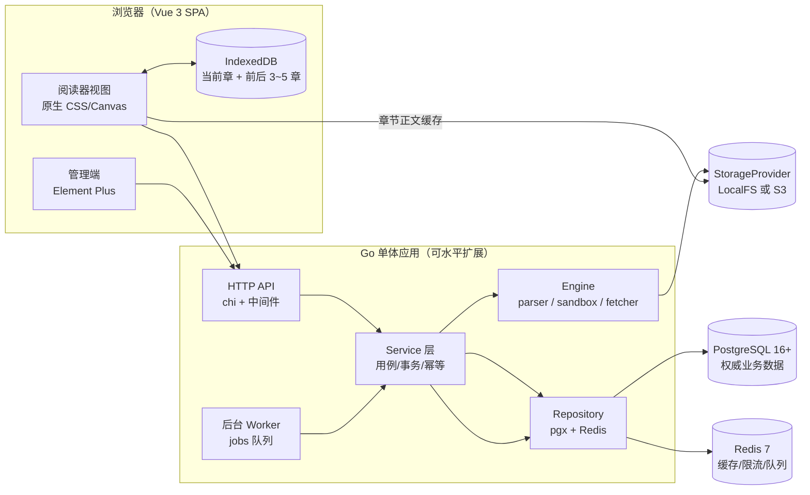
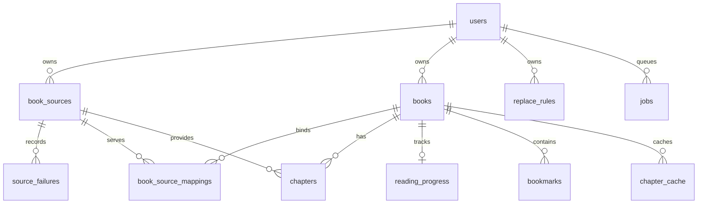

# YReader 系统架构与书源沙箱设计

> 状态：Draft v1.4（S5-1：书源 header AES-GCM 信封加密；S5-4 终审冻结）
> 对应交付物：本文件、[schema.sql](schema.sql)、[openapi.yaml](openapi.yaml)
> 上游依据：[summary.md](research/summary.md) 与 6 份单仓研究报告
> 范围：M1 书源解析核心（优先）、M2 阅读器与书架、M3 本地书库与外围同步的**契约边界**；不含实现代码。

---

## 0. 阅读指南与冻结规则

1. 本文件中的 **MUST / MUST NOT / SHOULD** 与 RFC 2119 同义，可直接转成 Stage 4 的验收用例。
2. 所有表名/列名以 [schema.sql](schema.sql) 为唯一权威；所有 HTTP 路径/字段以 [openapi.yaml](openapi.yaml) 为唯一权威。三份文件冲突时，**DDL 与 OpenAPI 优先于本文叙述**，并回改本文。
3. 契约冻结后，任何字段改名、错误码新增、超时默认值调整都必须走「契约变更」流程：修改三份文件 + 在本文件 §12 追加 ADR。
4. 文中出现的参考仓库路径仅作**行为出处**，不构成实现依赖；净室声明见 [summary.md](research/summary.md) §6。

### 0.1 一页纸决策摘要

| 编号 | 决策 | 关键参数 | 落点 |
|---|---|---|---|
| D1 | JS 沙箱 | 单次操作总墙钟 **10s**；单次 JS **3s**；输出 **1 MB（1,048,576 字节）**；`vm.Interrupt` + `ctx` 透传双保险 | §3.3 |
| D2 | 模板求值 | Fast-Path 纯算术子集，其余无条件回落 goja | §3.4 |
| D3 | SSRF | `DialContext` 先解析→全量过滤→逐 IP 回退拨号；重定向 ≤5 跳逐跳校验；`netip` 完备黑名单 | §3.5 |
| D4 | 多源书籍 | 逻辑书唯一键 `(user_id, normalized_name, normalized_author)` + `book_source_mappings` | §4.1 |
| D5 | 换源重定位 | 精确 `normalized_title`（±20）→ trigram 模糊 → 章节比例 | §4.2 |
| D6 | JSONB/GIN | `rules` 仅服务 `@>`/`?`/`?|`/`?&`；禁止 `->>` 等值/模糊查询后期待索引 | §4.3 |

---

## 1. 系统上下文与部署拓扑



**部署基线**

| 组件 | 形态 | 说明 |
|---|---|---|
| `backend` | 单容器，`cmd/server` | 同时提供 API 与后台 Worker（Stage 4 可通过 `WORKER_ENABLED` 拆分） |
| PostgreSQL 16+ | 外部服务 | 唯一权威存储；JSONB + GIN + pg_trgm |
| Redis | 外部服务 | 搜索/目录缓存、域名限流令牌、任务队列；**不是**权威存储 |
| StorageProvider | LocalFS 或 S3 | 章节正文、封面、字体、备份包；DB 只存 `object_key` |
| 浏览器 CDN | 无 | 静态资源由同一 Go 进程提供，避免额外部署面 |

**MUST NOT**：书源引擎不得直接依赖 `database/sql`、Redis 客户端或 `net/http` 的默认全局客户端；`engine` 只接受 `fetcher.Fetcher` 与 `storage.Provider` 接口注入。

---

## 2. 分层与模块边界

### 2.1 依赖方向（单向）

```text
api (handler/middleware)
  └── service (用例编排、事务边界、权限)
        ├── repository (PostgreSQL / Redis)
        └── engine
              ├── parser   (CSS / XPath / JSONPath / regex / 组合规则)
              ├── sandbox  (goja 池、桥接、{{ }} fast-path)
              └── fetcher  (HTTP、SSRF、编码、限流、重试)
```

规则（MUST）：

1. `api` 不得出现 SQL、Redis key、书源解析逻辑；只做参数绑定、鉴权、错误映射。
2. `service` 拥有事务边界与幂等键；跨表写操作必须在同一事务内。
3. `repository` 只做数据访问，不调用 `engine`；返回领域结构体而非 `pgx.Rows`。
4. `engine` 是**纯函数式**的：输入 `(SourceSpec, RequestContext, Fetcher)`，输出 `(Result, []StepTrace, error)`；不读数据库、不写日志到 DB、不持有全局可变状态。
5. 跨层错误必须用 `errors.Is/As` 判定 sentinel（§5.3），禁止字符串匹配。

### 2.2 目录映射（Stage 3 直接落地）

```text
backend/internal/
├── api/            # handler、middleware、路由、错误映射
├── service/        # books、sources、search、reader、progress、jobs、auth
├── repository/     # pg/、redis/、tx.go
├── pkg/storage/    # Provider 接口 + localfs/ + s3/
├── pkg/textnorm/   # 书名/章节名归一化（唯一实现）
└── engine/
    ├── parser/     # rule_split.go、css.go、xpath.go、jsonpath.go、regex.go
    ├── sandbox/    # pool.go、runtime.go、bridge_java.go、template_fastpath.go、errors.go
    └── fetcher/    # client.go、ssrf.go、charset.go、ratelimit.go、retry.go
```

---

## 3. 书源解析引擎

### 3.1 规则模型与执行管线

书源规则按 Legado 语义分为五组：`search` / `explore` / `bookInfo` / `toc` / `content`。引擎不感知业务语义，只执行 `RuleStep` 序列。

```go
// 契约示意（Stage 4 实现）
type Mode int // ModeDefault | ModeCSS | ModeXPath | ModeJSON | ModeRegex | ModeJS

type RuleStep struct {
    Mode        Mode
    Expr        string   // 去前缀后的表达式
    Put         map[string]string // @put: 变量
    Replace     string   // ## 第 1 段（正则）
    Replacement string   // ## 第 2 段
    ReplaceFirst bool    // ## 第 3 段存在时为 true
}
```

**执行顺序（MUST 与 Legado 对齐）**

```text
原始规则
  → 1. 去首尾空白
  → 2. 识别模式前缀（@css: / @XPath: / @json: / // / $./$[ / :regex / @js: / <js>）
  → 3. 分离 @put:{...}
  → 4. 按顶层分隔符切成 || / && / %% 分支（括号与引号内不切）
  → 5. 对每个分支：回填 $n / @get / {{ }} → 求值 → 应用 ## 替换
  → 6. 组合：|| 取首个非空；&& 顺序拼接；%% 按索引交错
  → 7. 统一后处理：HTML 实体还原、必要 trim
```

**切分器契约**：必须实现「括号/引号感知的顶层切分」，输入 `div[a="x&&y"]&&span` 只能切成两段；`JSONPath` 内的 `&&`/`||` 不得被误切；括号不平衡返回 `ErrRuleSyntax`（422）。

### 3.2 求值器分工

| 规则类型 | 实现 | 失败语义 |
|---|---|---|
| 默认 / `@css:` | `goquery` | 未命中 → 空集合（不报错） |
| `@XPath:` / `//` | `antchfx/htmlquery` | 非法 XPath → `rule_execution_failed` |
| `@json:` / `$.` | `tidwall/gjson` | 非法路径 → 空结果 |
| `:regex` / `##` | Go `regexp`（RE2，天然抗 ReDoS） | 编译失败 → `rule_execution_failed` |
| `@js:` / `<js>` | §3.3 沙箱 | sentinel 见 §5.3 |
| `{{ }}` | §3.4 Fast-Path / goja | 表达式非法 → 回落 goja；仍失败 → 422 |

**MUST**：单条规则的求值必须携带 `StepTrace`（模式、输入摘要、是否命中、耗时、错误码），供调试台与 §8 观测使用；摘要不得包含正文全文（只保留前 256 字节 + sha256 前 8 位）。

### 3.3 JS 沙箱（goja）：双层超时、Sentinel、池化

#### 3.3.1 时间与资源边界

| 边界 | 值 | 强制方式 |
|---|---|---|
| 单次书源操作总墙钟 | **10s** | handler 入口 `context.WithTimeout(r.Context(), 10*time.Second)`，贯穿 HTTP 抓取、解析、JS、DB 写入前 |
| 单次 JS 执行 | **3s** | `sandboxCtx, cancel := context.WithTimeout(reqCtx, 3*time.Second)` |
| 单次 JS 输出 | **1 MB = 1,048,576 字节**（UTF-8） | 序列化后 `len(out) > 1<<20` → `ErrSandboxOutputLimit` |
| JS 栈深 | 1024（goja 默认上限内） | `vm.SetMaxCallStackSize(1024)`，越界视为 `ErrRuleExecution` |
| 单次 HTTP 响应体 | 16 MiB | fetcher 限读 |
| 重定向 | ≤ 5 跳 | §3.5.4 |

**关键约束**：`vm.Interrupt()` 只能中断**字节码循环**，无法打断正在阻塞的 Go 原生桥接函数。因此双保险是强制的：

```go
func (s *Sandbox) Run(reqCtx context.Context, prog *goja.Program, b Bindings) (result any, err error) {
    ctx, cancel := context.WithTimeout(reqCtx, 3*time.Second)
    defer cancel()

    vm := s.pool.Get().(*goja.Runtime)
    discard := false
    defer func() {
        if r := recover(); r != nil {
            discard = true
            err = fmt.Errorf("%w: %v", ErrSandboxPanic, r)
            return
        }
        if discard {
            s.pool.Discard(vm) // 超时/panic/输出超限：状态不可信，不归还
        } else {
            s.reset(vm) // 清理注入的全局键与变量
            s.pool.Put(vm)
        }
    }()

    installBridge(vm, ctx, b) // 每个桥接函数都持有 ctx

    done := make(chan struct{})
    go func() {
        select {
        case <-ctx.Done():
            vm.Interrupt(ErrSandboxTimeout) // 只中断字节码循环
        case <-done:
        }
    }()
    defer close(done)

    v, runErr := vm.RunProgram(prog)
    if runErr != nil {
        if errors.Is(runErr, ErrSandboxTimeout) || ctx.Err() != nil {
            discard = true
            return nil, ErrSandboxTimeout
        }
        return nil, fmt.Errorf("%w: %v", ErrRuleExecution, runErr)
    }
    if outputLen(v) > 1<<20 {
        discard = true
        return nil, ErrSandboxOutputLimit
    }
    return v, nil
}
```

**MUST**：

1. 外层 10s 是**总预算**，不是「每步 10s」；子步骤必须递减（`reqCtx` 已带 deadline，沙箱不得自行放宽）。
2. JS 内 `java.ajax` / `source.*` / `book.*` 的网络调用**必须接收并透传 `ctx`**，否则 3s 到点时阻塞 I/O 无法被取消。
3. 发生 `ErrSandboxTimeout`、`ErrSandboxPanic`、或运行期异常导致状态可疑时，**必须丢弃 Runtime**，不得放回池。
4. 正常结束时归还前必须：`vm.ClearInterrupt()`、删除注入的全局键、清空 `source/book/result` 绑定；禁止把上一本书的变量带进下一次执行。

#### 3.3.2 错误归因（Sentinel）

```go
var (
    ErrSandboxTimeout     = errors.New("sandbox: execution timeout")     // 504 sandbox_timeout
    ErrSandboxOutputLimit = errors.New("sandbox: output limit exceeded") // 422 sandbox_output_limit
    ErrSandboxPanic       = errors.New("sandbox: runtime panic")         // 500 sandbox_panic
    ErrRuleExecution      = errors.New("engine: rule execution failed")  // 422 rule_execution_failed
    ErrUnsupportedRule    = errors.New("engine: unsupported rule")       // 422 unsupported_rule
)
```

**MUST**：`vm.Interrupt(ErrSandboxTimeout)` 传入的就是该 sentinel 本身；沙箱返回层用 `errors.Is` 区分「超时」与「脚本语法/运行期异常」。上层策略不同：

| 归因 | 业务动作 |
|---|---|
| `ErrSandboxTimeout` | 记录超时、`source_failures.kind='timeout'`、按 §6 降权/熔断 |
| `ErrRuleExecution` | 记录「书源规则逻辑错误」，**不熔断**，返回可读的规则错误 |
| `ErrUnsupportedRule` | 返回 422 并附 `feature`，提示该源需要 Stage 5 扩展 |
| `ErrSandboxOutputLimit` | 视为规则缺陷，记录并截断，不熔断 |

#### 3.3.3 并发与生命周期

```text
sync.Pool[*goja.Runtime]
      │ borrow（独占，禁止跨 goroutine 共享）
      ▼
  per-execution Sandbox ──► installBridge(ctx) ──► RunProgram(prog)
      │                                                   │
      │  成功：reset + Put                                │  超时/panic：discard（GC）
      └───────────────────────────────────────────────────┘
```

**MUST**：

- `goja.Runtime` **不是 goroutine 安全的**；一个 Runtime 在任一时刻只能被一个 goroutine 使用。池只保证「借用期间独占」，不提供并发复用。
- 预编译 AST 缓存：`map[sha256(script)]*goja.Program` + LRU（默认 2048 条 / 32 MiB），命中率低时按 LRU 淘汰；编译失败不缓存。
- 池容量默认 `GOMAXPROCS*4`，空闲 10 分钟回收；池空时新建，不排队等待（避免书源抓取互相阻塞）。
- 同一次「书源操作」内多个 `@js:` 步骤**可以**各自借还，但不得并行使用同一 Runtime。

#### 3.3.4 桥接白名单

**允许**（全部为纯计算或受控网络，且网络桥接接收 `ctx`）：

| 命名空间 | 函数 | 说明 |
|---|---|---|
| `java` | `ajax(url)`, `get(url)`, `post(url, body)` | 走 §3.5 fetcher，受 SSRF/限流/10s 预算约束 |
| `java` | `base64Decode`, `base64Encode`, `md5`, `hexEncode` | 纯计算 |
| `java` | `aesDecodeToString`, `aesEncodeToString`, `desDecodeToString` | 纯计算 |
| `java` | `timeFormat`, `randomUUID` | 纯计算 |
| `java` | `log(msg)` | 写结构化日志，自动脱敏 |
| `source` | `getVariable(k)`, `setVariable(k,v)` | 作用域=本次操作，不落库 |
| `book` | `name`, `author`, `bookUrl` | 只读快照 |
| 全局 | `result`, `baseUrl`, `cookie`（只读串）, `page` | 由上下文注入 |

**严禁**：`file.*`、`readFile`、`writeFile`、`deleteFile`、`process`、`exec`、`require`、`importClass`、`Packages`、反射入口、`load`、任意宿主对象引用。桥接层只暴露**函数**，不暴露 Go 结构体/反射值。

> 依据：`changshengyu_reader-dev` 的 `java.getFile/readFile/deleteFile`（`JsExtensions.kt:312-355`）与 `java.ajax` 是实际 RCE 面；即使有 `ClassShutter` 黑名单也挡不住显式桥接。

### 3.4 `{{ }}` 模板求值：Fast-Path 子集

**语义目标**：与 Legado 的 `{{ }}`（等价 JS 表达式）兼容；**执行策略**：能证明等价时走 Go 原生，否则一律 goja。

#### 3.4.1 Fast-Path 语法（严格 BNF）

```bnf
expr    := term (("+" | "-") term)*
term    := factor (("*" | "/" | "%") factor)*
factor  := ["-"] primary
primary := INT | IDENT | "(" expr ")"
IDENT   := [A-Za-z_][A-Za-z0-9_]*
INT     := [0-9]+
```

- 仅允许上述记号与空白；出现任何其它字符（`.`、`[`、`]`、`?`、`:`、`"`、`'`、`` ` ``、`!`、`=`、`<`、`>`、`&`、`|`、`,`、`;`、函数调用形式 `f(`）→ **立即回落 goja**。
- **无条件回落的显式清单**：函数调用、对象属性访问（`$.`/`$[` JSONPath 除外）、三元运算符 `? :`、字符串拼接、任意比较/逻辑运算符、数组下标、正则字面量。不得为这些形式在 Fast-Path 里「顺手实现」子集语义。
- 变量来自本次操作的上下文；缺失标识符按空串处理，算术时按 Go `strconv.Atoi` 解析，失败即**回落 goja**（不在 Fast-Path 内自造 JS 语义）。
- 除零、溢出、非数字参与运算 → **回落 goja**。
- 显式规则前缀（`@css:`、`@XPath:`、`@json:`、`$.`、`$[`）→ 不作为 JS，直接交给 §3.2 对应解析器（Fast-Path 的「规则引用」分支）。

#### 3.4.2 决策流程

```text
{{ body }}
  ├─ 以 @css:/@XPath:/@json:/$. 开头 ──► 规则解析器（Fast-Path，不启 goja）
  ├─ 匹配 BNF 且变量均可安全转数字 ──► Go 算术求值（Fast-Path）
  └─ 其它 ──► 当前请求独占的 goja.Runtime（3s / 1 MB 约束不变）
```

**MUST**：Fast-Path 与 goja 对同一表达式的输出必须一致；Stage 4 需为每个 BNF 产生式写对照测试（`{{a+b*c}}`、`{{-a%3}}`、`{{(a+1)*2}}`）。任何不一致以 goja 为准并修正 Fast-Path。

### 3.5 Fetcher 与 SSRF 纵深防御

#### 3.5.1 总原则

- 所有出站请求（规则抓取、`java.ajax`、封面下载、登录）走**同一个** `fetcher.Client`；禁止业务代码直接用 `http.Get`。
- 每次请求必须带 `context`（10s 总预算的子 deadline）。
- 代理：书源 fetcher **默认禁用环境代理**（`Transport.Proxy = nil`），否则代理拨号会绕过 `DialContext` 校验；如未来支持显式代理，必须对代理端点同样做 IP 校验。

#### 3.5.2 `DialContext`：先解析 → 全量过滤 → 逐 IP 回退

```text
DialContext(ctx, "tcp", "host:port")
  ├─ 1. host 若已是 IP → 直接校验
  ├─ 2. 否则 LookupNetIP(ctx, "ip", host) 取全部候选（IPv4+IPv6）
  ├─ 3. 对每个 IP 执行 IsBlockedIP(ip.Unmap())；全部被拦 → ErrSSRFBlocked
  ├─ 4. 对通过校验的 IP 依次 DialContext（每个用剩余 ctx 预算）
  │      └─ 任一成功即返回；全部失败 → 返回聚合错误（含最后一个原因）
  └─ 5. 连接目标始终是「已校验 IP」，绝不再按域名二次解析（防 DNS rebinding）
```

**MUST NOT**：只拨第一个 IP 就放弃（多 IP CDN 会误伤）；也不得先拨号再校验（TOCTOU）。

#### 3.5.3 `IsBlockedIP(addr netip.Addr) bool`

```text
addr = addr.Unmap()                       // ::ffff:127.0.0.1 → 127.0.0.1
拦截：!IsValid | IsUnspecified | IsLoopback | IsPrivate |
      IsLinkLocalUnicast | IsLinkLocalMulticast | IsMulticast | !IsGlobalUnicast
额外网段（netip.Prefix 常量表）：
  100.64.0.0/10     CGNAT
  198.18.0.0/15     基准测试
  169.254.0.0/16    链路本地（含云元数据 169.254.169.254）
  240.0.0.0/4       保留
  64:ff9b::/96      NAT64
  64:ff9b:1::/48    NAT64 本地
  2002::/16         6to4
  2001::/32         Teredo
  2001:db8::/32     文档示例（额外防御）
```

**MUST**：`IsBlockedIP` 是唯一判定入口，单元测试需覆盖 IPv4-mapped、NAT64、6to4、Teredo、`0.0.0.0`、`::`、`fe80::1`、`fd00::1`、`100.64.0.1`、`198.18.0.1`、`240.0.0.1`。

#### 3.5.4 重定向逐跳校验

- `CheckRedirect`：`len(via) > 5` → `ErrRedirectLimit`；每跳校验 scheme ∈ {http, https}；跨 host 时剥离 `Authorization`/`Cookie` 敏感头。
- 因为每一跳都是新的 Request，`Transport` 会对新 host **重新执行** §3.5.2；`302 → http://127.0.0.1` 会在拨号阶段被 `ErrSSRFBlocked` 拦截。
- `Location` 为相对路径时按当前 URL 解析；禁止 `file://`、`gopher://`、`data:`。

#### 3.5.5 编码、限流、重试

| 关注点 | 契约 |
|---|---|
| 编码 | 优先级：响应头 `charset` → HTML `<meta>` → BOM → ICU 探测（`golang.org/x/text/encoding` + 探测库）；统一转 UTF-8 后交给解析器 |
| 超时 | 连接 5s、TLS 握手 5s、响应头 8s、读 body 受 10s 总预算约束 |
| 响应体 | 16 MiB 上限；超限 → `response_too_large`（502）且不读入内存 |
| 重试 | 仅对幂等失败（连接错误、502/503/504）重试 **2 次**（共 3 attempts），指数退避 200ms/600ms + 抖动；4xx 不重试 |
| 限流 | 按 `concurrent_rate`：纯数字=并发上限（信号量）；`n/ms`=窗口限速（Redis 令牌桶 key `rate:source:{id}`）；另有域名级令牌桶 `rate:host:{host}` |
| Cookie | 结构化（domain/path/secure/httpOnly/sameSite/expires），按 source 隔离；不落明文日志 |

---

## 4. 数据模型

### 4.1 逻辑书唯一 + 多源绑定



**核心规则（MUST）**

1. **一本书 = 一条 `books` 记录**，唯一键 `(user_id, normalized_name, normalized_author)`；书名/作者必须先经 `pkg/textnorm` 归一化（NFKC → 小写 → 去空白/标点），DB 触发器仅在应用未传时兜底。
2. 同一逻辑书在每个书源下的详情页/目录地址存 `book_source_mappings`，唯一键 `(book_id, source_id, book_url)`；允许同一 `(book_id, source_id)` 存在多条（源站换域名），但同一时刻只有一条 `sync_status='active'`。
3. `books.active_source_id + active_book_url` 指向当前阅读源；**换源只更新这两个字段 + 进度，不新建书**。
4. `chapters` 属于 `(book_id, source_id)`：每个源一套目录；`chapter_index` 只对 `is_volume=false` 的可读章节连续编号（0..N-1），卷名行 `chapter_index = NULL`、靠 `sort_order` 保持目录展示顺序（详情表见 `schema.sql` 的 `ck_chapters_volume_index`）。
5. 删除书源：`books.active_source_id` 置空（`ON DELETE SET NULL`），书保留为「待换源」；`book_source_mappings` 与对应 `chapters` 级联删除。service 层必须在书架返回 `needs_source=true`。
6. 删除书：级联删除映射/章节/进度/书签/缓存元数据；对象存储文件通过异步 `full_cache` 清理任务删除（DB 事务不覆盖对象存储）。

### 4.2 阅读进度与三级换源重定位

#### 4.2.1 进度模型

`reading_progress` 一行对应 `(user_id, book_id)`，**同时保存三套定位信息**：

| 字段 | 用途 |
|---|---|
| `chapter_index` | 当前源内的章序号（主定位） |
| `chapter_title` + `normalized_title` | 换源后原章可能不存在，用标题重定位 |
| `chapter_ratio` (0–1) | 章内比例；换源后用于换算新章 `char_offset` |
| `char_offset` | 当前章内的字符偏移（快速恢复，不跨源信任） |
| `version` | 乐观锁；每次 UPDATE 由触发器 +1 |

**并发规则**：`PUT /books/{id}/progress` 必须携带 `If-Match: "<version>"`；缺失 → 428，版本不匹配 → 409 并返回双方进度（`details.current` / `details.incoming`）。服务端**不采用**「新者胜」启发式——参考仓库的 `preserve_newer_reading_progress` 在用户回翻场景会丢进度。

**version 维护责任归属（MUST）**：

- `version` 的递增**只归应用层**，DB 触发器**绝不自增**（`touch_progress_updated_at` 仅刷新 `server_updated_at`）。
- 应用层在**同一条 UPDATE** 里完成乐观锁判断与自增，防止「先读后写」竞态：
  ```sql
  UPDATE reading_progress
     SET chapter_index = $1, char_offset = $2, chapter_title = $3,
         normalized_title = $4, chapter_ratio = $5, client_updated_at = $6,
         device_id = $7, version = version + 1
   WHERE user_id = $8 AND book_id = $9 AND version = $10;
  ```
  影响行数为 0 → 版本冲突，返回 409；影响 1 行 → 成功并回读新 `version`。
- 禁止在 service 层「先 `SELECT version`，再 `UPDATE ... version = 旧值 + 1`」，那会在并发下双重递增或丢失更新。

#### 4.2.2 三级重定位算法（换源时执行）

输入：`old_index`、`old_title`、`old_normalized_title`、`old_ratio`、`old_total`、目标源目录 `chapters[0..N-1]`（`is_volume=false`）。

```text
1) 目标目录为空（N=0）           → 422 relocation_failed（提示先同步目标源目录）
2) Level 1 精确匹配
   window = [max(0, old_index-20), min(N-1, old_index+20)]
   在 window 内找 normalized_title 完全相等者
   多个候选：取 |index-old_index| 最小 → 再取 title 字符串完全相等 → 再取 index 最小
   命中 → strategy="exact", confidence=1.0
3) Level 2 模糊匹配（pg_trgm）
   window = ±100；similarity(normalized_title, old_normalized_title) >= 0.6
   取 similarity 最高 → 同分取距离最近
   命中 → strategy="fuzzy", confidence=similarity
4) Level 3 比例回退
   ratio = old_index / max(old_total, 1)
   new_index = clamp(round(ratio * N), 0, N-1)
   strategy="ratio", confidence=0.3
5) 章内偏移
   chapter_index 定位后用 chapter_ratio 换算新章内偏移：
   char_offset = floor(chapter_ratio * new_chapter_char_count)
   首次拉取新章正文后回写该 char_offset（同版本号递增）
6) 落库（单事务）
   books.active_source_id / active_book_url
   reading_progress.chapter_index / chapter_title / normalized_title / chapter_ratio
   mapping.sync_status / last_synced_at
   version++（触发器）
```

**MUST**：`strategy` 与 `confidence` 必须在 API 响应中返回，前端在 `ratio` 回退时提示「章节可能不精确」；`dry_run=true` 时只计算不落库。

**边界**：
- 重名章节（大量「第1章」重复）→ Level 2 阈值 0.6 会全部命中，必须用「距离最近」打破平局。
- 目标源章节数远少于旧源 → Level 3 可能落到最后一章，允许但标记低置信度。
- 旧进度 `normalized_title` 为空（历史数据）→ 跳过 Level 1，直接 Level 2/3。
- 书签不随换源改写；UI 按 `chapter_title` 展示，避免误导。

### 4.3 JSONB + GIN 访问契约

`book_sources.rules` 使用 `jsonb_ops` GIN。**索引能服务的谓词仅四类**：

```sql
-- ✅ 包含
SELECT id FROM book_sources
 WHERE user_id = $1 AND rules @> '{"search":{"bookList":"..."}}';

-- ✅ 键存在
SELECT id FROM book_sources
 WHERE user_id = $1 AND rules ? 'toc';

-- ✅ 多键任一 / 全部
SELECT id FROM book_sources
 WHERE user_id = $1 AND rules ?| ARRAY['search','explore'];
SELECT id FROM book_sources
 WHERE user_id = $1 AND rules ?& ARRAY['toc','content'];
```

**MUST NOT**（这类写法不会走 GIN，且容易误以为走索引）：

```sql
-- ❌ 路径提取后等值：全表扫描
WHERE rules->>'bookSourceName' = '...'
-- ❌ 深层路径 LIKE：全表扫描
WHERE rules->'content'->>'content' LIKE '%正文%'
-- ❌ 对 jsonb 整体做 text 转换
WHERE rules::text ILIKE '%ruleToc%'
```

**替代方案**（按优先级）：
1. 检索字段提升为真实列（`book_source_name/group/enabled/weight` 已提升）。
2. 确需按规则内部字段查 → 建表达式索引或生成列（必须 `user_id` 前缀），例如
   `CREATE INDEX ... ON book_sources (user_id, (rules->'toc'->>'chapterList'));`
3. 仅调试场景 → 按 `id` 点查后再在应用层判断，不参与检索。

**CI 门禁**：`repository` 层 SQL 中出现 `rules->>` / `rules#>>` / `rules::text` 时，必须同时在同目录 `*.sql` 注释里写明「表达式索引名」或「允许全表扫描的理由」，否则 Lint 失败。Stage 5 用 10k 行书源执行 `EXPLAIN (ANALYZE)` 断言 `Bitmap Index Scan on ix_book_sources_rules_gin`。

**GIN 扩展与 URL 前缀评估**：

- MVP 阶段单实例用户数有限，`book_sources.rules` 的 GIN 全表可接受；若 Stage 5 压测发现 GIN 选择率低，后续改为 `(user_id, rules)` 复合表达式索引或分区表。
- 若后续发现 URL 模糊检索慢，可按需补充 `CREATE INDEX ix_book_sources_url_prefix ON book_sources (book_source_url text_pattern_ops);` 用于 `LIKE 'https://...'` 前缀匹配。

### 4.4 文本归一化（`pkg/textnorm`，唯一实现）

| 函数 | 规则 | 示例 |
|---|---|---|
| `NormalizeBook(name)` | NFKC → 去零宽 → 小写 → 去空白与标点 | `《斗 破苍穹》` → `斗破苍穹` |
| `NormalizeChapter(title)` | 先抽章节号：`第N章/节/回/话`、`N章`、独立数字；N 支持中文数字（一…九千九百九十九）；**三段式输出**：有剩余标题 → `n:<int>:<clean_title>`，无标题 → `n:<int>`，无序号 → 走书名归一化 | `第120章 风起` → `n:120:风起`；`第一百零八回` → `n:108`；`序章` → `序章` |
| `NormalizeAuthor` | 同书名；剥「作者[:：]」前缀与末尾「著」 | `天蚕土豆 著` → `天蚕土豆` |

**MUST**：SQL 的 `chapter_title_key_fallback` 只处理阿拉伯数字，**不得**作为主实现；Stage 4 的写入路径必须调用 Go 归一化，SQL 函数仅用于回填与索引兜底。归一化函数需有 ≥30 条黄金用例（含全角数字、罗马数字、`正文`、`番外`）。

**归一化边界清单（MUST）**：

1. 标题含多个数字时，**取第一个数字**作为章节序号。
2. 罗马数字（如《第XIV章》）**暂不解析**，fallback 到纯标题归一化。
3. 卷名行（`is_volume=true`）由应用层 `NormalizeChapter` 依据 `is_volume` **单独处理**；SQL 兜底函数不感知 `is_volume`，仅处理普通章节。

### 4.5 数据保留与级联

| 数据 | 保留策略 |
|---|---|
| `jobs` | 完成 30 天后归档/删除（`expires_at`） |
| `source_failures` | `expires_at` 到期后由清理任务删除；`resolved_at` 仅作审计 |
| `auth_sessions` | 过期或吊销 7 天后删除 |
| `chapter_cache` | 按 `expires_at` 清理；对象存储删除失败进入重试队列 |
| `books` 删除 | 级联 DB 行 + 异步清理对象存储前缀 `chapter/{book_id}/` |

### 4.6 章节级源覆盖（Chapter-level Source Override）

#### 4.6.1 语义与边界

override **只影响该章正文来源**，不改变 `books.active_source_id`、不改变 `chapters` 目录结构、不改变 `reading_progress.chapter_index` 语义；同一章重复设置采用 `ON CONFLICT (book_id, chapter_index) DO UPDATE` Upsert 语义。

#### 4.6.2 URL → 源匹配算法

若未显式传入 `source_id`，提取 `chapter_url` 的 host 并规范化（转小写、剥离 `www.` 前缀、去端口），在当前用户 `book_sources` 中匹配规范化后的 `book_source_url` host；多源同 host 时取 `enabled=true` 且 `weight` 最高者（同权重取 `updated_at` 最新）；无匹配返回 **422 `no_matching_source`**。显式传入 `source_id` 时跳过 host 匹配校验（用于镜像站域名不同但规则通用的场景），但仍强制校验该 `source_id` 属于当前用户且 `enabled=true`（不满足则返回 **404 `not_found`** 或 **409 `source_disabled`**）。

#### 4.6.3 拒绝盲提降级

严禁用通用 HTML 正文盲提算法兜底；无匹配源时必须报错引导用户先添加对应书源；即使显式传入了 `source_id` 或自动匹配到了书源，若试抓正文失败（`rule_execution_failed` / `source_request_failed` / `sandbox_timeout` 等，其中 URL 的 SSRF 命中属于前置入参校验层并返回 **403 `blocked_private_address`**），一律返回对应错误码，同样绝不降级到通用盲提，确保 `ruleContent`、分页拼接与替换净化规则完整执行。

#### 4.6.4 生命周期

① **整本换源**（`switch-source` 且 `dry_run=false`）→ 同事务内 `DELETE` 清空该书所有 override；② **追更任务** → 不触碰 override；③ **目录刷新** → 不触碰 override，但若章节数减少导致 `chapter_index >= new_total_chapters` 越界则标记 `status='stale'`；④ **删除书源** → `ON DELETE CASCADE` 级联删除；⑤ **用户手动重置** → `DELETE` 单条。

#### 4.6.5 GET /content 读取顺序与 chapter_cache 覆写规则

`GET /content` 优先查 `status='active'` 的 override，命中则按 `(book_id, override.source_id, chapter_index)` 读写 `chapter_cache`；未命中或 stale 则回退走 `books.active_source_id`。`POST .../override` 试抓成功后立即写入/覆写 `(book_id, override.source_id, chapter_index)` 这一条 B 源缓存，**不删除也不修改**原源 A 在 `(book_id, active_source_id, chapter_index)` 下的缓存（A 源缓存由其自身 TTL 管理）；`DELETE .../override` 时只清理 B 源 `(book_id, override.source_id, chapter_index)` 那一条缓存（同步在 §6.3 缓存失效矩阵补一行）。

#### 4.6.6 stale 的 UI 语义与性能演进备注

目录中 `override_status='stale'` 的章节显示"覆盖已失效"视觉标记，引导用户重新设置或删除；同时注明（或同步记入 §9）：`v_bookshelf.override_count` 在 MVP 阶段用相关子查询（含 `o.user_id = b.user_id AND o.book_id = b.id`，直接命中 `ix_chapter_overrides_user_book` 复合索引）实现，若 Stage 5 压测发现 500 本书架列表 p95 超 300ms，则改为 `LEFT JOIN + GROUP BY` 聚合或独立批量查询。

#### 4.6.7 多源缓存预热与目录归属（v1.4，DEF-OAS-08）

- 预热目标源由 `POST /books/{bookId}/cache` 的 `CacheBookRequest.source_id` 指定，缺省为 `books.active_source_id`；显式传入时必须属于该书 `book_source_mappings` 中已绑定的源。
- 预热只写正文缓存键 `yreader:cache:content:<book_id>:<source_id>:<chapter_index>`（Redis 或内存），同书不同源缓存键相互隔离，**不改变** `books.active_source_id`，**不改变** `chapters` 表；目标源 `chapter_url` 一律取自 `chapters` 表 `(book_id, target_source_id, chapter_index)` 记录，严禁借用活跃源 URL。
- 锁粒度按书+源：`pg_advisory_xact_lock(hashtextextended('cache:' || book_id || ':' || source_id, 0))`；同书不同源可并行预热，同书同源仍返回 409。

---

## 5. API 契约

### 5.1 通用约定

| 项 | 约定 |
|---|---|
| Base | `/api/v1`；健康检查在 `/healthz`、`/readyz`（不带版本） |
| 认证 | `Authorization: Bearer <access_jwt>`；access 15 分钟，refresh 30 天且轮换；`token_version` 不匹配立即 401 |
| 内容类型 | 请求/响应 `application/json; charset=utf-8` |
| 命名 | JSON 一律 `snake_case`（与 DB 对齐，减少映射歧义） |
| 分页 | `page`（1 起）+ `page_size`（默认 20，最大 100）；响应 `{items,total,page,page_size}` |
| 幂等 | 创建类 POST 接口预留 Idempotency-Key 头；仅校验格式（8–128 字符）并记录日志，当前批次不做 24h 强去重，防重依赖业务端点自身规则（如 POST /books/{bookId}/cache 的咨询锁原子防重与在途任务拦截） |
| 并发 | 进度写用 `If-Match`；书源/书籍更新用 `If-Unmodified-Since` 或 `version` 字段（二选一，OpenAPI 以 `version` 为准） |
| 时间 | 全部 RFC 3339 UTC（`2026-01-01T00:00:00Z`） |
| 请求追踪 | 响应头 `X-Request-Id`；错误体带 `request_id` |

### 5.2 端点总览

| 分组 | 方法与路径 | 说明 |
|---|---|---|
| 认证 | `POST /auth/login`、`POST /auth/refresh`、`POST /auth/logout`、`GET /auth/me` | JWT + refresh 轮换 |
| 书源 | `GET/POST /sources`、`GET/PUT/DELETE /sources/{id}` | 列表分页/过滤；写操作带 `version` |
| 书源 | `POST /sources/import`、`GET /sources/export` | Legado JSON 导入导出（`dry_run`） |
| 书源 | `POST /sources/{id}/debug` | 规则调试：返回逐级 `StepTrace` |
| 搜索 | `GET /search?keyword=` | 多源并行搜索，返回分组结果 + 失败源 |
| 书架 | `GET/POST /books`、`GET/PATCH/DELETE /books/{id}` | 书架 CRUD；`POST` 入参 `source_id + book_url` |
| 目录 | `GET /books/{id}/chapters` | 支持 `source_id`、`refresh=true` |
| 正文 | `GET /books/{id}/content` | `chapter_index` 或 `chapter_id`；返回正文 + 下一章 |
| 章节覆盖 | `POST/DELETE /books/{id}/chapters/{chapterIndex}/override` | 单章源覆盖（Upsert 试抓；Delete 重置） |
| 进度 | `GET/PUT /books/{id}/progress` | `PUT` 必须 `If-Match`，冲突 409 |
| 换源 | `POST /books/{id}/switch-source` | 三级重定位；返回 `strategy/confidence` |
| 映射 | `GET/POST /books/{id}/mappings`、`DELETE /books/{id}/mappings/{mapping_id}` | 备用源管理 |
| 书签 | `GET/POST /books/{id}/bookmarks`、`DELETE /bookmarks/{id}` | 章节内书签 |
| 净化 | `GET/POST /replace-rules`、`PUT/DELETE /replace-rules/{id}` | 替换规则 CRUD |
| 任务 | `POST /books/{id}/cache`、`GET /jobs/{id}`、`DELETE /jobs/{id}` | 整本缓存等异步任务 |
| 设置 | `GET/PATCH /settings` | 用户级设置（合并语义） |

### 5.3 错误模型与错误码

统一错误体：

```json
{
  "error": {
    "code": "sandbox_timeout",
    "message": "书源 JS 执行超过 3s，已中断",
    "request_id": "req_01J...",
    "details": {"source_id": "...", "rule": "toc", "elapsed_ms": 3001}
  }
}
```

| `code` | HTTP | 触发条件 | 是否熔断书源 |
|---|---|---|---|
| `validation_error` | 400 | 参数/JSON 结构错误 | 否 |
| `unauthorized` | 401 | 无 token / token 过期 / `token_version` 不匹配 | 否 |
| `forbidden` | 403 | 越权访问他人资源 | 否 |
| `not_found` | 404 | 资源不存在 | 否 |
| `conflict` | 409 | 唯一键/状态冲突（非进度） | 否 |
| `progress_conflict` | 409 | `If-Match` 版本不匹配 | 否 |
| `source_disabled` | 409 | 目标书源被禁用或熔断中 | 否 |
| `precondition_required` | 428 | 写进度未带 `If-Match` | 否 |
| `unsupported_rule` | 422 | 规则需要尚未实现的能力（附 `feature`） | 否 |
| `rule_execution_failed` | 422 | 选择器/正则/JS 逻辑错误 | 否 |
| `sandbox_output_limit` | 422 | JS 输出 > 1 MB（1,048,576 字节） | 否 |
| `relocation_failed` | 422 | 目标源无目录或无法定位 | 否 |
| `no_matching_source` | 422 | chapter_url 的 host 未匹配到用户启用书源 | 否 |
| `override_not_found` | 404 | 章节级源覆盖不存在 | 否 |
| `payload_too_large` | 413 | 请求体超限（导入包 32 MiB） | 否 |
| `rate_limited` | 429 | 用户级/书源级限流 | 否 |
| `source_request_failed` | 502 | 目标站网络错误/非 2xx | 是（`network`） |
| `response_too_large` | 502 | 响应体 > 16 MiB | 是（`network`） |
| `redirect_limit` | 502 | 重定向 > 5 跳 | 是（`network`） |
| `source_timeout` | 504 | 单次操作 > 10s | 是（`timeout`） |
| `sandbox_timeout` | 504 | 单次 JS > 3s | 是（`timeout`） |
| `unsafe_url` | 403 | 非 http/https、含 userinfo、非法端口 | 否 |
| `blocked_private_address` | 403 | 命中 `IsBlockedIP` | 否（安全事件，记审计） |
| `sandbox_panic` | 500 | goja panic（已 recover） | 否 |
| `internal_error` | 500 | 未分类内部错误 | 否 |

**MUST**：`sandbox_timeout` 与 `rule_execution_failed` **不得**合并——前者触发书源降权/熔断，后者只记录规则缺陷。二者靠 `errors.Is` 判定，禁止用错误字符串。

### 5.4 关键响应示例

**换源（精确命中）**

```json
{
  "book_id": "b_01J...",
  "strategy": "exact",
  "confidence": 1.0,
  "chapter_index": 118,
  "chapter_title": "第118章 风起",
  "chapter_ratio": 0.42,
  "char_offset": 0,
  "source_id": "s_01J...",
  "dry_run": false
}
```

**进度冲突（409）**

```json
{
  "error": {
    "code": "progress_conflict",
    "message": "阅读进度已被其他设备更新",
    "request_id": "req_01J...",
    "details": {
      "current":  {"chapter_index": 120, "char_offset": 300, "version": 8, "server_updated_at": "..."},
      "incoming": {"chapter_index": 118, "char_offset": 20,  "version": 7}
    }
  }
}
```

**规则调试（`POST /sources/{id}/debug`）**

```json
{
  "steps": [
    {"index": 1, "mode": "css", "expr": ".book-list > li", "hit": true,
     "output_preview": "12 items", "elapsed_ms": 4},
    {"index": 2, "mode": "template", "expr": "{{page+1}}", "hit": true,
     "output_preview": "2", "elapsed_ms": 0},
    {"index": 3, "mode": "js", "expr": "java.ajax(...)", "hit": false,
     "error_code": "sandbox_timeout", "elapsed_ms": 3001}
  ],
  "result_preview": "…",
  "trace_id": "tr_01J..."
}
```

### 5.5 OpenAPI 与实现的映射

- `openapi.yaml` 是**唯一**的路径/字段权威；Stage 4 用 `oapi-codegen` 生成 Go 类型，禁止手写重复 DTO。
- `api` 层只做：绑定 → 校验（`go-playground/validator`）→ 调 service → `errors.Is` 映射错误码 → 写响应。
- 所有列表接口必须返回 `ETag` 或 `updated_at`，供前端条件请求；写接口返回新 `version`。

---

## 6. 缓存、异步任务与一致性

### 6.1 Redis 用途与 key 规范

| Key | 类型 | TTL | 说明 |
|---|---|---|---|
| `search:{user_id}:{sha1(keyword+source_ids)}` | string(JSON) | 300s | 搜索结果快照；书源更新/删除时按 user 前缀清理 |
| `toc:{book_id}:{source_id}` | string(JSON) | 900s | 目录快照；`refresh=true` 或追更任务成功即删 |
| `source:health:{source_id}` | hash | 600s | 熔断窗口内的失败计数（DB `source_failures` 为权威） |
| `rate:source:{source_id}` | string(令牌桶) | 动态 | `concurrent_rate` 窗口限速 |
| `rate:host:{host}` | string(令牌桶) | 动态 | 域名级保护，默认 10 rps/域名 |
| `idem:{user_id}:{key}` | string | 24h | POST 幂等键 → 响应快照（预留 key 规范：当前批次未启用强幂等，见 §5.1） |
| `lock:book:{book_id}` | string(SET NX PX) | 30s | 同书并发刷新目录/换源的短锁（DB 事务仍是最终一致） |

**MUST**：Redis 只做缓存与限流，**不得**作为任何业务数据的唯一副本；Redis 整体丢失后系统必须能从 PG 重建。

### 6.2 异步任务（DB 队列，非 Redis 队列）

`jobs` 表是队列权威，Worker 用 `FOR UPDATE SKIP LOCKED` 租约，避免 Redis 丢消息：

```sql
UPDATE jobs SET status='running', started_at=now(), worker_id=$1, attempts=attempts+1
WHERE id = (
  SELECT id FROM jobs
   WHERE status='queued'
   ORDER BY created_at
   FOR UPDATE SKIP LOCKED
   LIMIT 1
)
RETURNING *;
```

- （注：基础任务调度与租约模型已被 §6.2.3 M3c 演进规则完全取代）。
- 租约与自愈：WorkerPool 认领任务时原子绑定 worker_id 并将 status 置为 running；同机旧实例秒级自愈，跨机超过 2 小时租约上限（60 分钟单任务执行预算 + 60 分钟故障缓冲）的存量任务由节点启动扫描置为 failed 终态。
- 任务幂等：`payload` 内含 `(book_id, source_id, chapter_range)`，重复执行结果一致。
- 追更巡检：按 `books.last_read_at` 分层调度（近 7 天每天，30 天内每 3 天，其余每周）。

### 6.2.3 任务防重与多实例租约自愈模型 (M3c 演进)

1. **事务级排他咨询锁**：
   `cacheBook` 调度在显式事务中使用 `pg_advisory_xact_lock(hashtextextended('cache:' || book_id, 0))` 64 位互斥锁，彻底消除微秒级并发下的"先查后插"竞态，事务结束自动安全释放。
2. **Worker 实例标识租约**：
   `WorkerPool` 启动时生成 `hostname-<pid>-<nano>` 唯一实例标识，租约通过 `FOR UPDATE SKIP LOCKED` 将任务原子更新为 `status = 'running'` 并记录 `worker_id`。
3. **多实例智能自愈准则**：
   - **同机旧实例立即回收**：按 `worker_id LIKE 'hostname-%'` 立即清理同机崩溃遗留的孤儿任务，实现秒级自愈；
   - **跨节点故障兜底**：跨机存活任务受保护，超过 2 小时租约上限的任务（60 分钟单任务超时 + 60 分钟缓冲）由节点启动扫描标记为 `failed`（依赖节点重启触发清理）；
   - **历史数据兼容**：`worker_id IS NULL` 的存量遗留任务在启动时立即回收。

4. **常驻巡检（S5-3，DEF-CODE-08）**：
   `WorkerPool.Start` 内派生 `ctx, cancel := context.WithCancel(parent)`，
   启动时**同步执行一次** `scanStaleOnce`（保持 DEF-CODE-07 即时自愈语义），
   随后每 `reaperInterval`（默认 10min）由 `reaperLoop` 的 `time.Ticker` 触发；
   **全部任务 worker 协程与巡检协程统一使用派生 `ctx` 启动并纳入 `p.wg`**；
   `Shutdown` 调 `cancel()` 后用 `select { case <-done: case <-ctx.Done(): }`
   双通道兜住 `wg.Wait()`，彻底防死锁与协程泄漏。终态写入仍用
   `context.Background()`（与 Stage 4 一致）。

### 6.3 缓存失效矩阵

| 变更 | 失效动作 |
|---|---|
| 书源更新（规则/header/并发） | 删该源 `search:*`（按 user 前缀扫描不可行 → 用版本号：`source_version:{user}` 参与 key） |
| 目录刷新成功 | 删 `toc:{book}:{source}`，更新 `book_source_mappings.last_synced_at` |
| 换源成功 | 删旧源 `toc`、写新进度、前端 IndexedDB 以 `book.updated_at` 判断重建 |
| 章节级源覆盖变更（`POST/DELETE /override`） | 只删该章 B 源 `(book_id, override.source_id, chapter_index)` 的 `chapter_cache`；A 源缓存不动（§4.6.5） |
| 替换规则变更 | 章节正文缓存不删（原文），前端按 `rules_version` 重新净化 |

> 搜索 key 的 user 前缀清理代价高，因此 key 中混入 `sources_version`（用户书源集合的单调版本），书源变更时 `INCR` 即可整体失效。

---

## 7. 安全模型

| 面 | 控制 |
|---|---|
| 认证 | 密码 Argon2id（m=64MiB,t=3,p=2）；JWT HS256（32B 密钥，`kid` 支持轮换）；refresh 轮换 + 复用检测（旧 token 再用 → 吊销全家族） |
| 授权 | 所有查询强制 `user_id = $current_user`；`admin` 仅额外可管理用户，不跨租户读书。repository 层所有 `chapter_cache` 读取必须 JOIN `books` 校验 `user_id`（该表无 user_id 列） |
| 传输 | 仅 HTTPS（反代终止）；HSTS；Cookie（若有）`Secure; HttpOnly; SameSite=Lax` |
| SSRF | §3.5；`blocked_private_address` 记安全审计（user/source/host/IP/时间） |
| 沙箱 | §3.3；白名单桥接；无文件/进程/反射 |
| 日志 | header/query/cookie/token 一律脱敏；`HttpLogSanitizer` 四类规则（Authorization、Cookie、token=、password=） |
| 导入 | Legado JSON 仅当数据解析；限制 32 MiB / 5000 源；**导入不执行任何规则**；未知键透传 |
| 密钥 | 环境变量/Secret 注入；DB 中不存明文密码、refresh token（只存哈希） |
| 反爬合规 | 遵守目标站 robots 与限流；`User-Agent` 可配置；不实现验证码破解 |

**已闭环（v1.4）**：书源 header 中的 Cookie/token 由 Service 在写库前用 AES-256-GCM 信封加密（信封格式 `v1:<kid>:<base64(nonce||ct||tag)>`，AAD=`user_id|source_id`），Repository 读路径透明解密；dry_run 不加密不落库，历史明文由 `cmd/migrate-header` 分批迁移（幂等、可断点续跑）。对应 DEF-SEC-01 与 ADR-010。

---

## 8. 可观测性

### 8.1 追踪（Trace）

每次书源操作生成 `trace_id`，`StepTrace` 结构：

```json
{"step": 3, "phase": "toc", "mode": "xpath", "expr_sha8": "a1b2c3d4",
 "input_bytes": 48213, "hit": true, "output_items": 812,
 "elapsed_ms": 37, "error_code": null}
```

- 默认只保留摘要与哈希；调试模式（`POST /sources/{id}/debug`）才返回前 512 字节预览。
- 前端调试台按 `trace_id` 回放；正文接口可选返回 `trace_id` 供用户反馈。

`DebugStep`（openapi.yaml）是 API 输出的完整结构；本节字段是同一数据在结构化日志中的简化投影（`step↔index`、`expr_sha8+input_bytes↔input_digest`）。实现时以 `DebugStep` 为准。

### 8.2 指标（Prometheus 命名）

| 指标 | 类型 | 标签 |
|---|---|---|
| `yreader_source_requests_total` | counter | `source_id`,`phase`,`outcome` |
| `yreader_source_request_duration_seconds` | histogram | `phase`（p50/p95/p99） |
| `yreader_sandbox_executions_total` | counter | `outcome`（ok/timeout/error/panic） |
| `yreader_sandbox_duration_seconds` | histogram | — |
| `yreader_ssrf_blocked_total` | counter | `reason`（private/loopback/mapped/nat64/...） |
| `yreader_jobs_total` | counter | `type`,`status` |
| `yreader_progress_conflicts_total` | counter | — |

### 8.3 日志字段（结构化 JSON）

`ts, level, msg, request_id, trace_id, user_id, source_id, book_id, phase, elapsed_ms, error_code`。
**MUST NOT** 记录正文、Cookie、Authorization、完整 URL query（只记 host + path 模板）。

---

## 9. 性能与容量预算

| 场景 | 目标（p95） | 约束 |
|---|---|---|
| 搜索（10 源并发） | ≤ 3s | 单源 10s 总预算，先返回者优先（SSE 可选） |
| 目录拉取（单源，≤3000 章） | ≤ 2s | 解析 + 归一化 ≤ 300ms/千章 |
| 正文拉取（含 1 次分页） | ≤ 1.5s | 缓存命中 ≤ 100ms |
| 书架列表（500 本） | ≤ 300ms | 走 `v_bookshelf`，单查询 |
| 换源重定位 | ≤ 200ms | Level 2 依赖 trigram 索引 |
| JS 单次 | ≤ 3s（硬上限） | 超时即 504 |
| 单实例内存 | ≤ 512MiB 基线 | goja 池 ≤ `GOMAXPROCS*4` 个 Runtime |

**容量假设**：单用户 ≤ 5000 书源、≤ 5000 本书、单书 ≤ 10000 章；Stage 5 需按此压测。

---

## 10. 阶段映射与交付边界

| 模块 | Stage 4 优先级 | 本契约覆盖 |
|---|---|---|
| M1 书源解析核心 | 最高 | parser / sandbox / fetcher / sources / debug / import-export |
| M2 阅读器与书架 | 次之 | books / chapters / content / progress / switch-source / bookmarks |
| M3 本地书库与外围同步 | 最后 | local books、StorageProvider、jobs、settings；RSS/TTS 延后 |

### 10.1 本地书库（M3a，v1.2 冻结）

**虚拟源（每用户一条）**

- `book_sources` 中固定 `book_source_url = "local://" + user_id`、`book_source_name = "本地书库"`、`book_source_type = 3`、`enabled = true`。
- **必须是 `enabled = true`**：M2c 正文链路会对禁用源直接 400，用 `enabled=false` 做“隐藏”会自断阅读。
- 并发自愈：`EnsureLocalSource` 先查后建，唯一键冲突（23505 on `uq_book_sources_user_url`）时重新查询并返回既有行，保证并发首触发只有一条。
- 隔离：`GET /sources` 与 `GET /search` 一律 `ExcludeLocal=true`（`book_source_type <> 3`）；`SourceRepository.Get` 不过滤，供正文/目录链路内部使用。

**书籍与目录**

- `books.book_type = 'local'`、`books.file_hash = sha256(文件字节)`；`(user_id, file_hash)` 部分唯一索引保证同文件幂等。
- `books.active_source_id = 虚拟源 id` 且 `active_book_url = "local:" + book_id`，两者同时非空以满足 `ck_books_active_source_url_pair`。
- `chapters` 复用同一套表结构，`source_id` 指向虚拟源：
  - 卷名行：`chapter_index = NULL`、`is_volume = true`、`url = "local:{book_id}:volume:{sort_order}"`；
  - 正文行：`url = "local:{book_id}:{chapter_index}"`；
  - `url_hash = sha256(上述内部标识符)`。
- `v_bookshelf.needs_source` 对本地书天然为 `false`（`book_type='online' AND active_source_id IS NULL`）。

**导入与读取**

- 上传协议：`POST /api/v1/books/import`，`application/octet-stream` 原始字节 + query 元数据（`filename`/`title`/`author`），免 multipart 绑定；上限 100 MiB（超出 413）。
- 文件类型判定：**魔数优先**（`PK\x03\x04` → EPUB；UTF-16 BOM → TXT；512B 内无 NUL → TXT），扩展名严格白名单 `.epub` / `.txt`；`.docx` 等含 PK 魔数但不在白名单一律 400。
- `filename` 已由 oapi-codegen 解码，禁止二次 `url.QueryUnescape`；统一把 `\` 归一为 `/` 后取 `path.Base`，拒绝空、`.`、`..` 及含 `/`、`\`、NUL 的结果。
- 文本解码顺序：BOM → UTF-16 → UTF-8 抽样 → GBK → Big5 → ISO-8859-1；正则匹配前统一换行。
- 分章：多种标题正则投票，命中最多且 ≥2 次采信；不足 2 次时 ≤5 万字整本单章、超 5 万字按 5 万字符切块，并写入 `warnings`。
- 落盘：正文按章并发写入 `local/{book_id}/{chapter_index}.txt`（errgroup，8 并发）；任一失败即 `DeletePrefix("local/{book_id}/")` 并回滚事务。清理使用**独立的 `context.Background()` + 30s 超时**，避免业务请求取消后清理被连带取消。
- 正文读取：本地书直接 `StorageProvider.Get`，仅执行用户替换规则与段落标准化；**严禁走 fetcher / parser / Redis**；`trace_id` 显式输出 `null`，`source_id` 为虚拟源 id，`is_overridden=false`。
- 本地书对 `switch-source` 与单章覆盖端点返回 400（`validation_error`）；删除书籍时级联清理 `local/{book_id}/` 前缀。

**明确不在 MVP**（必须返回 `unsupported_rule`，不得静默失败）：

| 能力 | 处理 |
|---|---|
| `webJs` / 浏览器渲染 / `loginUi` | 422 `unsupported_rule`，`feature="webview"` |
| `sourceRegex` 加密书源自动解密 | 422 `unsupported_rule`，`feature="encrypted_source"` |
| 段评 `ruleReview` | 保留字段、不执行（导入导出不丢） |
| RSS / TTS / 阅读统计 | Stage 4 后评估 |

---

## 11. 验收基线（Stage 4/5 直接转测试）

### 11.1 契约测试清单（MUST）

1. **规则语义**：40 条黄金规则（CSS/XPath/JSONPath/正则/`||`/`&&`/`%%`/`##`/`@put`/`@get`/索引语法）与 Legado 行为逐字对齐。
2. **沙箱超时**：`@js:while(true){}` → 3s ± 300ms 返回 `sandbox_timeout`；Runtime 被丢弃（池计数不增加）。
3. **阻塞 I/O 取消**：`java.ajax` 指向 10s 才响应的测试服务器 → 3s 时返回，且服务端连接被关闭。
4. **输出上限**：构造 1.1 MB 字符串 → `sandbox_output_limit`。
5. **Fast-Path 等价**：`{{a+b*c}}` 等 12 条表达式，Fast-Path 与 goja 输出一致。
6. **SSRF 矩阵**：`::ffff:127.0.0.1`、`64:ff9b::7f00:1`、`2002:7f00:1::`、`2001:0::1`、`100.64.0.1`、`198.18.0.1`、`169.254.169.254`、`240.0.0.1`、`0.0.0.0`、`::` → 全部 `blocked_private_address`。
7. **重定向绕过**：`302 → http://127.0.0.1` → 403，且未发出内网请求。
8. **多 IP 回退**：DNS 返回 [坏 IP, 好 IP] → 连接成功（验证不是只试第一个）。
9. **换源三级**：精确/模糊/比例各 3 例；重名章节取最近；`dry_run` 不落库。
10. **进度冲突**：并发两个 `PUT` 同版本 → 一个 200、一个 409，且 409 含双方进度。
11. **JSONB 索引**：10k 行 `EXPLAIN` 断言 `Bitmap Index Scan`；`rules->>` 查询被 Lint 拦截。
12. **导入导出**：1000 条 Legado 书源 round-trip，未知键 100% 保留。
13. **OpenAPI**：`spectral lint` 0 error；生成的 Go client 编译通过。

### 11.2 非功能

- 10 万章目录导入 ≤ 60s；单书 3000 章目录刷新 ≤ 2s。
- 100 并发正文请求，p95 ≤ 1.5s，无 goroutine 泄漏（`goleak`）。
- 沙箱 1000 次执行无内存增长（pprof 对比）。

---

## 12. 决策记录（ADR）

| ADR | 决策 | 理由 | 代价 |
|---|---|---|---|
| ADR-001 | Go 单体 + PG + Redis，不上微服务 | 单人/小团队维护，模块边界靠包约束 | 单进程故障域；Stage 3 加健康检查与优雅退出 |
| ADR-002 | goja 双超时（10s 操作 + 3s JS）+ `ctx` 透传 | `vm.Interrupt` 不能打断阻塞 Native | 桥接层必须处处传 ctx，易漏 |
| ADR-003 | `{{ }}` Fast-Path 仅纯算术，其余 goja | 减少 80% 模板的 JS 开销，语义以 goja 为准 | 需维护等价性测试 |
| ADR-004 | SSRF 在 `DialContext` 解析后按 IP 拨号 | 防 DNS rebinding 与 TOCTOU | 失去 Happy Eyeballs；多 IP 需顺序试拨 |
| ADR-005 | 逻辑书唯一 + 多源映射表 | 支持换源且不产生重复书 | 书名+作者归一化误合并风险，需人工拆分入口 |
| ADR-006 | DB 队列（`SKIP LOCKED`）而非 Redis 队列 | 任务不丢、可审计、事务一致 | 高频轮询增加 DB 负载（已用索引与退避缓解） |
| ADR-007 | 检索列提升 + 规则 JSONB + GIN | 兼容 Legado 全量字段且可检索 | GIN 只服务包含/存在性；复杂查询需表达式索引 |
| ADR-008 | OpenAPI 驱动生成 DTO | 前后端契约单一来源 | 生成代码需纳入 Lint |
| ADR-009 | 章节级源覆盖用独立表 `chapter_source_overrides` 而非 `chapters` 增加列 | 避免污染 `chapters`、支持级联删除语义清晰 | 多一次 JOIN 查询 |
| ADR-010 | 书源 header 采用应用层 AES-256-GCM 信封加密 | 数据库/备份/日志不再含明文凭据；加密在 Service 层完成、Repository 透明解密、engine 不接触密钥 | 密钥管理成本；dry_run 与迁移需显式路径 | 旧 kid 退役：存量迁移完成后保留 ≥30 天且 `SELECT count(*) FROM book_sources WHERE header->>'__enc' LIKE 'v1:<old_kid>:%'` 为 0 才可移除；密钥丢失：迁移前 pg_dump 快照 + 启动校验至少一个 kid 可解 |
| ADR-011 | 多源缓存预热按「书 + 目标源」独立锁与独立目录 | 同书多源预热可并行，且不污染活跃源目录归属 | 缓存行按 source_id 分裂，需按源清理；锁键 `cache:<book_id>:<source_id>`；`target_source_id` 不落库仅由 payload 解析 |
| ADR-012 | WorkerPool 常驻巡检：启动同步初检 + 每 10min Ticker；全部 worker/巡检统一派生 ctx；Shutdown 取消派生 ctx 后双通道 `wg.Wait()` | 跨节点宕机残留任务脱离仅靠重启自愈的局限；消灭停机等待死锁风险；`reaperInterval` 可注入便于测试 | 每节点多一个常驻 goroutine；巡检占用连接，受 `MaxConns` 预算约束 |

---

## 13. 风险与未决项

| # | 风险 | 缓解 |
|---|---|---|
| R1 | Legado 规则边角语义（`$n` 非正则分组、`getStringList` 按 `\n` 切分、`Entities.unescape`）实现偏差 | 黄金测试集 + 与 `changshengyu_reader-dev` 行为对拍（只对拍输出，不复制代码） |
| R2 | goja 与 Rhino 的 JS 差异（ES 版本、`importClass`） | 白名单桥接 + 明确 422；不支持的能力进 `unsupported_features` 报告 |
| R3 | trigram 模糊匹配对「第1章」类同质标题失效 | 距离窗口 + 同分取最近；低置信度提示；允许手动选章 |
| R4 | 书源 header 明文存储 | 已闭环（v1.4）：应用层 AES-256-GCM 信封 + 密钥轮换 + 分批迁移（DEF-SEC-01 / ADR-010） |
| R5 | 单进程 Worker 与 API 争抢资源 | `WORKER_ENABLED` 拆分 + 独立并发上限 |
| R6 | `rules` JSONB 被误用于检索 | §4.3 CI Lint + EXPLAIN 断言 |
| R7 | 参考仓库许可证/来源风险 | 净室：只对拍行为，不复制代码；`warpdotsys` 反编译来源仅作黑盒 |

### 13.1 已拍板确认（Stage 2 冻结时生效）

1. **正文内联 `trace_id`**：保留（正文接口返回 `trace_id`，便于用户反馈）。
2. **搜索 SSE**：MVP **不上**，用同步聚合（先返回者优先，SSE 延后）。
3. **书源分组**：MVP 用 `book_source_group` 文本列，**不拆表**；Stage 4 视需求再评估。

### 13.2 章节级源覆盖（v1.1 拍板）

已拍板，详见 §4.6。


