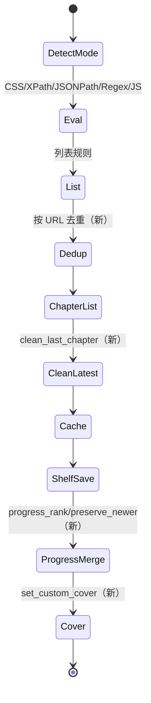
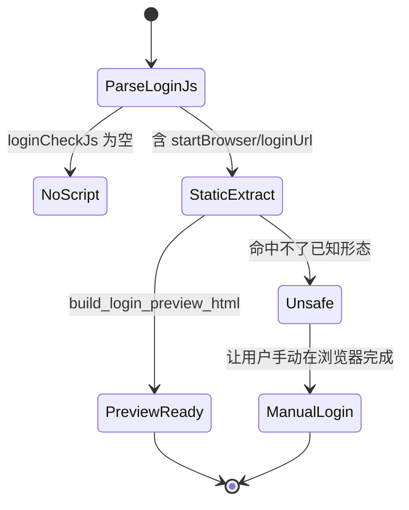

# 1432433gg_reader-next 研究报告

> 仓库：`D:\YLReader\references\1432433gg_reader-next` | 线上：https://github.com/1432433gg/reader-next
> 技术栈：Rust（edition 2021，`reader-next 1.1.6`）/ Axum 0.7 + Tokio / sqlx 0.7（SQLite）/ reqwest 0.12（rustls）/ rquickjs 0.7（QuickJS）/ scraper + jsonpath_lib + sxd-xpath / `regex`（线性时间）/ **新增 `lopdf`(PDF) + `mobi`(MOBI) + `image`(jpeg/png/webp) + `json5`** / 前端 Vue 3.5（`frontend/`）+ 文档站 VitePress（`docs/`）
> 代码规模：305 个文件；`src/api/handlers/book.rs` 3,875 行、`src/service/book_service.rs` 2,387 行、`src/parser/rule_engine.rs` 2,525 行、`src/parser/html.rs` 855 行、`src/parser/js.rs` 511 行；`docs/` 下 20+ 篇 VitePress 文档（`book-source/{spec,javascript,rules,search-rule,book-info,content-rule,toc-rule}.md`）；`tests/book_source_compat.rs` 703 行
> 分析范围与方法：**以 `givenge_reader-rust` 为基线做逐文件哈希 + `Compare-Object` 行级差分**，只深读有差异的文件；另读 `docs/book-source/spec.md`、`docs/book-source/javascript.md`、`src/api/handlers/book.rs` 差异段、`src/service/book_service.rs` 新增函数清单、`src/crawler/*`。未覆盖：`local_*` 本地书、AI 相关、`frontend/` 组件、`docs/.vitepress` 站点配置。

## 0. 一句话结论

这是 `givenge/reader-rust` 的**活跃分支**（同源证据：`rule_analyzer.rs`/`jsonpath.rs`/`model/book_source.rs` 与本仓库逐字节相同），它把力气花在**「工程正确性」而不是「规则覆盖」**上：章节去重、`latestChapter` 清洗、阅读进度冲突合并、重复书合并、登录脚本静态解析、PDF/MOBI/图片格式支持、`println!` 换 `tracing`、并补了一整套 VitePress 书源规格文档；但**基线的两个 P0（JS 无超时、无 SSRF）原样保留**，且 `book.rs` 3,875 行比基线更胖。

## 1. 书源解析：规则类型与执行模型

### 1.1 支持的规则类型（继承基线 + 增量判定）

> 同源证据：`src/parser/rule_analyzer.rs`(99 行)、`src/parser/jsonpath.rs`(66 行)、`src/model/book_source.rs`(343 行) 与 `givenge_reader-rust` **SHA-256 完全一致**（哈希比对结果 `SAME`）。因此规则语法判定与基线相同，本节只列**判定结论 + reader-next 的差异**。

| 规则类型 | 判定 | reader-next 的差异 | 证据 |
|---|---|---|---|
| CSS（默认） | 支持 | 新增 `clean_last_chapter` 清洗「最新章节」多行/广告（`rule_engine.rs`） | `rule_engine.rs`（`clean_last_chapter` 段） |
| `@css:` 显式 | 支持 | 无变化 | `rule_engine.rs:37-39`（同基线） |
| `@@` 转义 | 支持 | 无变化 | `rule_analyzer.rs:79`（哈希一致） |
| `@XPath:` / `//` / `./` | 支持 | `html.rs` 855 行（+8 行，含补丁） | `rule_engine.rs:40-43,55-57` |
| `@json:` / JSONPath | 支持 | `jsonpath.rs` 未变 | `rule_engine.rs:44-46` |
| `##` 正则替换 | 支持 | 无变化 | `rule_engine.rs`（transform 段，哈希差仅 `clean_last_chapter`） |
| 纯正则（`:` 前缀） | 支持 | 无变化 | `rule_engine.rs:61-63` |
| `@regex:` 显式 | 支持（方言扩展） | 无变化 | `rule_engine.rs:47-49` |
| `:regex` 后缀 | 不支持 | 无变化 | 未发现（已验证：`grep ":regex"`） |
| `||` / `&&` / `%%` | 支持 | 无变化 | `rule_analyzer.rs:7` |
| `@put:` / `@get:` / `{{ }}` | 支持 | 无变化 | `rule_engine.rs:1450-1919` |
| `@js:` / `<js>` / `js:` | 支持 | **删除了搜索专用入口** `eval_js_search_with_source`，统一走 `eval_js_inner_with_source`；`java.*` 绑定更全（`get/post/encode/...`） | `js.rs:53-118`；差分 `<=` 项 |
| `$n` 捕获 | 支持 | 无变化 | `rule_engine.rs`（Regex 分支） |
| `!` / `[-1]` / 区间索引 | 部分支持 | 无变化（未实现 Legado 索引语法） | 未发现 |
| `@href`/`@text`/`@html`/`@textNodes`/`@ownText` | 支持 | 无变化 | `html.rs:484-516`（855 行版） |
| `jsLib` / `coverDecodeJs` / `loginUi` / `ruleReview` | 支持（模型层） | 无变化 | `book_source.rs:19,25,23,43`（哈希一致） |
| `${key}` URL 占位符 | 支持 | 无变化 | `url_analyzer.rs`（仅 +2 行） |
| `ruleReview` 执行 | 部分支持 | 仍是「模型有、执行链未验证」 | 同基线 |

### 1.2 执行模型（关键差异）

1. **章节列表去重是 reader-next 最重要的解析修复**：新增 `seen_urls` + `out.retain(|chapter| chapter.url != url_abs)`，把「同一 URL 重复出现」的章节合并而非追加（`rule_engine.rs` 差分：`seen_urls.insert(url_abs.clone())` / `out.retain(...)`）。这直接解决「目录翻页重复/丢章」问题。
2. **`latestChapterTitle` 清洗**：`clean_last_chapter` 对超过 80 字符或含多行的值，只保留「以『第』开头且含『章』」的最后一行，否则保留原值（`rule_engine.rs` 差分）。这是对「最新章节」被广告/推荐污染的实际修复。
3. **JS 运行时仍无配额**：`Runtime::new()` + `Context::full()`（`js.rs:129` 附近，与基线同位置），`grep "Interrupt|set_interrupt_handler|memory_limit|max_steps"` 无命中；`java.ajax` 仍直接发请求（`js.rs:171`）。
4. **JS 绑定继续扩张**：`java` 下新增 `get/post/encodeURI/...`（`js.rs:171-246` 的 `Func::new` 列表），但**没有新增任何超时/限额/审计**。
5. **日志从 `println!` 改为 `tracing::debug!`**：`crawler/fetcher.rs` 差分显示 4 处 `println!("DEBUG: ...")` → `tracing::debug!`。这是从「调试脚本」走向「可运维服务」的信号。
6. **SSRF 仍未实现**：`grep "private|loopback|127.0|169.254|is_private"` 于 `src/crawler/*.rs` **零命中**（`http_client.rs` 与基线哈希一致）。
7. **登录能力靠「静态解析 JS」而非执行**：`book_service.rs` 新增 `looks_like_login_script`、`extract_login_function_body`、`find_matching_delimiter`、`extract_start_browser_argument`、`extract_login_url_assignment`、`eval_login_url_expression`、`decode_js_string_literal`、`split_js_concat` 等函数——**在不执行 JS 的前提下，从 `loginCheckJs` 里抠出 `startBrowser(...)` 的 URL 与 `loginUrl = ...` 赋值**，用于生成登录预览页（`build_login_preview_html`）。这是一个「避免开 JS 沙箱」的工程折中，值得单独评价（见 §4）。

### 1.3 规则边界与失败语义（增量）

| 场景 | reader-next 行为 | 证据 |
|---|---|---|
| 目录出现重复 URL | 去重，后出现的同 URL 条目覆盖先前条目 | `rule_engine.rs` 差分（`seen_urls` / `retain`） |
| 最新章节字段被污染 | 清洗为「第 N 章 …」最后一行或原文 | `rule_engine.rs` 差分（`clean_last_chapter`） |
| 登录脚本含 `startBrowser("...")` | 静态提取 URL，生成预览；不执行脚本 | `book_service.rs` 新增函数清单 |
| 登录脚本含 `loginUrl = "..."` | 静态提取赋值（支持字符串拼接 `split_js_concat`） | 同上 |
| 登录脚本是动态拼接/变量 | `eval_login_url_expression` 只处理受限表达式，失败则 `None` | 同上 |
| 搜索 JS | 统一走通用 `eval_js_inner_with_source`（不再有 search 专用入口） | `js.rs` 差分 |
| JS 死循环 | 仍不可中断 | `js.rs:129` |
| 请求失败 | 仍 `retry`（默认 2）无退避 | `fetcher.rs`（仅日志改动） |

### 1.4 方言差异小结（相对 Legado 官方语义）

- **`:` 前缀判为正则**（`rule_engine.rs:61`），而 Legado 只在「取元素」路径把首字符 `:` 当纯正则；同一书源在「取文本」与「取列表」下可能得到不同结果。
- **`@regex:` 是本方言新增**（`rule_engine.rs:47`），Legado 无此前缀；导出给 Legado 前需降级为 `:` 前缀或 `##` 形式。
- **`${key}` 占位符**（`AGENTS.md` 架构段）与 Legado 的 `{{key}}` 并存，但两者求值时机不同（前者在 URL 拼接期，后者在规则求值期）。
- **`jsLib` 每次求值重新执行**（`js.rs:321`），不保留上一次的全局变量；Legado 的共享作用域语义在此被放弃。

## 2. 数据模型

### 2.1 表结构（与基线完全相同）

`src/storage/db/migrations/` 仍是 `0001_init.sql`(20)、`0002_add_user_ns.sql`(14)、`0003_users_and_account_documents.sql`(43)，**没有任何新增迁移**：

| 表 | 关键列 | 与基线差异 |
|---|---|---|
| `book_sources` | `book_source_url` PK、`json`、`updated_at` | 无 |
| `book_cache` | `book_url` PK、`json` | 无 |
| `chapter_cache` | `(book_url, chapter_index)` PK、`file_path` | 无 |
| `users` / `user_sessions` | 用户名/盐/token/过期 | 无 |
| `json_documents` | `(namespace, name)` PK、`json` | 无（书架仍存 JSON 文档） |
| `ai_book_memories` | `(user_ns, book_key)` | 无 |

> 关键结论：**reader-next 的功能增量（进度冲突、封面、缓存迁移）全部靠「应用层算法 + `json_documents` 内的 JSON 字段」实现，没有 schema 演进**。这意味着它在「读旧数据」上兼容，但「多端并发」仍靠应用层合并而非数据库约束。

### 2.2 数据语义增量（代码而非 schema）

- **阅读进度冲突合并**：新增 `progress_rank`、`progress_updated_at`、`preserve_newer_reading_progress`，并有一组测试（`save_book_accepts_newer_lower_progress`、`save_books_preserves_newer_existing_reading_progress`、`get_shelf_book_prefers_latest_duplicate_progress`）——**用 `updated_at` + 进度大小做「新者胜 + 大者胜」的启发式**。
- **重复书合并**：`save_books_merges_duplicate_book_urls_and_keeps_newest_progress`；同名不同源仍保留（`save_books_keeps_same_title_from_different_sources`）。
- **自定义封面**：`set_custom_cover` + 「stale save 不覆盖封面」测试（`custom_cover_survives_stale_saves_and_reset_does_not_resurrect_it`）。
- **章节缓存归属迁移**：`restore_legacy_chapter_cache`、`delete_chapter_content_cache`、`cache_ownership_*` 三个测试，处理「旧路径缓存如何归到新 book key 且只计一次」。

### 2.3 数据正确性补丁清单（reader-next 的真正价值）

| 补丁 | 新增函数 | 解决的问题 | 证据 |
|---|---|---|---|
| 进度冲突合并 | `progress_rank` / `progress_updated_at` / `preserve_newer_reading_progress` | 多端同时阅读时「旧进度覆盖新进度」 | `book_service.rs` 差分 |
| 重复书合并 | `save_books_merges_duplicate_book_urls_and_keeps_newest_progress` 等测试 | 同 `bookUrl` 被重复加入书架、进度分裂 | `book_service.rs` 差分 |
| 同名不同源保留 | `save_books_keeps_same_title_from_different_sources` | 「同名合并」误伤不同书源的书 | `book_service.rs` 差分 |
| 自定义封面保护 | `set_custom_cover` + `custom_cover_survives_stale_saves_*` | 刷新元数据时把用户自定义封面覆盖 | `book_service.rs` 差分 |
| 章节缓存归属迁移 | `restore_legacy_chapter_cache` / `delete_chapter_content_cache` / `cache_ownership_*` | 旧路径缓存成为孤儿或重复计数 | `book_service.rs` 差分 |
| 登录预览 | `resolve_login_preview_target` / `build_login_preview_html` / `extract_*` | 无法执行 JS 时仍让用户完成登录 | `book_service.rs` 差分 |

### 2.4 与 Legado 书源 JSON 的字段映射

`model/book_source.rs` 与基线逐字节相同（见 §1.1 同源证据），字段映射表完全沿用（26 个 `rule*` + `jsLib/loginUi/coverDecodeJs/ruleReview/enabledCookieJar/exploreScreen`），不重复列出。

## 3. 状态机

### 3.1 搜索 → 详情 → 目录 → 正文（含增量）

证据：`rule_engine.rs` 差分（`seen_urls`/`clean_last_chapter`）；`book_service.rs` 新增函数（`preserve_newer_reading_progress`、`set_custom_cover`）。

### 3.2 登录预览状态（reader-next 独有）

证据：`book_service.rs` 的 `resolve_login_preview_target`/`build_login_preview_html`/`extract_start_browser_argument`/`extract_login_url_assignment`。

### 3.3 缓存与并发

- 章节缓存：仍「`chapter_cache` 行 + 文件」双写，新增「归属迁移」逻辑但**没有事务**；`cache_ownership_*` 测试只覆盖「计数一次/优先 canonical」。
- 书架：仍 `json_documents` 全量读写；进度合并算法在应用层，多实例部署下仍会互相覆盖（无 DB 锁/CAS）。
- 书源：仍 URL 主键覆盖式保存。

## 4. 已知架构缺陷

| 严重度 | 缺陷 | 影响 | 证据 | 根因 |
|---|---|---|---|---|
| P0 | JS 仍无超时/无中断/无内存上限 | 一条死循环脚本永久占用 worker | `js.rs:129`（`Runtime::new()`）；`grep Interrupt/memory_limit` 无命中 | 与基线同源，未修 |
| P0 | 仍无 SSRF 防护 | 书源/`java.ajax` 可打内网与云元数据 | `src/crawler/*` 无地址过滤（grep 零命中）；`js.rs:171` | 与基线同源，未修 |
| P1 | `book.rs` 3,875 行 + `book_service.rs` 2,387 行 | 比基线更胖；封面/进度/缓存迁移/登录预览全塞进 service | 文件行数；新增 30+ 函数 | 以「测试驱动补丁」方式演进，未拆层 |
| P1 | 登录能力靠「正则/字符串解析 JS」 | `loginCheckJs` 稍复杂就提取失败；且容易误判（把注释里的 `startBrowser` 当真的） | `book_service.rs`（`looks_like_login_script`/`extract_*`） | 不愿引入 JS 沙箱，只能用静态分析绕 |
| P1 | 进度合并是启发式 | 「新者胜 + 进度大者胜」在「用户回翻」场景会误判为退步并丢弃 | `progress_rank`/`preserve_newer_reading_progress` + 测试名 | 没有服务端单调时钟/版本向量 |
| P1 | 书架仍是 JSON 文档 | 无法索引/分页；并发写覆盖 | `0003_...sql:25-31` | 与基线同源 |
| P2 | 迁移仍 3 个、无 down | 无法演进 schema | `src/storage/db/migrations/` | 与基线同源 |
| P2 | 无 `local_epub` 测试（基线有 261 行） | EPUB 回归保护反而变弱 | `tests/` 清单对比 | 测试重组时遗漏 |
| P2 | PDF/MOBI 解析引入 `lopdf`/`mobi` | 二进制解析面扩大（未审计的 unsafe/panic 风险） | `Cargo.toml` 差分 | 本地书格式扩展 |
| P2 | 删除基线已有的搜索 JS 入口 | 若有书源依赖 search 专用绑定（key/page/source_key 组合），行为可能变化 | `js.rs` 差分（`<=` 项） | 统一入口的重构 |

## 5. 对我们的启示

### 可借鉴

1. **目录去重 + 最新章节清洗**（`rule_engine.rs` 差分）：这是「脏 HTML/翻页重复」的两个高频真实问题。落地：Go 解析目录后按 `absolute(url)` 去重（保留首次出现或最后一次，需定契约），`latestChapter` 做「第 N 章」正则清洗。
2. **进度冲突的显式策略**：`preserve_newer_reading_progress` 用 `updated_at` + 进度比较。落地：PG 里存 `progress_updated_at`（客户端时间）+ `server_updated_at`，冲突时以「客户端时间新且 chapter_index 不回退」为准，并把「回翻」作为显式用户操作（允许回退但记录 `reason=manual`）。
3. **重复书合并 / 同名不同源保留**：`save_books_merges_duplicate_book_urls_and_keeps_newest_progress`。落地：`books` 唯一键 `(user_id, book_url)`，同 `(name, author)` 不同 `source_id` 允许并存。
4. **自定义封面不被 stale save 覆盖**：`set_custom_cover` + 专门测试。落地：`books.custom_cover_url` 与 `cover_url` 分列，更新逻辑只写 `cover_url`。
5. **缓存归属迁移**（`restore_legacy_chapter_cache`）：旧版本路径 → 新路径的一次性迁移。落地：`StorageProvider` 提供 `MigrateLegacyPath`，用 `schema_migrations` 记录一次性执行。
6. **VitePress 书源规格文档**（`docs/book-source/spec.md`）：定义 L1 Parser / L2 Evaluator / L3 Engine 三级兼容目标与 MUST/SHOULD/MAY（`spec.md:33-34`）。落地：我们的 `docs/architecture.md` 直接采用这三层，作为 Stage 2 验收口径。

### 必须避免

1. **不要用「静态解析 JS」替代沙箱**：`extract_login_url_assignment` 之类只能覆盖已知形态，且会误判。替代：goja 沙箱内执行 `loginCheckJs`（限时/限 API），或明确「不支持脚本登录」。
2. **不要让进度合并变成隐式规则**：`preserve_newer_reading_progress` 的启发式在「回翻」时是错的。替代：显式 `client_updated_at` + 服务端版本号，冲突返回 409 让客户端决策。
3. **不要继续扩大 `book.rs`/`book_service.rs`**：3,875/2,387 行。替代：`service/{shelf,progress,cover,login,cache}` 分包。
4. **不要把书架放 JSON 文档**：同基线。替代：关系表 + 进度列。
5. **不要引入未经审计的二进制解析库**：`lopdf`/`mobi`。替代：本地书解析作为可选模块 + `panic=abort` 隔离 + fuzz 测试。
6. **不要让 JS 兼容测试形同虚设**：`tests/js_compat.rs` 仅 14 行，QuickJS 上 `java.*` 桥接几乎没有回归保护。替代：为每个桥接函数写契约测试，并用真实书源样本做 golden 测试。

### 对 Stage 2 契约的具体约束建议

- `schema.sql`：`books` 增加 `custom_cover_url`、`progress_updated_at`、`progress_rank/version`；`chapters` 唯一键 `(book_id, url_hash)` 防重复；`chapter_cache` 用 `(book_id, chapter_index)` + `object_key` 而非文件路径。
- `openapi.yaml`：`PUT /books/{id}/progress` 支持 `If-Unmodified-Since`/`version`，冲突返回 409 + 双方进度；`PUT /books/{id}/cover` 与 `PATCH /books/{id}` 分离，避免 stale save 覆盖封面。
- 契约文档：采用 L1/L2/L3 兼容分层，把「目录去重策略」「latestChapter 清洗规则」写成可测试条款。

## 6. 证据索引

| 文件:行号 | 结论 | 原文短引用（≤2 行） |
|---|---|---|
| `Cargo.toml:2` | 版本 1.1.6，包名 reader-next | `name = "reader-next"` / `version = "1.1.6"` |
| `Cargo.toml:24` | 新增 PDF 解析 | `lopdf = "0.34"` |
| `Cargo.toml:25` | 新增 MOBI 解析 | `mobi = "0.8"` |
| `Cargo.toml:26` | 新增图片解码 | `image = { version = "0.25", default-features = false, features = ["jpeg", "png", "webp"] }` |
| `src/parser/rule_analyzer.rs:7` | 与基线逐字节相同（同源证据） | `pub fn split_top_level(rule: &str, delimiters: &[&str]) -> SplitResult {` |
| `src/model/book_source.rs:43` | `ruleReview` 字段（同基线） | `pub rule_review: Option<ReviewRule>,` |
| `src/parser/rule_engine.rs`（差分） | 新增最新章节清洗 | `fn clean_last_chapter(value: Option<String>) -> Option<String> {` |
| `src/parser/rule_engine.rs`（差分） | 章节按 URL 去重 | `out.retain(\|chapter\| chapter.url != url_abs);` |
| `src/parser/rule_engine.rs`（差分） | 去重集合 | `seen_urls.insert(url_abs.clone());` |
| `src/parser/rule_engine.rs:37` | 显式模式识别（同基线） | `if rule.starts_with("@css:") \|\| rule.starts_with("@CSS:") {` |
| `src/parser/js.rs:129` | 每次新建 QuickJS Runtime（无配额） | `let rt = Runtime::new()?;` |
| `src/parser/js.rs:171` | `java.ajax` 直接发请求 | `Func::new(\|spec: String\| -> String { java_ajax(&spec).unwrap_or_default() })` |
| `src/parser/js.rs:44` | `jsLib` 包裹 | `pub fn with_js_lib<T>(js_lib: Option<&str>, f: impl FnOnce() -> T) -> T {` |
| `src/crawler/fetcher.rs`（差分） | 日志改为 tracing | `tracing::debug!("fetch response status: {}", status);` |
| `src/crawler/http_client.rs:12` | 超时仍来自配置 | `.timeout(Duration::from_secs(timeout_secs))` |
| `src/crawler/url_analyzer.rs:40` | 默认重试 2 | `let mut retry = 2usize;` |
| `src/storage/db/migrations/0001_init.sql:1` | 书源表 URL 主键（未变） | `CREATE TABLE IF NOT EXISTS book_sources (` |
| `src/storage/db/migrations/0001_init.sql:14` | 章节缓存存路径（未变） | `CREATE TABLE IF NOT EXISTS chapter_cache (` |
| `src/storage/db/migrations/0003_users_and_account_documents.sql:25` | 书架仍是 JSON 文档 | `CREATE TABLE IF NOT EXISTS json_documents (` |
| `src/service/book_service.rs`（差分） | 进度冲突合并 | `preserve_newer_reading_progress` |
| `src/service/book_service.rs`（差分） | 进度排序键 | `progress_rank` / `progress_updated_at` |
| `src/service/book_service.rs`（差分） | 自定义封面 | `set_custom_cover` |
| `src/service/book_service.rs`（差分） | 缓存归属迁移 | `restore_legacy_chapter_cache` / `delete_chapter_content_cache` |
| `src/service/book_service.rs`（差分） | 登录脚本静态解析 | `extract_start_browser_argument` / `extract_login_url_assignment` / `eval_login_url_expression` |
| `src/service/book_service.rs`（差分） | 登录预览页生成 | `build_login_preview_html` / `resolve_login_preview_target` |
| `tests/book_source_compat.rs:1` | 兼容测试 703 行（基线 552） | `book_source_compat.rs 703` |
| `tests/encrypted_source_rules.rs:1` | 新增加密书源测试 | `encrypted_source_rules.rs 66` |
| `tests/js_compat.rs:1` | JS 测试仍仅 14 行 | `js_compat.rs 14` |
| `docs/book-source/spec.md:25-27` | 三级兼容目标 L1 Parser / L2 Evaluator / L3 Engine | `L1 Parser` / `L2 Evaluator` / `L3 Engine`（规格表） |
| `docs/book-source/spec.md:29` | 兼容目标分层决定实现范围 | `若目标是“兼容当前项目书源规则”，至少需要 L2。若目标是替代当前书源运行时，需要 L3。` |
| `docs/book-source/spec.md:33` | 兼容性用 MUST/SHOULD 定义 | `MUST：必须实现，否则大量书源不兼容。` |
| `docs/book-source/spec.md:1266` | `ReviewRule` 默认不执行 | `兼容实现 SHOULD 保留 ReviewRule 字段用于导入导出，但 MUST 默认不执行段评规则，除非明确实现扩展能力。` |
| `docs/book-source/javascript.md:3` | JS 在服务端 QuickJS 执行 | `Reader Next 的 JS 规则运行在服务端 QuickJS 中，不是浏览器页面环境。` |
| `src/service/book_service.rs`（差分） | 删除书时清缓存 | `delete_chapter_content_cache` |
| `src/service/book_service.rs`（差分） | 登录脚本像不像 JS 的判定 | `looks_like_login_script` |
| `src/service/book_service.rs`（差分） | JS 字符串拼接还原 | `split_js_concat` / `decode_js_string_literal` |
| `src/service/book_service.rs`（差分） | 括号配对（提取函数体） | `find_matching_delimiter` |
| `src/service/book_service.rs`（差分） | 本地书判定 | `is_local_txt_book` |
| `src/service/book_service.rs`（差分） | 并发保存自定义封面测试 | `custom_cover_and_stale_progress_save_can_run_concurrently` |
| `src/service/book_service.rs`（差分） | 同名不同源保留测试 | `save_books_keeps_same_title_from_different_sources` |
| `src/parser/js.rs:53` | 通用 JS 求值入口 | `pub fn eval_js(script: &str, input: &str, base_url: &str) -> anyhow::Result<String> {` |
| `src/parser/html.rs:484` | `@text` 取值分支 | `"text" \| "@text" => {` |
| `src/storage/cache/file_cache.rs:44` | 缓存写文件（无原子写） | `fs::write(path, value).await?;` |
| `src/parser/rule_engine.rs:50` | `js:` 前缀判定 | `if rule.starts_with("js:") \|\| rule.starts_with("@js:") \|\| rule.starts_with("<js>") {` |

## 7. 关键路径文件地图（Stage 2 取证入口）

| 关注点 | 文件（相对仓库根） | 行数 | 与基线的差异 |
|---|---|---|---|
| 规则引擎 | `src/parser/rule_engine.rs` | 2,525 | +17 行：`clean_last_chapter`、章节去重 |
| 顶层切分 | `src/parser/rule_analyzer.rs` | 99 | 哈希一致 |
| HTML/CSS | `src/parser/html.rs` | 855 | +8 行 |
| JS 运行时 | `src/parser/js.rs` | 511 | −17 行：删搜索专用入口，`java.*` 更多 |
| JSONPath | `src/parser/jsonpath.rs` | 66 | 哈希一致 |
| URL 编译 | `src/crawler/url_analyzer.rs` | 667 | +2 行 |
| 抓取 | `src/crawler/fetcher.rs` | 279 | 同长度，`println!`→`tracing` |
| HTTP | `src/crawler/http_client.rs` | 25 | 哈希一致 |
| 书源模型 | `src/model/book_source.rs` | 343 | 哈希一致 |
| 业务（进度/封面/登录） | `src/service/book_service.rs` | 2,387 | +670 行 |
| Handler | `src/api/handlers/book.rs` | 3,875 | +690 行 |
| 迁移 | `src/storage/db/migrations/000{1,2,3}*.sql` | 20/14/43 | 无新增 |
| 兼容测试 | `tests/book_source_compat.rs` | 703 | +151 行 |
| 加密书源测试 | `tests/encrypted_source_rules.rs` | 66 | 新增 |
| JS 测试 | `tests/js_compat.rs` | 14 | 未增长 |
| 规格文档 | `docs/book-source/spec.md` | 1,300+ | 新增（L1/L2/L3 + MUST/SHOULD） |

## 8. 缺陷验证方法（Stage 5 可直接复用）

| 缺陷 | 验证方式 | 期望的「反例」观察 |
|---|---|---|
| JS 死循环 | `@js:while(true){}` | 无超时，线程占用 |
| SSRF | `@js:java.get("http://127.0.0.1:<port>/")` | 能访问本机 |
| 登录静态解析误判 | `loginCheckJs` 注释里写 `startBrowser("http://evil")` | 可能被当作真实登录 URL |
| 回翻进度误判 | 设备 A 读到第 100 章，设备 B 回翻到第 10 章并保存 | B 的进度可能被 A 的「更大进度」覆盖 |
| 封面 stale save | 设置自定义封面后触发元数据刷新 | 自定义封面应保留（测试已覆盖） |
| 章节重复 | 目录两页有重叠 URL | 去重后数量正确（测试已覆盖） |
| 缓存孤儿 | 删除书后检查 `storage/` 文件 | 可能残留章节文件 |

## 9. 对 Stage 2 的开放问题

1. 进度合并能否只用「客户端时间 + 版本号」而不引入 `progress_rank` 这种启发式？回翻场景如何表达？
2. `spec.md` 的 L1/L2/L3 分层是否直接作为我们的引擎验收门槛？
3. `clean_last_chapter` 的「80 字符 / 单行」阈值是否要可配置？清洗规则是否要写进契约？
4. 登录编排：我们是否在 MVP 支持「静态提取登录 URL」这种折中，还是直接做沙箱内登录脚本？
5. `book.rs` 3,875 行的端点集合里，哪些属于 MVP（搜索/详情/目录/正文/进度/封面）？
6. PDF/MOBI 的二进制解析是否进入 Stage 4，还是只做 TXT/EPUB 并明确「PDF/MOBI 稍后」？
