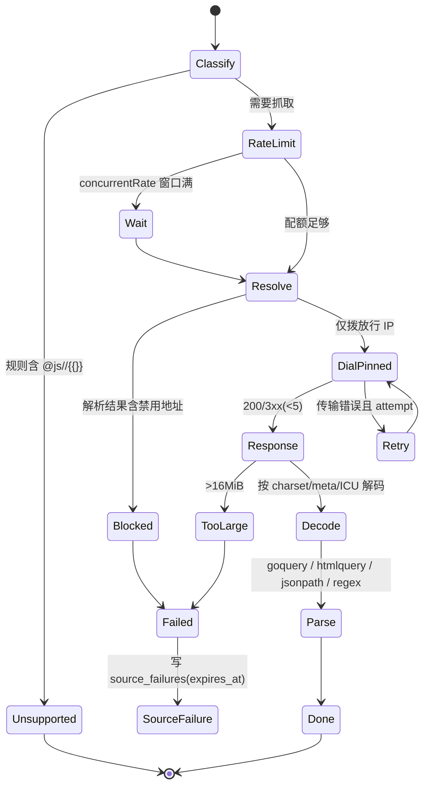
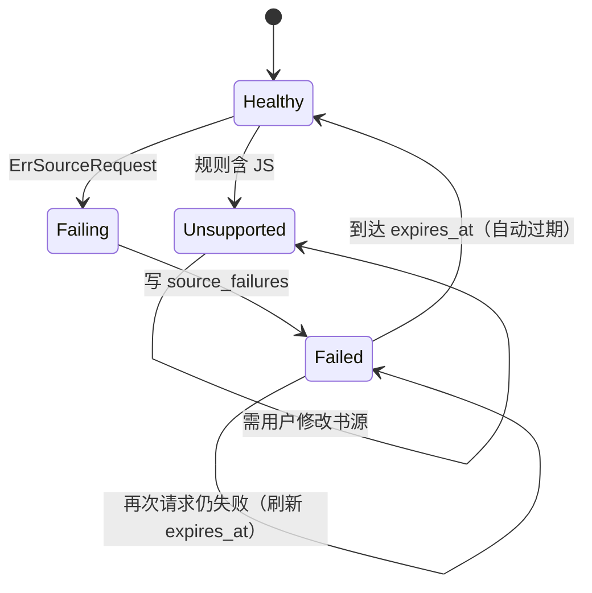

# changshengyu_openreader 研究报告

> 仓库：`D:\YReader\references\changshengyu_openreader` | 线上：https://github.com/changshengyu/openreader
> 技术栈：Go 1.26.10 / Gin 1.10 / GORM 1.25 + **SQLite（`mattn/go-sqlite3`，cgo）** / JWT（`golang-jwt/v5`）/ goquery 1.9.2 + `antchfx/htmlquery` 1.3.4 + `PaesslerAG/jsonpath` / 自研 ICU 风格 charset 检测（`charset_icu.go` + 508 行表）/ **无 JS 引擎（`@js:` 被显式禁用）** / 前端 Vue 3.5 + Element Plus 2.10 + Pinia 3 + Vite 8
> 代码规模：1,163 个文件；`backend/engine` 下 42 个 Go 文件，核心 `source_parser.go` 1,891 行、`source_rule_evaluator.go` 1,198 行、`fetcher.go` 786 行、`source_network_policy.go` 613 行、`source_request.go` 470 行、`charset_icu.go` 453 行；契约测试极多（`parser_test.go` 1,333 行、`source_network_policy_contract_test.go` 695 行、`source_rule_evaluator_test.go` 662 行）
> 分析范围与方法：读 `backend/go.mod`、`engine/{source_rule_evaluator,source_parser,fetcher,source_network_policy,source_request,charset_icu}.go` 关键段、`models/models.go`、`db/db.go`、`docs/security-review-checklist.md`、`docs/upstream-alignment-audit.md`；用 `grep` 验证 JS/SSRF/限流/迁移模式。未覆盖：`epub_parser.go`/`txt_parser.go`/`umd_parser.go` 的格式细节、`services/*` 全部、前端组件。

## 0. 一句话结论

这是 6 个仓库里**安全与契约意识最强、但兼容性主动让步**的 Go 实现：SSRF 防护做到了「DNS 解析后只拨放行 IP + 自定义 RoundTripper + 代理/SOCKS 全链路校验」，限流真正解析 `concurrentRate`，迁移有 `SchemaMigration` 版本表，测试以「契约/生命周期」命名且数量惊人；代价是**彻底不执行任何 `@js:`/`<js>`/`webJs`**（保留字段、显式 `ErrUnsupportedSourceRule`），并且**只支持 SQLite（cgo）**。它最适合当我们的「安全基线 + 错误语义」参照，不适合当「书源覆盖率」参照。

## 1. 书源解析：规则类型与执行模型

### 1.1 支持的规则类型（逐项判定）

| 规则类型 | 判定 | 说明 | 证据 |
|---|---|---|---|
| CSS（默认） | 支持 | goquery `Find`，带 `@text`/`@html` 等尾部操作 | `source_rule_evaluator.go:974-1012` |
| `@css:` 显式 | 支持 | 去前缀后交给 CSS 解析 | `source_rule_evaluator.go:976-977` |
| `@@` 转义 | 部分支持 | 代码只识别 `@css:/@xpath:/@json:/@js:` 前缀，未发现 `@@` 专门分支 | 未发现（已验证：`grep "@@"`、`sourceRuleCSSSelector`） |
| `@XPath:` | 支持 | `htmlquery`，含 `//` 隐式判定 | `source_rule_evaluator.go:963-970` |
| `//` 隐式 XPath | 支持 | 同上 | `source_rule_evaluator.go:970` |
| `@json:` / JSONPath | 支持 | `PaesslerAG/jsonpath`；`$.`/`$[` 自动判定 | `source_rule_evaluator.go:955-960` |
| `##` 正则替换（含 `##first`） | 支持 | 解析为 `sourceRuleTransform`，支持第 4 段 `first` | `source_rule_evaluator.go:704-731` |
| 纯正则（首字符 `:`） | 支持 | `sourceRuleRegexElements` | `source_rule_evaluator.go:889-907`、`:1188` |
| `:regex` 后缀 | 不支持 | 无该语法 | 未发现（已验证：`grep ":regex"`） |
| `||` / `&&` / `%%` | 支持 | 自研平衡扫描器（识别 `{}` 与引号），`%%` 做交错 | `source_rule_evaluator.go:1067-1160`、`:442-484` |
| `@put:` / `@get:` / `{{ }}` | **部分支持** | `@put` 支持并做严格限额；`{{ }}` 被判定为「需要隔离运行时」而拒绝 | `source_rule_evaluator.go:527-600`（put）；`:1040`（template 拒绝） |
| `@js:` / `<js>` | **不支持（显式拒绝）** | 保留原始字段用于导入导出，但执行时返回 `ErrUnsupportedSourceRule` | `source_rule_evaluator.go:1030-1041`；`source_parser.go:110-114` |
| `$n` 捕获 | 支持 | `sourceRuleCapture` 解析 `$0..$99` | `source_rule_evaluator.go:1019-1028` |
| `!` 排除 / `[-1]` / 区间索引 | 部分支持 | 未见 JSoup 式索引语法；CSS 交给 goquery 原生（`nth-child` 等） | 未发现（已验证：`grep "indexDefault\\|findIndexSet"` 无命中） |
| `@href` 等属性 | 支持 | 尾部操作识别 `text/html`，其余按属性名 | `source_rule_evaluator.go:991-1017` |
| 章节分页 `nextContentUrl` | 支持 | 有独立分页测试（458 行） | `source_pagination_test.go` |
| 目录分页 `nextTocUrl` | 支持 | `source_toc_test.go` 246 行覆盖 | `engine/source_toc_test.go` |
| base64/AES/DES | 不支持（规则层无 `java.*` 桥） | 无脚本即无桥接 API；仅替换规则支持 JS `String.replace` 语义的 `$1`/`$<name>` | `services/replacerules/engine.go:52-118` |
| `ruleReview`（段评） | 未发现 | 无 `ReviewRule`/`review` 相关模型 | 未发现（已验证：`grep -ri "review" models/ engine/` 无业务命中） |

### 1.2 执行模型（关键）

1. **不是「字符串 split」，而是带平衡感知的扫描器**：`sourceRuleCompositeParts` 逐字符扫描，只有 `brackets/parentheses/braces` 深度为 0 时才认定 `&&`/`||`/`%%`（`source_rule_evaluator.go:1067-1160`），这与 Legado 的 `RuleAnalyzer` 目标一致但实现独立。
2. **规则求值有「是否需要 evaluator」的快路径**：`sourceRuleNeedsEvaluator` 判断规则是否含 `##`/变量/JS/显式前缀（`:1177-1195`），纯 CSS 直接走 goquery，避免不必要的 `newSourceRuleDocument`；`parseBookResults` 也先判断 `bookResultRuleNeedsEvaluator`（`source_parser.go:377-405`）。
3. **变量运行时是显式的 `sourceRuleRuntime`**：带 `depth`（嵌套上限 8）、`persistentBookVariables`/`persistentChapterVariables`（`:151-159`）、`enterVariableRule/leaveVariableRule`（`:214-225`）。**变量不跨请求泄漏**，每次解析新建 runtime（`newSourceRuleRuntime`），这是比三个 Kotlin 实现更干净的设计。
4. **限额全部来自 `models` 常量**：变量个数/键长/值长/总字节（`source_rule_evaluator.go:33-38`），`@put` JSON 超过 `maxSourceRuleVariableBytes` 直接报错（`:548`），深度超限报错（`:218`）。
5. **没有 JS 沙箱、也没有 JS**：`sourceRuleUnsupportedError` 对 `@js:`/`<js>`/`{{}}` 一律返回 `ErrUnsupportedSourceRule`（`:1035-1041`）；`source_parser.go` 对 `header`/`loginCheckJs` 里的动态 JS 同样拒绝（`:110-114`）。官方文档明确写入安全清单：「JavaScript/WebJS rules are preserved but fail explicitly … no user-supplied script executes in the Go process, browser, filesystem or server network context」（`docs/security-review-checklist.md:1004`）。
6. **网络层（本仓库最强项）**：
   - `http.Client{Timeout: 15s}`、`MaxResponseBytes=16MiB`、`MaxRedirects=5`、`MaxRetries=3`（`fetcher.go:26-31`、`:91-96`）；
   - SSRF：`resolveAllowed` 先 DNS 解析、过滤 `sourceAddressForbidden` 的地址，再**只对放行的 IP 逐个 `dial`**（`source_network_policy.go:307-344`），从根上消除 DNS rebinding；`sourceValidatedRoundTripper` 在每次 `RoundTrip` 校验代理端点与目标（`:423-438`），SOCKS4/5 也走 `resolveAllowed`（`:551-600`）；
   - 禁用段：unspecified/loopback/private/link-local/multicast + `0.0.0.0/8`、`100.64/10`、`192.0.0.0/24`、`192.0.2.0/24`、`198.18/15`、`198.51.100/24`、`203.0.113/24`、`224/4`、`240/4`、`::/96`、`64:ff9b::/96`、`100::/64`、`2001:db8::/32`、`2002::/16` 等（`:347-384`）；
   - allowlist：最多 256 条、16384 字节（`:52-64`），支持主机名/CIDR；
   - 错误脱敏：`redactedSourceFetchError` 只暴露 `kind`，底层 `cause` 藏在 `Unwrap`（`fetcher.go:64-83`、`:508-513`），避免把内网 IP/代理信息带进 API。
7. **限流**：`acquireSourceRate` 支持 `"n/ms"` 窗口计数与纯数字「串行 + 最小间隔」两种语义（`fetcher.go:515-570`），按 `sourceKey+rate` 存 `sync.Map`。
8. **编码**：`DecodeBody` 先看显式 charset，再看 `detectHTMLCharset`（meta/BOM），最后走 `charset_icu.go`（`fetcher.go:763-800`）。
9. **并发**：解析器是同进程同步调用；XPath 的「有界 worker」只存在于契约测试（子进程 + `debug.SetMemoryLimit(32<<20)`，`xpath_advisory_lifecycle_contract_test.go:54,132`），**生产路径没有独立隔离**。

### 1.3 规则边界与失败语义

| 场景 | 行为 | 证据 |
|---|---|---|
| 规则含 JS | `ErrUnsupportedSourceRule`，API 层返回「该规则不支持」类错误，书源被标记而非崩溃 | `source_rule_evaluator.go:1035-1041` |
| 规则语法错 | `ErrInvalidSourceRule`（`@put` 超限、深度超限等） | `:548`、`:601-606` |
| 响应超限 | `ErrSourceResponseLimit`（16 MiB） | `fetcher.go:49` |
| 重定向超限 | `ErrSourceRedirectLimit`（5 次） | `fetcher.go:50` |
| 内网地址 | `ErrUnsafeSourceURL`/`ErrUnsafeSourceNetwork`，且错误文本被 redact | `fetcher.go:48`；`source_network_policy.go:342` |
| 书源请求失败 vs 规则错 | **显式区分**：`ErrSourceRequest` 才允许把书源标记为失效，规则错不抑制书源 | `fetcher.go:42-45` |
| 书源失效 | `SourceFailure` 表带 `ExpiresAt`，到期自动恢复（不是硬编码 600s） | `models/models.go:109-116` |
| 超时 | 15s client timeout + `context` 取消；重试按 `retry` 但被 `MaxRetries` 截断 | `fetcher.go:300-305`、`:325-359` |
| 规则调试台 | 前端有「兼容源默认排除/风险标签」，后端有 `/api/sources` 校验；未见逐级 trace | `docs/upstream-alignment-audit.md:113` |

## 2. 数据模型

### 2.1 表结构（GORM）

| 表 | 关键列 | 说明 |
|---|---|---|
| `users` | `username uniqueIndex(80)`、`password_hash`、`role`、`book_limit`、`source_limit`、`can_edit_sources`、`can_access_webdav`、`auth_version` | `auth_version` 用于「改密/踢下线」 |
| `user_sessions` | `id(64)`、`user_id`、`auth_version`、`legacy`、`expires_at`、`revoked_at` | 服务端会话表，支持撤销 |
| `user_settings` | `(user_id, key)` 复合唯一、`value text` | 每用户设置 |
| `book_sources` | `name`、`base_url`、`search_url`、`book_url_pattern`、`source_type`、`charset`、`concurrent_rate`、`header`、`login_url`、`login_check_js`、`weight`、`respond_time`、**`rules text`**、`enabled`、`group` | **规则整段 JSON 存 `rules` text，检索字段拆列** |
| `user_book_sources` | `(user_id, source_id)` 复合主键、`detached` | 用户与书源多对多 + 分离态 |
| `book_source_namespaces` | `user_id` 主键 | 每用户命名空间 |
| `schema_migrations` | `key` 主键、`applied_at` | **显式迁移版本表** |
| `source_failures` | `(user_id, source_id)` 唯一、`message`、`failed_at`、`expires_at` | 失效书源带 TTL |
| 书籍/章节/进度 | GORM 模型（`Book`/`Chapter`/`Bookmark` 等，见 `models.go` 其余段） | 书名/作者/进度为列 |

### 2.2 书源规则的持久化形态

- **`Rules string` + `gorm:"type:text"`**（`models/models.go:67`），内容是一个 JSON 对象；`BookSourceRule` 结构体（`:175` 起）是它的 Go 映射，字段名带 `omitempty`，因此可以**无损 round-trip 未知键**（`docs` 里专门记录过 `customExtension` 保留：`api/book_source_ownership_api_contract_test.go:99-134`）。
- 迁移：`db/db.go:91-99` 显式 `AutoMigrate(...&models.SchemaMigration{})`，随后每个迁移用 `SchemaMigration` 的 `OnConflict{DoNothing}` 幂等占位（`:126-200`），**有版本记录、可判断是否已执行**；但仍是 forward-only，无 down 脚本。
- SQLite 工程细节：`PRAGMA journal_mode=WAL`、`PRAGMA busy_timeout=5000`（`db.go:49-50`），并在 `BEGIN` 时直接拿写锁以避免 `busy` 重试（`db.go:71-72` 注释）；单写者模型。
- **约束**：`username`/`(user_id,key)`/`(user_id,source_id)` 有唯一索引；外键级联未见（GORM 默认不建 FK），删除用户需应用层清理。

### 2.3 与 Legado 书源 JSON 的字段映射

`models.BookSourceRule`（`models.go:175+`）逐项覆盖 Legado 的 `ruleSearch/ruleExplore/ruleBookInfo/ruleToc/ruleContent`，命名采用 `bookListRule/bookNameRule/...` 的扁平化（而不是嵌套对象），例如：

| Legado 键 | OpenReader 字段 | 证据 |
|---|---|---|
| `ruleSearch.bookList` | `BookListRule` | `models.go:181` |
| `ruleSearch.name` | `BookNameRule` | `models.go:183` |
| `ruleBookInfo.init` | `BookInfoInitRule` | `models.go`（`BookInfo` 段） |
| `ruleToc.chapterList` | `ChapterListRule` | `models.go`（`TOC` 段） |
| `ruleToc.preUpdateJs` | `ChapterPreUpdateJSRule`（保留不执行） | `api/api_test.go:3084` |
| `ruleContent.webJs` | `ContentWebJSRule`（保留不执行） | `api/api_test.go:3094` |
| `ruleContent.content` | `ContentRule` | `models.go`（`Content` 段） |
| `header`（含 `@js:`） | `BaseSource.Header` 原始字符串 + `ParsedRules().headers` | `models/models.go:148`；`docs/upstream-alignment-audit.md:160` |

> 关键差异：**OpenReader 把「保留」与「执行」彻底分开**——JS/WebView 字段原样落库、原样导出，但执行路径拒绝。这正是我们 Stage 2 需要的「兼容导入 + 安全执行」双轨策略。

## 3. 状态机

### 3.1 书源请求状态

证据：`fetcher.go:515-570`（限流）、`source_network_policy.go:307-344`（pin dial）、`:347-384`（禁用段）、`fetcher.go:26-31`（限额）、`source_rule_evaluator.go:1035`（JS 拒绝）、`models.go:109-116`（失败 TTL）。

### 3.2 书源失效与恢复

证据：`fetcher.go:42-45`（只有 `ErrSourceRequest` 才抑制书源）、`models.go:114-116`（`ExpiresAt`）。

### 3.3 缓存 / 并发 / 一致性

- 缓存：`engine/cache.go`（65 行）——进程内小缓存，非持久；正文/目录主要落 SQLite 与文件。
- 并发：SQLite 单写者 + `BEGIN IMMEDIATE`（`db.go:71`）；`user_sessions` 支持多端会话；进度为列（chapter + offset）。
- 多端冲突：`auth_version` 统一失效旧 JWT；进度仍是 last-write-wins（未见版本号/向量时钟）。

## 4. 已知架构缺陷

| 严重度 | 缺陷 | 影响 | 证据 | 根因 |
|---|---|---|---|---|
| P0 | **不执行任何 JS** | 依赖 `@js:` 的书源（在 Legado 生态中占比很高）完全不可用，覆盖率断崖 | `source_rule_evaluator.go:1030-1041`；`docs/security-review-checklist.md:1004` | 团队选择「零脚本执行」作为安全边界，宁可牺牲兼容 |
| P0 | **只有 SQLite（cgo）** | 无法直接多实例水平扩展；cgo 让静态编译/交叉编译变难；PG 用户无法迁移 | `go.mod`（只有 `gorm.io/driver/sqlite` + `mattn/go-sqlite3`） | 面向单机自托管，未做 PG 抽象 |
| P1 | `source_parser.go` 1,891 行 + `source_rule_evaluator.go` 1,198 行 | 搜索/详情/目录/正文四条链路的解析逻辑集中，改动回归面大 | 文件行数 | 以「一条链路一组函数」组织，未拆包 |
| P1 | `{{ }}` 模板整体禁用 | 依赖模板插值的书源（搜索分页、URL 拼接）失效 | `source_rule_evaluator.go:1040` | 模板等价于执行代码，团队不愿引入 mini-evaluator |
| P1 | XPath 无生产级隔离 | 恶意 XPath 仍可在主进程耗尽 CPU/内存；测试里的 32MiB 子进程只是「可观测性验证」 | `xpath_advisory_lifecycle_contract_test.go:54,132` | 生产路径同步解析，隔离留给未来 |
| P1 | SQLite 单写者 + `busy_timeout` | 高并发写（多用户同时加书/进度）会排队，尾延迟高 | `db.go:49-50,71` | 架构选择 |
| P2 | 规则 `rules` 是 `text` 而非 JSONB | 无法用 DB 层做规则字段查询/索引；只能全表读后在 Go 里解析 | `models.go:67` | SQLite 无 JSONB（新版本有 JSON1 但未用） |
| P2 | 迁移 forward-only | 回滚只能还原备份；`AutoMigrate` 与手写迁移混用 | `db.go:91-99,126-200` | 单机部署假设 |
| P2 | 错误脱敏过于激进 | `redactedSourceFetchError` 只暴露 kind，排障时看不到真实原因（需查日志） | `fetcher.go:64-83` | 防内网信息泄漏的取舍 |
| P2 | 无 `ruleReview`/段评 | 与 kukume/warpdotsys 的扩展能力有差距 | 未发现 | 功能取舍 |
| P2 | 测试文件与实现同目录、体量巨大 | `engine` 目录 42 个文件里约一半是 `_test.go`，导航成本高 | `backend/engine` 清单 | 「契约测试优先」的工程文化 |

## 5. 对我们的启示

### 可借鉴

1. **SSRF 的「解析后只拨放行 IP」**：`resolveAllowed` + `dialAllowed`（`source_network_policy.go:307-344`）彻底消除 DNS rebinding；`RoundTripper` 层再校验代理端与目标（`:423-438`）。落地：Go `fetcher` 自定义 `DialContext`，`net.Dialer.Control` 里再校验一次 `RemoteAddr`，双保险。
2. **禁用网段清单**（`:347-384`）可直接作为我们的单元测试表（含 IPv6 `64:ff9b::/96`、`2002::/16` 等容易漏的段）。
3. **`ErrSourceRequest` vs 规则错的区分**（`fetcher.go:42-45`）：只有网络失败才熔断书源，规则错不算失效。落地：定义 `ErrKind{Transport, Parse, Unsupported}`，熔断只看 `Transport`。
4. **`source_failures.expires_at`**（`models.go:109-116`）：书源失效带 TTL 且可自动恢复，替代硬编码 600s。落地：PG 表 `source_failures(user_id, source_id, message, failed_at, expires_at)` + 部分索引。
5. **「保留但不执行」的双轨策略**（`docs/security-review-checklist.md:1004`）：JS 字段原样导入导出，执行返回 `unsupported` 并在 UI 打风险标签（`upstream-alignment-audit.md:113`）。落地：`book_sources.rules` 保留 `@js` 原文，引擎返回结构化 `unsupported_features[]`，前端书源列表显示「不兼容」徽标。
6. **限额常量化 + 运行时 depth**（`source_rule_evaluator.go:33-38,218`）：变量数量/长度/嵌套深度全部有上限。落地：`engine/limits.go` 统一常量，评测时按书源返回 `limits_exceeded`。

### 必须避免

1. **不要「一刀切禁 JS」就结束**：OpenReader 的覆盖率损失是真实的（`@js:` 在真实书源里极常见）。替代：goja 白名单沙箱 + 3s 超时 + SSRF fetcher，**执行但不可怕**。
2. **不要只支持 SQLite**：`go.mod` 只有 sqlite。替代：PG 为唯一权威库，SQLite 仅作为「迁移导入源」。
3. **不要用 `AutoMigrate` 当迁移系统**：`db.go:91`。替代：版本化 SQL + `schema_migrations`（保留其 `key/applied_at` 思路，但迁移内容用 SQL 文件）。
4. **不要把 1,900 行的 parser 继续堆大**：`source_parser.go:1891`。替代：`engine/search|detail|toc|content` 四个子包，各自带 golden 测试。
5. **不要让 `{{ }}` 永久禁用**：模板是大量书源的刚需。替代：受限模板求值器（只允许变量替换 + 简单函数），或纳入 goja 沙箱。
6. **不要用「测试子进程」冒充生产隔离**：`xpath_advisory_lifecycle_contract_test.go:132` 的 32MiB 只在测试里。替代：生产用 `context` + `memory limit`（如 cgroup）或独立 worker。

### 对 Stage 2 契约的具体约束建议

- `schema.sql`：采用其「列 + 规则 JSON」混合模型，但 `rules` 用 `JSONB` + GIN；`source_failures` 带 `expires_at`；`schema_migrations(key, applied_at)` 保留；`user_sessions(auth_version)` 保留以支持踢下线。
- `openapi.yaml`：错误必须区分 `unsupported_rule`（含 `feature` 字段）、`unsafe_url`、`source_timeout`、`response_too_large`、`redirect_limit`，与 `fetcher.go:47-53` 的错误族一一对应。
- 沙箱契约：先定义「不支持」清单与降级行为（本书源/本书/整站），再定义 JS 白名单；二者都要有 `docs` 级契约测试。

## 6. 证据索引

| 文件:行号 | 结论 | 原文短引用（≤2 行） |
|---|---|---|
| `backend/go.mod:9` | 只有 SQLite 驱动 | `gorm.io/driver/sqlite v1.5.6` |
| `backend/go.mod:10` | cgo SQLite | `github.com/mattn/go-sqlite3 v1.14.36` |
| `backend/engine/fetcher.go:27` | 默认请求超时 15s | `defaultSourceRequestTimeout = 15 * time.Second` |
| `backend/engine/fetcher.go:28` | 响应体上限 16 MiB | `defaultMaxSourceResponse    = int64(16 * 1024 * 1024)` |
| `backend/engine/fetcher.go:29` | 重定向上限 5 | `defaultMaxSourceRedirects   = 5` |
| `backend/engine/fetcher.go:30` | 重试上限 3 | `defaultMaxSourceRetries     = 3` |
| `backend/engine/fetcher.go:42` | 明确区分「源请求失败」与「规则错」 | `var ErrSourceRequest = errors.New("source request failed")` |
| `backend/engine/fetcher.go:49` | 响应超限错误 | `ErrSourceResponseLimit = errors.New("source response exceeds limit")` |
| `backend/engine/fetcher.go:515` | 限流入口 | `func acquireSourceRate(ctx context.Context, sourceKey, rate string) (func(), error) {` |
| `backend/engine/fetcher.go:527` | 解析 `n/ms` 窗口 | `if countText, windowText, found := strings.Cut(rate, "/"); found {` |
| `backend/engine/source_network_policy.go:307` | 拨号前集中校验 | `func (runtime sourceNetworkRuntime) dialAllowed(ctx context.Context, network, address string) (net.Conn, error) {` |
| `backend/engine/source_network_policy.go:319` | 只拨放行后的 IP | `addresses, err := runtime.resolveAllowed(ctx, host)` |
| `backend/engine/source_network_policy.go:352` | 私网/环回/链路本地全禁 | `if address.IsUnspecified() \|\| address.IsLoopback() \|\| address.IsPrivate() \|\|` |
| `backend/engine/source_network_policy.go:365` | 保留段清单（含 CGNAT/文档段） | `var sourceBlockedNetworkPrefixes = []netip.Prefix{` |
| `backend/engine/source_network_policy.go:52` | allowlist 大小限制 | `return nil, errors.New("source network allowlist exceeds 16384 bytes")` |
| `backend/engine/source_network_policy.go:64` | allowlist 条目上限 256 | `return nil, errors.New("source network allowlist exceeds 256 entries")` |
| `backend/engine/source_network_policy.go:423` | 每次 RoundTrip 校验代理与目标 | `func (roundTripper *sourceValidatedRoundTripper) RoundTrip(...)` |
| `backend/engine/source_rule_evaluator.go:1030` | JS 判定 | `func sourceRuleUsesJavaScript(rule string) bool {` |
| `backend/engine/source_rule_evaluator.go:1037` | JS 被禁用 | `return fmt.Errorf("%w: JavaScript/WebJS execution is disabled", ErrUnsupportedSourceRule)` |
| `backend/engine/source_rule_evaluator.go:1040` | `{{ }}` 被禁用 | `return fmt.Errorf("%w: template JavaScript requires an isolated runtime", ErrUnsupportedSourceRule)` |
| `backend/engine/source_rule_evaluator.go:1067` | 组合规则扫描器 | `func sourceRuleCompositeParts(rule string) ([]string, string) {` |
| `backend/engine/source_rule_evaluator.go:709` | `##` 变换解析 | `parts := strings.Split(rawRule, "##")` |
| `backend/engine/source_rule_evaluator.go:1019` | `$n` 捕获 | `func sourceRuleCapture(rule string) (int, bool) {` |
| `backend/engine/source_rule_evaluator.go:218` | 变量嵌套深度上限 8 | `if r.depth >= maxSourceRuleVariableDepth {` |
| `backend/engine/source_parser.go:110` | 动态 header 的 JS 被拒绝 | `if strings.HasPrefix(header, "@js:") \|\| strings.HasPrefix(header, "<js>") {` |
| `backend/engine/source_parser.go:1891` | 解析器超大 | `source_parser.go 1891 行` |
| `backend/models/models.go:67` | 规则整段 JSON 存 text | `Rules          string    \`json:"rules" gorm:"type:text"\`` |
| `backend/models/models.go:101` | 迁移版本表 | `type SchemaMigration struct {` |
| `backend/models/models.go:109` | 书源失效带过期时间 | `type SourceFailure struct {` / `ExpiresAt time.Time \`gorm:"not null;index"\`` |
| `backend/models/models.go:23` | 会话版本（踢下线） | `AuthVersion     uint64    \`json:"-" gorm:"not null;default:1"\`` |
| `backend/db/db.go:49` | WAL 模式 | `"PRAGMA journal_mode = WAL;",` |
| `backend/db/db.go:50` | 写忙等待 5s | `"PRAGMA busy_timeout = 5000;",` |
| `backend/db/db.go:91` | GORM 自动迁移入口 | `func AutoMigrate(database *gorm.DB) error {` |
| `backend/engine/fetcher.go:763` | 编码解码入口 | `func DecodeBody(body []byte, charset string) (string, error) {` |
| `docs/security-review-checklist.md:1004` | 官方承诺「不执行用户脚本」 | `no user-supplied script executes in the Go process, browser, filesystem or server network context` |
| `docs/security-review-checklist.md:1009` | `{{...}}` 明确保持禁用 | `{{...}} remains outside the bounded runtime and must stay disabled without an isolated JS sandbox` |
| `docs/upstream-alignment-audit.md:160` | 动态 JS header 只保留不执行 | `动态 JS header 只保留并在界面明确提示，不冒充执行` |

## 7. 关键路径文件地图（Stage 2 取证入口）

| 关注点 | 文件（相对仓库根） | 行数 | 用途 |
|---|---|---|---|
| 规则求值器 | `backend/engine/source_rule_evaluator.go` | 1,198 | 模式、组合、`@put/@get`、`##`、JS 拒绝 |
| 解析流水线 | `backend/engine/source_parser.go` | 1,891 | 搜索/详情/目录/正文 |
| URL 编译 | `backend/engine/source_request.go` | 470 | urlOption、headers、POST |
| 抓取器 | `backend/engine/fetcher.go` | 786 | 超时/重试/上限/限流/解码 |
| SSRF 策略 | `backend/engine/source_network_policy.go` | 613 | 解析→过滤→拨放行 IP |
| 编码检测 | `backend/engine/{charset_icu.go,text_encoding.go}` | 453/450 | ICU 表 + 编码判定 |
| 数据模型 | `backend/models/models.go` | 455 | GORM 表 + `BookSourceRule` |
| 迁移 | `backend/db/db.go` | 425 | WAL、`SchemaMigration`、backfill |
| 替换规则 | `backend/services/replacerules/engine.go` | ? | JS `String.replace` 语义 |
| 书源兼容导入导出 | `backend/services/sourcecompat/export.go` | ? | 未知键保留、`@js` 保留 |
| 路由 | `backend/api/*.go` | 多文件 | Gin handler |
| 前端 | `frontend/package.json` | 40 | Vue 3.5 + Element Plus |
| 安全清单 | `docs/security-review-checklist.md` | 1,500+ | 发布前安全门禁（含 JS 承诺） |
| 契约测试 | `backend/engine/*_contract_test.go` | 多文件 | 行为契约 |

## 8. 缺陷验证方法（Stage 5 可直接复用）

| 缺陷 | 验证方式 | 期望的「反例」观察 |
|---|---|---|
| JS 书源不可用 | 导入一个 `@js:` 搜索规则的书源 | 返回 `unsupported_rule` 而非结果 |
| SSRF | 设 `source_network_allowlist` 为空，请求 `http://127.0.0.1` | 返回 `unsafe_url` |
| DNS rebinding | 构造解析到内网的域名（测试 DNS） | `resolveAllowed` 过滤后无可拨 IP，返回 `unsafe_url` |
| 限流 | 设 `concurrentRate="1/500"`，并发 5 请求 | 每 500ms 最多 1 个 |
| 响应上限 | 返回 17MiB 的测试页 | `response_too_large` |
| 重定向上限 | 6 次 302 链 | `redirect_limit` |
| 熔断语义 | 规则错 vs 网络错分别触发 | 只有网络错写 `source_failures` |

## 9. 对 Stage 2 的开放问题

1. 「不支持 JS」的降级粒度：整源禁用、单字段置空、还是仅该字段返回 `unsupported`？其实现是「整次请求失败」，我们要不要更细？
2. `rules` 用 `JSONB` 后，如何保持 `customExtension` 等未知键的**无损 round-trip**（`json.RawMessage` + merge）？
3. 其 `ErrSourceRequest`/规则错二分法是否作为我们错误码设计的强制基线？
4. SQLite 的 WAL/busy_timeout/`BEGIN IMMEDIATE` 经验是否用于我们的「单机部署模式」？
5. 契约测试（`*_contract_test.go`）的组织方式（同目录 + 大量小用例）是否引入到我们的 Go 工程？
6. 其「禁止 `{{ }}`」的策略与我们的 goja 方案冲突，Stage 2 必须明确「模板是否等价于 JS」。
