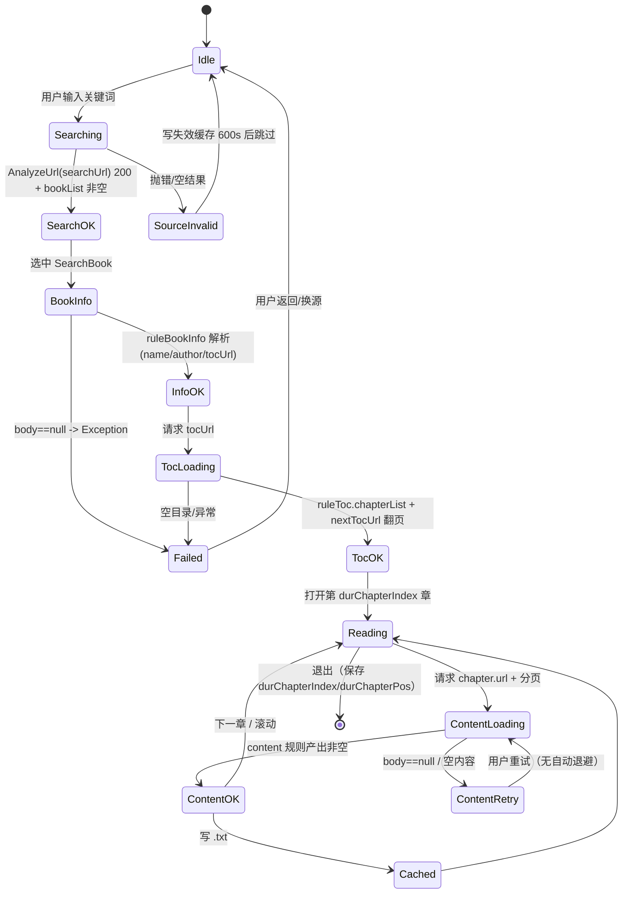

# changshengyu_reader-dev 研究报告

> 仓库：`D:\YReader\references\changshengyu_reader-dev` | 线上：https://github.com/changshengyu/reader-dev
> 技术栈：Kotlin 1.5.21 + Java 11 / Spring Boot 2.1.6.RELEASE + Vert.x 3.8.1（`RestVerticle` 注册路由）/ JavaFX WebView 11.0.2（`ReaderUIApplication`）/ OkHttp 4.9.1 / Jsoup 1.14.1 + JsoupXpath 2.5.0 + json-path 2.6.0 / Rhino 1.7.13（`src/lib/rhino-1.7.13-1.jar`）/ Gson + Jackson / 前端 Vue 2.6 + Element UI 2.15（`web/`）/ Gradle Kotlin DSL
> 代码规模：486 个文件；120 个 `.kt` + 94 个 `.java`；核心规则引擎 `analyzeRule` 共 7 个 Kotlin 文件约 2,200 行（`AnalyzeRule.kt` 734、`AnalyzeUrl.kt` 629、`AnalyzeByJSoup.kt` 494、`RuleAnalyzer.kt` 381、`AnalyzeByJSonPath.kt` 183、`AnalyzeByXPath.kt` 148、`AnalyzeByRegex.kt` 59），`JsExtensions.kt` 910 行，`BookController.kt` 3,261 行，`BaseController.kt` 403 行
> 分析范围与方法：完整读取 `model/analyzeRule/` 全部 7 个文件的关键段落、`model/webBook/{WebBook,BookContent}.kt`、`help/http/{HttpHelper,OkHttpUtils,EncodeConverter}.kt`、`help/JsExtensions.kt` 签名清单、`help/CacheManager.kt`、`data/entities/**`、`com/htmake/reader/api/controller/{BookController,BaseController}.kt` 的存储与进度段落、`utils/VertExt.kt` 的 `saveStorage/getStorage`、`build.gradle.kts`。检索手段：`grep` 规则前缀（`@css:`/`@XPath:`/`@Json:`/`@js:`/`<js>`/`{{`/`%%`/`##`/`@put:`/`@get:`）、`grep` 网络/编码/SSRF/正则编译模式。未覆盖：`web/` 下 25 个 `.vue` 交互细节、`WebdavController.kt`(750 行) 的 DAV 协议实现、`RssSource` 抓取执行链、`localBook/*` 本地书解析、JavaFX UI。

## 0. 一句话结论

这是把 Legado（阅读 3.0）的 `io.legado.app` 规则内核**整体搬进 JVM**、用 Spring Boot + Vert.x 包成「桌面/自托管 Web 阅读器」的移植工程：规则语义与 Legado 高度一致（CSS/XPath/JSONPath/正则/`||`/`&&`/`%%`/`##`/`@put`/`@get`/`{{}}` 全覆盖），**书源兼容性值得作为 Stage 2 契约的语义基准**；但它把全部业务数据落在 `storage/data/<userNameSpace>/*.json` 单文件里、`saveStorage` 直接 `writeText` 覆盖、`CacheManager.get()` 已被掏空返回 `null`、Rhino 只有黑名单沙箱且无超时、SSL 校验全关，**绝不能把它的存储层、缓存层与执行安全模型带进我们的 Go/PG 架构**。

## 1. 书源解析：规则类型与执行模型

### 1.1 支持的规则类型

| 规则类型 | 判定 | 语法/示例 | 实现位置 | 未命中行为 |
|---|---|---|---|---|
| CSS 选择器（默认规则） | 支持 | `div.book-list > a` | `AnalyzeRule.kt:471` 兜底 `Mode.Default`；`AnalyzeByJSoup.kt:298` 调 `temp.select(beforeRule)` | 返回空 `Elements`，`getStringList` 返回空 list，`getString` 返回 `""`（`AnalyzeRule.kt:247`） |
| `@css:` 显式前缀 | 支持 | `@css:.item@href` | `AnalyzeRule.kt:447-450`（大小写不敏感，保留原串交给 Jsoup） | 同上 |
| `@@` 转义前缀 | 支持 | `@@div` 表示不做 `$`/`@` 语义、按 CSS 原名匹配 | `AnalyzeRule.kt:451-454` | 同上 |
| `@XPath:` 显式前缀 | 支持 | `@XPath://div[@id="list"]/a` | `AnalyzeRule.kt:455-458` | `getElements` 返回空 list |
| `//` 隐式 XPath | 支持 | `//div/a/text()` | `AnalyzeRule.kt:467-470`（凡以 `/` 开头即判 XPath） | 同上 |
| `@json:` / JSONPath | 支持 | `@json:$.data.list[*]`、`$.data.list[*]` | `AnalyzeRule.kt:459-466`；`AnalyzeByJSonPath.kt:78` | 返回 `null`/空串 |
| `##` 正则替换 | 支持 | `rule##regex##replacement`，第 4 段存在则 `replaceFirst` | `AnalyzeRule.kt:594-604`；执行 `AnalyzeRule.kt:362-385` | 替换失败回退到字面量 `String.replace`（`:375`/`:381`） |
| 纯正则（首字符 `:`） | 支持（仅 `getElement` 路径） | `:(\d+)` | `AnalyzeRule.kt:396-399`；`AnalyzeByRegex.kt:8-29` | `getElement` 返回 `null`（`AnalyzeByRegex.kt:11-13`） |
| `:regex` 后缀式写法 | 不支持 | — | 未发现（已验证：全仓 `grep ":regex"`、`grep "regex:"` 无任何命中；仅存在首字符 `:` 的 AllInOne 写法 `AnalyzeRule.kt:395` 注释） | — |
| `||`（或） | 支持 | `ruleA||ruleB` | `RuleAnalyzer.kt:166-238` 切分；`AnalyzeByJSoup.kt:89` 首个非空即 `break` | 全部分支为空则结果为空 |
| `&&`（与/顺序合并） | 支持 | `ruleA&&ruleB` | `AnalyzeByJSoup.kt:102-105`（结果简单拼接，不是集合交集） | 任一段为空则拼接结果偏空 |
| `%%`（交叉取列表） | 支持 | `name%%author` | `AnalyzeByJSoup.kt:93-100` 按 `i` 交错拉链；`AnalyzeByXPath.kt:67-74` 同构 | 短列表越界即跳过（`i < temp.size`），不抛错 |
| `@put:{...}` | 支持 | `@put:{"k":"v"}` | `AnalyzeRule.kt:345-357`、`727`；写入 `chapter/book/ruleData` 变量域 | JSON 解析失败静默忽略（`:350-354`） |
| `@get:{...}` | 支持 | `@get:{"k"}`、`{{k}}` | `AnalyzeRule.kt:494-501`、`729` | 变量缺失返回 `""`（`:626-639`） |
| `{{ }}` 插值 | 支持 | `{{page}}`、`{{result.length}}` | `AnalyzeRule.kt:498-501`；`AnalyzeUrl.kt:125-128` 对 URL 也做插值 | JS 返回 `null` 时插入空串（`:575`） |
| `@js:` / `<js>…</js>` | 支持 | `@js:java.ajax(...)`、`<js>result</js>` | 模式识别 `AppPattern.kt:7`；执行 `AnalyzeRule.kt:644-657` | JS 抛异常时向上冒泡（未捕获） |
| `$1`/`$2` 分组 | 支持（语义=上一步列表的下标，非正则分组） | `rule1##x##y$1` 中 `$1` 取列表第 1 项 | `AnalyzeRule.kt:518-544`、`730`；`makeUpRule` `:557-566` | 下标越界则整段丢弃（`:560`） |
| `!` 排除 / `[-1]` / 区间索引 | 支持 | `tag.div!0:3`、`tag.div[-1]`、`tag.div[3:-2:-10]` | `AnalyzeByJSoup.kt:262-270`（注释即语法说明）、`304-341` | 越界索引被过滤（`:312-313`） |
| `@href`/`@text`/`@html`/`@textNodes`/`@ownText`/`@all` | 支持 | `a@href`、`div@html` | `AnalyzeByJSoup.kt:214-256`；`html` 会先移除 `script/style`（`:241-242`） | 属性为空或重复时跳过（`:253`） |
| Jsoup 扩展 `:eq()`/`:gt()`/`:lt()` | 部分支持 | `div:eq(0)`、`li:gt(2)` | 仓库未自实现，完全依赖 Jsoup 1.14.1 选择器（`AnalyzeByJSoup.kt:298`）；对 `:eq` 无专门测试 | 由 Jsoup 抛 `SelectorParseException` |
| base64 / AES / DES / 3DES | 部分支持 | 不是规则语法，只能经 `@js:` 调 `java.base64Decode`/`java.aesDecodeToString` | `JsExtensions.kt:221-243`、`551-692`、`805-877` | JS 内部 try/catch，失败返回 `null` |
| `@Header:` 元规则 | 支持 | `url,{"headers":...}` 之外的 `@Header:{...}` | 解析 `SourceAnalyzer.kt:17`；URL 选项处理 `AnalyzeUrl.kt:160-180` | 解析失败忽略该段 |
| 文本 / HTML / URL 三态 | 支持 | `getString`（文本，`Entities.unescape` `:249`）/ `getString(isUrl=true)`（补全绝对 URL `:259`）/ `getElement`（节点，`getElement` `:268`） | 见左列 | URL 为空时回落 `baseUrl`（`:256-257`） |

补充判定（模板要求「不可含糊」）：

- **默认取值不做 `trim()` 全文裁剪**，但 Jsoup `Element.text()` 会归一化空白，`textNodes` 分支显式 `trim`（`AnalyzeByJSoup.kt:225`）；`getString` 末尾统一 `Entities.unescape`（`AnalyzeRule.kt:249`），即 HTML 实体被还原成字符。
- **`getStringList` 对字符串结果按 `\n` 切分**（`AnalyzeRule.kt:181-183`），这是「一个规则产出多行」的隐式约定，也是很多书源写 `##\n` 的根因。

### 1.2 执行模型

- **拆分不是 AST，而是手写字符扫描器**。`RuleAnalyzer` 维护 `queue/pos/start/startX`，`splitRule(vararg split)` 先找分隔符，再回退扫描 `[`/`(` 平衡组，只有分隔符不在括号/引号内才切分（`RuleAnalyzer.kt:166-238`，注释明确「不用正则…解决 jsonPath 自带的 `&&` 与 `||` 冲突」）。不平衡时直接 `throw Error("<前缀>后未平衡")`（`:229-231`）。
- **规则是一条「管道」而非树**：`splitSourceRule` 产出 `List<SourceRule>`，逐个串行求值，每步的输出是下一步的输入（`AnalyzeRule.kt:154-177`、`223-244`）。`SourceRule.init` 负责识别模式前缀（`:444-472`），`makeUpRule` 负责 `$n`/`@get`/`{{}}` 回填（`:550-605`）。
- **求值上下文按实例隔离，但变量是「三级回退」全局**：`put/get` 依次落到 `chapter` → `book` → `ruleData`（`AnalyzeRule.kt:619-639`）。这意味着 `@put` 写进 `Book.variable` 后会**跨章节泄漏**（`Book.kt:100-107` 把 `variableMap` 序列化到 `variable` 字段），书源作者可用它做跨页状态，但也可能污染下一次解析。
- **JS 绑定对象清单**（`AnalyzeRule.kt:645-657`）：`java`（`JsExtensions` 实例）、`cookie`（`CookieStore`）、`cache`（`CacheManager`）、`source`、`book`、`result`、`baseUrl`、`chapter`、`title`、`src`、`nextChapterUrl`。`java.*` 暴露的能力包括 `ajax/ajaxAll/connect/webView/importScript/cacheFile/downloadFile/get/post/getCookie/getFile/readFile/deleteFile/unzipFile/queryTTF/replaceFont/toast/log/aes*/des*/digest*`（`JsExtensions.kt:39-907` 函数清单）。
- **JS 引擎 = 随仓库打包的 Rhino 1.7.13 fork（`src/lib/rhino-1.7.13-1.jar`），黑名单类过滤 + 无超时/无指令数限制**：`AppConst.kt:15` 直接 `RhinoScriptEngine()`；实现不在 `.java` 源码树，而在该 jar 内（`com/script/javascript/*.class`，含 `RhinoClassShutter`、`RhinoWrapFactory`、`RhinoSecurityManager`），可 `javap` 静态审计。`RhinoScriptEngine$1.makeContext()` 确实调用了 `setClassShutter(RhinoClassShutter.getInstance())` 与 `setWrapFactory(...)`（黑名单过滤生效），但 `RhinoScriptEngine.eval` 直接 `Context.evaluateReader`，**没有 `instructionObserverThreshold`/`observeInstructionCount`/墙钟超时**，死循环无法中断；`RhinoSecurityManager` 依赖已废弃的 Java SecurityManager，JDK 17 下默认不生效。真正的高危面是 `java.getFile/readFile/deleteFile`（`JsExtensions.kt:312-355`）与 `java.ajax`：这些是显式绑定的宿主能力，不经过类过滤，任意书源仍可读写文件、发任意请求。
- **网络层**：OkHttp 单例，`connectTimeout/writeTimeout/readTimeout` 均 15s、`retryOnConnectionFailure(true)`、`followRedirects(true)`（`HttpHelper.kt:33-42`）；但注册了 `unsafeSSLSocketFactory`/`unsafeTrustManager`/`unsafeHostnameVerifier`（`:37-39`），等于关闭证书校验。字符编码走 ICU 探测器 `EncodingDetect.getHtmlEncode`（`OkHttpUtils.kt:113`、`EncodeConverter.kt:31`、`lib/icu4j/CharsetDetector.java` 496 行），能识别 GBK/UTF-8/UTF-16 等。Cookie 由 `CookieStore` 全局单例维护。**SSRF 防护未发现**（已验证：`grep "isSiteLocalAddress|isLoopbackAddress|InetAddress|127.0.0.1|192.168|10.0.0"` 仅命中 `NetworkUtils.kt:127-142` 的「展示本机 IP」工具函数，请求路径无任何内网地址过滤）。
- **并发**：`BookContent` 对「一页拆多页」的正文用 `withContext(IO) + async` **无上限并发**（`BookContent.kt:78-98`），同一本书多页同时打同一个站点；`BookController.getBookShelfBooks` 里用 `Mutex` 串行化章节刷新（`BookController.kt:1758`），但仅覆盖书架刷新这一条路径。

### 1.3 规则边界与失败语义

| 场景 | 行为 | 证据 |
|---|---|---|
| 规则为空 | `getString` 返回 `""`；`getStringList` 返回 `null` | `AnalyzeRule.kt:205`、`:136` |
| 选择器/JSONPath 未命中 | 返回空列表或 `null`，**不抛异常** | `AnalyzeByJSoup.kt:108`、`AnalyzeByJSonPath.kt:78-120` |
| 括号不平衡 | `throw Error(...)`，冒泡到调用方 | `RuleAnalyzer.kt:229-231` |
| 正文请求失败（`body == null`） | `throw Exception("error_get_web_content")` | `BookContent.kt:31-33` |
| 正文分页 | 循环跟随 `nextContentUrl`，用 `nextUrlList.contains` 防自环 | `BookContent.kt:51-74` |
| 多页并发取正文 | `res.body!!` 强解包，任一页空 body 直接 NPE | `BookContent.kt:90` |
| 书源失效（搜索/详情抛错） | 记为「失效书源」缓存 600 秒，后续 10 分钟内跳过 | `BookController.kt:113-116`、`:1048-1050` |
| 404/验证码/反爬 | 无专门识别；仅表现为 `body` 不含选择器 → 空结果；`loginCheckJs` 只做“是否已登录”的改写 | `WebBook.kt:60-65` |
| 超时 | 仅 OkHttp 的 15s 读/连/写，无总时长上限、无退避重试（`retry` 仅透传给 `newCallStrResponse`） | `HttpHelper.kt:34-36`、`AnalyzeUrl.kt:354` |
| 规则调试台 | 有：`Debugger.kt`(170 行)/`DebugLog.kt` + `web/` 的书源调试页；日志按书源 URL 分组写入 `DebugLog` | `model/Debugger.kt`、`DebugLog.kt`、`WebBook.kt:59` |

### 1.4 与 Android 版 Legado 的差异（影响「能否跑真书源」的判定）

- **没有 `ui` 包、没有 `App.kt`、没有 DAO**：`src/main/java/io/legado/app/` 下只剩 `constant/data/exception/help/lib/model/utils` 七个包；`model/` 根目录只有 `Debug*` 三个文件。说明本仓库是把 Android 版「内核 + 实体」抽出后接 JVM 外壳，UI 由 `web/`(Vue2) 与 JavaFX 承担。
- **入口有两个 `main`**：`ReaderApplication.kt:69`（Spring Boot + Vert.x，服务端模式）与 `ReaderUIApplication.kt:392`（JavaFX WebView，桌面模式），同一份规则内核被两种外壳复用。
- **`@Header:` 元规则与 `Mode.Regex` 的触发条件是 Legado 原生行为**：`SourceAnalyzer.kt:17` 解析 `@Header:{...}`；`AnalyzeRule.kt:482-486` 规定「规则首个 token 是 `@get`/`{{}}` 且前面不含 `##`」时整体降级为 `Mode.Regex`，这是 `$1`/`@get` 能直接内嵌在正则规则里的原因。
- **`getElement` 才是「纯正则」入口**：`allInOne && ruleStr.startsWith(":")` 时 `start=1` 并把模式设为 `Mode.Regex`（`AnalyzeRule.kt:395-399`）；普通 `getString` 路径不会走这里，因此同一书源在「取列表」与「取文本」两种 API 下正则语义不完全一致。
- **`concurrentRate` 字段只声明不使用**：`BookSource.kt:38` 有 `concurrentRate`，但 `WebBook`/`BookContent` 均未读取它做限流（`BookContent.kt:78-98` 直接裸并发），这是「书源自带限流声明被忽略」的直接证据。

## 2. 数据模型

### 2.1 实体清单与存储介质

**关键事实：本仓库没有任何数据库。** 所有 `@Entity`/`@PrimaryKey` 注解都被注释掉（`BookSource.kt:23-26`、`Bookmark.kt:7`、`Cache.kt:3`、`Cookie.kt:3`、`SearchKeyword.kt:8`、`BookGroup.kt:7`、`ReplaceRule.kt:8`、`SearchBook.kt:10`、`TxtTocRule.kt:3-7`），`appDb`/`AppDatabase`/`androidx.room` 只在注释里出现（`CacheManager.kt:25,31`、`CookieStore.kt:15-81`、`BookContent.kt:38`）。持久化实际由 `VertExt.saveStorage/getStorage` 完成：**每个实体集合是一个 JSON 文件**，路径 `storage/data/<userNameSpace>/<name>.json`（`VertExt.kt:128-172`、`BaseController.kt:211-233`）。

| 实体 | 关键字段 | 存储介质 |
|---|---|---|
| `BookSource` | `bookSourceName/Url/Group/Type`、`enabled`、`enabledExplore`、`concurrentRate`、`header`、`loginUrl`、`loginCheckJs`、`weight`、`respondTime=180000`、5 组 `rule*` | `storage/data/<ns>/bookSource.json`（整对象 JSON 数组） |
| `Book` | `bookUrl`、`tocUrl`、`origin`、`originName`、`name`、`author`、`durChapterIndex`、`durChapterPos`、`durChapterTime`、`totalChapterNum`、`latestChapterTitle`、`variable`、`readConfig` | `storage/data/<ns>/bookshelf.json` |
| `BookChapter` | `url`、`title`、`index`、`baseUrl`、`bookUrl`、`isVolume`、`start/end`、`variable` | `storage/data/<ns>/<书名>_<作者>/<md5(bookUrl)>.json` |
| `Bookmark` | `chapterIndex`、`chapterPos`、`chapterName`、`bookText`、`content` | `storage/data/<ns>/bookmark.json`（`BookController.kt:2148`） |
| `ReplaceRule` | `id`、`name`、`group`、`pattern`、`replacement`、`scope`、`order` | `storage/data/<ns>/replaceRule.json`（`:2141`） |
| `RssSource` | `sourceUrl`、`ruleArticles/ruleTitle/ruleLink/ruleContent`、`ruleNextPage`、`articleStyle` | `storage/data/<ns>/rssSources.json`（`:2134`） |
| `RssArticle` | 文章字段（`RssArticle.kt` 46 行） | 同上/RSS 缓存 |
| `SearchBook` | `bookUrl`、`origin`、`name`、`author`、`tocUrl`、`origins`（多源合并） | 内存 + 结果集写回 `bookSource` 子文件（`BookController.kt:1980-2013`） |
| `BookGroup` | `groupId`、`groupName`、`order`、`show` | `storage/data/<ns>/bookGroup.json`（`:1596`） |
| `Cache` | `value`、`deadline` | **已废弃**：`CacheManager.get()` 恒返回 `null`（`CacheManager.kt:30-33`） |
| `Cookie` | `url`、`cookie` | 内存 `CookieStore`；落库代码注释掉（`CookieStore.kt:15`） |
| `User` | `username`、`token`、`enable_webdav`、`enable_local_store`、`created_at` | `storage/data/users.json`（`BaseController.kt:245`） |
| 章节正文缓存 | 每章一个 `<chapterIndex>.txt` | `storage/data/<ns>/<书名>_<作者>/<md5>/<n>.txt`（`BookController.kt:584-585`、`:2732-2735`） |

### 2.2 书源规则的持久化形态

- **不做拆列，整段 JSON 字符串**：`BookSource` 把 `ruleExplore/ruleSearch/ruleBookInfo/ruleToc/ruleContent` 声明为嵌套对象，再由 `Converters` 用 GSON 转成字符串（`BookSource.kt:187-219`）——这是 Room `TypeConverter` 遗留写法，但当前无 DB，实际是「JSON 里再嵌 JSON」：`bookSource.json` 中一个书源对象的 `ruleSearch` 值是一个字符串。
- **版本兼容**：`BookSource.fromJson` 走 `SourceAnalyzer.jsonToBookSource`（`:174-176`），`@JsonIgnoreProperties` 忽略未知字段（`:27`），所以旧版书源 JSON 可读；但没有 schema 版本号，字段改名只能靠 Jackson 宽松反序列化兜底。
- **关键约束全部缺失**：无唯一键（`bookSourceUrl` 唯一性仅在内存 `equals/hashCode` 保证，`BookSource.kt:82-87`）、无索引、无级联删除、无软删除、无事务。删除一本书要同步删 `bookshelf.json` 中的对象 + 章节目录文件 + 正文缓存目录（`BookController.kt:1536-1579`），任一步失败即产生孤儿文件。

### 2.3 与 Legado 书源 JSON 的字段映射（22 项 rule*）

| Legado 书源 JSON 字段 | 本仓库落点 | 证据 |
|---|---|---|
| `ruleSearch.bookList` | `SearchRule.bookList` | `rule/SearchRule.kt:4` |
| `ruleSearch.name` | `SearchRule.name` | `SearchRule.kt:5` |
| `ruleSearch.author` | `SearchRule.author` | `SearchRule.kt:6` |
| `ruleSearch.intro` | `SearchRule.intro` | `SearchRule.kt:7` |
| `ruleSearch.kind` | `SearchRule.kind` | `SearchRule.kt:8` |
| `ruleSearch.lastChapter` | `SearchRule.lastChapter` | `SearchRule.kt:9` |
| `ruleSearch.updateTime` | `SearchRule.updateTime` | `SearchRule.kt:10` |
| `ruleSearch.bookUrl` | `SearchRule.bookUrl` | `SearchRule.kt:11` |
| `ruleSearch.coverUrl` | `SearchRule.coverUrl` | `SearchRule.kt:12` |
| `ruleSearch.wordCount` | `SearchRule.wordCount` | `SearchRule.kt:13` |
| `ruleExplore.*` | `ExploreRule`（与 Search 同 10 字段） | `ExploreRule.kt:4-13` |
| `ruleBookInfo.init` | `BookInfoRule.init` | `BookInfoRule.kt:4` |
| `ruleBookInfo.tocUrl` | `BookInfoRule.tocUrl` | `BookInfoRule.kt:12` |
| `ruleBookInfo.canReName` | `BookInfoRule.canReName` | `BookInfoRule.kt:14` |
| `ruleToc.preUpdateJs` | `TocRule.preUpdateJs` | `TocRule.kt:4` |
| `ruleToc.chapterList` | `TocRule.chapterList` | `TocRule.kt:5` |
| `ruleToc.chapterName` | `TocRule.chapterName` | `TocRule.kt:6` |
| `ruleToc.chapterUrl` | `TocRule.chapterUrl` | `TocRule.kt:7` |
| `ruleToc.isVolume` / `isVip` | `TocRule.isVolume/isVip` | `TocRule.kt:8-9` |
| `ruleToc.nextTocUrl` | `TocRule.nextTocUrl` | `TocRule.kt:11` |
| `ruleContent.content` | `ContentRule.content` | `ContentRule.kt:4` |
| `ruleContent.nextContentUrl` | `ContentRule.nextContentUrl` | `ContentRule.kt:5` |
| `ruleContent.webJs` | `ContentRule.webJs` | `ContentRule.kt:6` |
| `ruleContent.sourceRegex` | `ContentRule.sourceRegex` | `ContentRule.kt:7` |
| `ruleContent.replaceRegex` | `ContentRule.replaceRegex` | `ContentRule.kt:8` |
| `ruleContent.imageStyle` | `ContentRule.imageStyle` | `ContentRule.kt:9` |

> 结论：**字段名与 Legado 3.0 书源 JSON 一一对应，无需转换层即可导入**；这部分（`data/entities/rule/*`）是我们 Stage 2 `schema.sql` 中 `rule_* JSONB` 的直接字段清单来源。

## 3. 状态机

### 3.1 搜索 → 详情 → 目录 → 正文

流程证据链：`WebBook.searchBook`（`WebBook.kt:44-81`）→ `BookList.analyzeBookList`（`:66-78`）→ `WebBook.getBookInfo`（`:140-165`）→ `WebBook.getChapterList`（`:170-199`）→ `BookChapterList.analyzeChapterList`（`:197`）→ `WebBook.getBookContent`（`:204-246`）→ `BookContent.analyzeContent`（`BookContent.kt:21-114`）。

### 3.2 书籍生命周期与书源状态

- 书籍：`Book.type`（0 文本 / 1 音频，`Book.kt:36`）+ `origin == BookType.local` 区分本地/在线（`:56-58`）；「已读/未读」不落状态字段，而是由 `durChapterIndex` 与 `totalChapterNum` 推导；「连载/完结」依赖书源 `lastChapter` 文本，无结构化状态。
- 书源：`enabled` / `enabledExplore` 两个布尔（`BookSource.kt:36-37`），另有隐式「失效」态——`storage/data/<ns>/<md5>/invalidBookSourceCache/<hash>` 文件存在即视为失效，TTL 600 秒（`BookController.kt:102-116`）。注意这个 TTL 是**硬编码**，且失效判定按 `bookSourceUrl` 字符串键，换域名即失效态丢失。
- 阅读进度：`Book.durChapterIndex` + `durChapterPos` + `durChapterTime`（`Book.kt:44-46`），由 `saveShelfBookProgress` 写回 `bookshelf.json`（`BookController.kt:1912-1922`），并可选同步到 WebDAV 的 `bookProgress/<书名>_<作者>.json`（`:2079-2098`）。

### 3.3 缓存与失效

| 缓存 | 介质 | TTL | 证据 |
|---|---|---|---|
| 章节正文 | `<md5(bookUrl)>/<index>.txt` 文件 | **永不过期**（无 TTL、无版本号） | `BookController.kt:584-585`、`:2650-2665` |
| 目录 | `<md5(bookUrl)>.json` | 手动 `refresh` 才刷新 | `BookController.kt:1780-1813` |
| 失效书源 | `invalidBookSourceCache` 文件 | 600 秒（硬编码） | `BookController.kt:115` |
| 封面 | `storage/cache/cover/<md5>.<ext>` | 无服务端 TTL，仅 HTTP `Cache-Control: 86400` | `BookController.kt:185-204` |
| 内存 Cache | `CacheManager` | **已掏空**：`put` 不落库、`get` 恒 `null` | `CacheManager.kt:17-33` |
| QueryTTF | 进程内 `HashMap` | deadline 毫秒（`saveTime=0` 表示永不过期） | `CacheManager.kt:11`、`:55-61` |

### 3.4 并发与一致性

- 多端同步：只有 WebDAV 全量 JSON 打包/解包（`BookController.kt:2099-2237`），无增量、无版本向量；同一本书两台设备同时读会**后写覆盖**。
- 进度冲突：`editShelfBook` 是「读整个数组 → 改一个元素 → 整体写回」（`:1947-1978`），仅书架刷新路径用 `Mutex`（`:1758`），HTTP 并发请求之间没有任何锁；`saveStorage` 用 `File.writeText` 直接截断重写（`VertExt.kt:155`），进程崩溃即可能得到半个 JSON。
- 任务取消：正文多页并发用裸 `async`（`BookContent.kt:79-97`），协程取消依赖上层 `CoroutineScope`，无显式 `ensureActive`（`:16` 仅 import 未在循环内使用）。

## 4. 已知架构缺陷

| 严重度 | 缺陷 | 影响 | 证据（路径:行号） | 根因 |
|---|---|---|---|---|
| P0 | JS 只有黑名单沙箱、无超时，且桥接暴露文件/网络 API | 任一恶意书源可读 `storage/`、删文件、打内网、死循环拖垮进程 | `AppConst.kt:15`；`JsExtensions.kt:312-355`、`:44-58`；`AnalyzeRule.kt:644-657`；`rhino-1.7.13-1.jar` 内 `RhinoScriptEngine$1.makeContext`（有 `ClassShutter`、无指令计数） | 复用 Rhino fork：黑名单 `ClassShutter` + 自定义 `WrapFactory`，但未设 `instructionObserverThreshold`/超时；`java.*` 桥接直接暴露文件与网络能力 |
| P0 | 全库无 SSRF 过滤，且 SSL 校验全关 | 书源可请求 `127.0.0.1`/内网段，配合 `unsafeTrustManager` 可被中间人 | `HttpHelper.kt:37-39`；`grep isSiteLocalAddress` 无请求路径命中 | 网络层是单例 OkHttp，没有「按 URL 校验目标 IP」的中间件 |
| P0 | 持久化是单文件 JSON 覆盖写 | 并发写/崩溃导致书架、书源整体损坏，且无法恢复 | `VertExt.kt:128-156`（`:155 file.writeText`） | 从 Android Room 迁到 JVM 时用文件系统「临时顶替」，未引入 DB |
| P1 | `BookController` 3,261 行上帝类 | 抓取、存储、WebDAV、导出、缓存全在一个类，改动回归面巨大 | `BookController.kt`（总 3,261 行；`:1024-1140` 搜索、`:1739-1830` 书架刷新、`:2056-2237` WebDAV 混排） | 无 Service/Repository 分层，Vert.x handler 直接写业务 |
| P1 | 正文多页无条件并发 | 单章几十页时对同一站点瞬时几十个请求，触发风控/封 IP | `BookContent.kt:78-98` | `async` 未接 `Semaphore`/`concurrentRate`（`BookSource.concurrentRate` 字段存在但此路径未用） |
| P1 | 正则无回溯上限 | 恶意/低质 `replaceRegex` 可让单次解析 CPU 打满（ReDoS） | `AnalyzeRule.kt:367`、`:379`；`AnalyzeByRegex.kt:10`、`:33` | 直接 `Pattern.compile` 用户输入，无 `Matcher` 超时/长度上限 |
| P1 | 缓存层被掏空 | `cache.get()` 恒 `null`，依赖缓存的规则（`java.cacheFile`）静默退化为每次重抓 | `CacheManager.kt:30-33` | 迁移期注释掉 `cacheDao` 后未补实现 |
| P1 | 正文分页可无限循环（跨页自环仅按字符串判等） | 书源返回相对/绝对 URL 混用时 `contains` 失效，可能反复抓同一页 | `BookContent.kt:51-58`（`nextUrlList` 存原始串，比较用 `getAbsoluteURL` 只在一处） | 去重键未统一归一化为绝对 URL |
| P2 | 封面缓存 TTL 只在 HTTP 头里 | 客户端不守 `Cache-Control` 时永久读旧封面 | `BookController.kt:185-204` | 没有服务端 mtime/版本参数 |
| P2 | 失效书源 TTL 硬编码 600s | 书源恢复后最长 10 分钟不可用；反之失效判定过粗 | `BookController.kt:115` | 无配置项、无按书源粒度的退避策略 |
| P2 | `res.body!!` 强解包 | 任一并发页返回空 body 直接 NPE，整章失败 | `BookContent.kt:90` | 空值处理缺失 |
| P2 | 明文用户信息与 token | `accessToken = username + ":" + token` 出现在 API 返回；`users.json` 明文存 token | `BaseController.kt:265-272` | 无会话签名/JWT，token 直接拼接 |

## 5. 对我们的启示

### 可借鉴

1. **规则管道的语义分层**：`Mode`（Default/XPath/Json/Js/Regex）+ `SourceRule` 的「前缀识别 → put 分离 → `$n`/`{{}}` 回填 → `##` 三段拆分」是经过大量真实书源检验的解析顺序（`AnalyzeRule.kt:444-605`）。落地：Go 侧定义 `RuleStep{Mode, Expr, Replace, Replacement, ReplaceFirst}`，用同一顺序做 `gjson/htmlquery/goquery` 分发，保证与 Legado 行为逐字对齐。
2. **`RuleAnalyzer` 的平衡组切分算法**：`splitRule` 处理 `||`/`&&`/`%%` 时跳过 `[]`/`()`/引号内内容（`RuleAnalyzer.kt:166-238`）。落地：直接以「行为规格」重写为 Go 的 `SplitRule`，并用它的注释案例（`tag.div[-1, 3:-2:-10, 2]`）做黄金测试。
3. **索引语法全集**：`.` 分隔、`!` 排除、`[]` 区间、负索引、反向（`[-1:0]`）——文档级注释 `AnalyzeByJSoup.kt:262-271` 可直接转成 Stage 2 的规则语法表。
4. **失效书源缓存**：给「书源连续失败」加短期熔断（`BookController.kt:113-116`）。落地：Redis key `source:invalid:<hash>` + TTL 可配置，替代硬编码 600s。
5. **章节级正文文件缓存**：`<md5>/<index>.txt` 的布局简单有效（`BookController.kt:584-585`）。落地：`StorageProvider` 的 `chapter/<book_id>/<index>.txt` 键规范，配 PG 元数据表记录 `cached_at`/`etag`。
6. **调试日志按书源分组**：`DebugLog` 以 `bookSourceUrl` 为分组键贯穿搜索/详情/目录/正文（`WebBook.kt:59,99,154,190,230`）。落地：调试台 SSE 流按 `source_id` 分频道，前端可回放。

### 必须避免

1. **不要用 JSON 文件做业务存储**：`saveStorage` 的 `writeText`（`VertExt.kt:155`）无法事务、无法并发。替代：PG 表 + `rule_* JSONB`，缓存走 Redis。
2. **不要让 JS 触达文件系统**：`java.readFile/deleteFile/getFile`（`JsExtensions.kt:312-355`）在服务端等于 RCE 的一半。替代：goja 只注入白名单 `java.ajax/get/post/getCookie/base64/aes*/md5`，且 `ajax` 走我们自己的 fetcher（带 SSRF 过滤）。
3. **不要关闭 TLS 校验**：`unsafeTrustManager`（`HttpHelper.kt:37-39`）会让所有书源请求可被劫持。替代：标准 `crypto/tls`，自签证书场景用显式配置的 CA pool。
4. **不要无条件并发抓正文分页**：`BookContent.kt:78-98`。替代：域名级 `golang.org/x/time/rate` 令牌桶 + `errgroup.SetLimit(N)`。
5. **不要让用户正则在无上限的 `Pattern.compile` 里跑**：`AnalyzeRule.kt:367`。替代：RE2（`regexp` 包）做默认引擎，PCRE 特性需求走带 `context` 超时的受限实现。
6. **不要把抓取/存储/同步塞进一个 handler 类**：`BookController.kt` 3,261 行。替代：`internal/api`（薄 handler）→ `internal/service`（用例）→ `internal/engine`（解析）→ `internal/repository`（PG/Redis）。

### 对 Stage 2 契约的具体约束建议

- `schema.sql`：`book_sources` 拆 `book_source_url/name/group/enabled/weight/last_update_time` 为列，`rule_search/rule_explore/rule_book_info/rule_toc/rule_content` 各一个 `JSONB`（GIN 索引），字段名严格采用 §2.3 的 26 个键；`book_chapters` 唯一键 `(book_id, chapter_index)`，正文缓存不落 PG 而落 `StorageProvider`。
- `openapi.yaml`：`POST /sources/{id}/debug` 必须回传「每一级规则的原始输入/输出 + 命中/未命中 + 耗时」，对齐 `DebugLog` 的分段日志能力；`GET /books/{id}/chapters` 支持 `refresh=true` 显式刷新（对应 `getLocalChapterList(refresh)`）。
- 沙箱契约：JS 执行必须带 `context.WithTimeout`（建议 3s，可配置）、最大内存/输出长度、白名单 API；`java.ajax` 必须复用带 SSRF 过滤的 fetcher。

## 6. 证据索引

| 文件:行号 | 结论 | 原文短引用（≤2 行） |
|---|---|---|
| `src/main/java/io/legado/app/model/analyzeRule/AnalyzeRule.kt:447` | `@CSS:` 显式前缀被识别并保留原串 | `ruleStr.startsWith("@CSS:", true) -> {` |
| `src/main/java/io/legado/app/model/analyzeRule/AnalyzeRule.kt:455` | `@XPath:` 切换 `Mode.XPath` | `ruleStr.startsWith("@XPath:", true) -> {` |
| `src/main/java/io/legado/app/model/analyzeRule/AnalyzeRule.kt:463` | 内容为 JSON 或 `$.`/`$[` 开头即按 JSONPath | `isJSON \|\| ruleStr.startsWith("$.") \|\| ruleStr.startsWith("$[") -> {` |
| `src/main/java/io/legado/app/model/analyzeRule/AnalyzeRule.kt:467` | 以 `/` 开头即 XPath | `ruleStr.startsWith("/") -> {//XPath特征很明显` |
| `src/main/java/io/legado/app/model/analyzeRule/AnalyzeRule.kt:521` | `##` 拆分为「规则/替换正则/替换文本/是否首次」 | `val ruleStrArray = ruleStr.split("##")` |
| `src/main/java/io/legado/app/model/analyzeRule/AnalyzeRule.kt:602` | 第 4 段存在则 `replaceFirst` | `if (ruleStrS.size > 3) {` / `replaceFirst = true` |
| `src/main/java/io/legado/app/model/analyzeRule/AnalyzeRule.kt:727` | `@put` 用正则抽取 JSON 片段 | `Pattern.compile("@put:(\\{[^}]+?\\})", ...)` |
| `src/main/java/io/legado/app/model/analyzeRule/AnalyzeRule.kt:729` | `@get:{k}` 与 `{{...}}` 同一正则识别 | `Pattern.compile("@get:\\{[^}]+?\\}\|\{\\{[\\w\\W]*?\\}\\}", ...)` |
| `src/main/java/io/legado/app/model/analyzeRule/AnalyzeRule.kt:645` | JS 绑定对象清单 | `val bindings = SimpleBindings()` / `bindings["java"] = this` |
| `src/main/java/io/legado/app/model/analyzeRule/AnalyzeRule.kt:249` | 取值统一做 HTML 实体还原 | `Entities.unescape(result.toString())` |
| `src/main/java/io/legado/app/model/analyzeRule/AnalyzeRule.kt:667` | `java.ajax` 同步阻塞执行 | `override fun ajax(urlStr: String): String? {` / `runBlocking {` |
| `src/main/java/io/legado/app/model/analyzeRule/AnalyzeRule.kt:367` | 用户正则直接 `Pattern.compile`，无回溯上限 | `val pattern = Pattern.compile(rule.replaceRegex)` |
| `src/main/java/io/legado/app/model/analyzeRule/RuleAnalyzer.kt:166` | 组合规则由手写扫描器切分，非 AST | `tailrec fun splitRule(vararg split: String): ArrayList<String> {` |
| `src/main/java/io/legado/app/model/analyzeRule/RuleAnalyzer.kt:229` | 括号不平衡直接抛 `Error` | `if (!chompBalanced(queue[pos], next)) throw Error(` |
| `src/main/java/io/legado/app/model/analyzeRule/AnalyzeByJSoup.kt:71` | JSoup 路径切分 `&&`/`\|\|`/`%%` | `val ruleStrS = ruleAnalyzes.splitRule("&&", "\|\|", "%%")` |
| `src/main/java/io/legado/app/model/analyzeRule/AnalyzeByJSoup.kt:89` | `\|\|` 首个非空分支短路 | `if (ruleAnalyzes.elementsType == "\|\|") break` |
| `src/main/java/io/legado/app/model/analyzeRule/AnalyzeByJSoup.kt:93` | `%%` 按行号交错合并 | `if ("%%" == ruleAnalyzes.elementsType) {` |
| `src/main/java/io/legado/app/model/analyzeRule/AnalyzeByJSoup.kt:221` | `@textNodes` 取直接文本节点并 trim | `"textNodes" -> for (element in elements) {` |
| `src/main/java/io/legado/app/model/analyzeRule/AnalyzeByJSoup.kt:241` | `@html` 先删 `script/style` 再取 outerHtml | `elements.select("script").remove()` |
| `src/main/java/io/legado/app/model/analyzeRule/AnalyzeByJSoup.kt:251` | `@attr` 形式取属性（`@href` 等） | `val url = element.attr(lastRule)` |
| `src/main/java/io/legado/app/model/analyzeRule/AnalyzeByJSoup.kt:262` | 索引/排除语法有完整注释规格 | `1.支持阅读原有写法，':'分隔索引，!或.表示筛选方式，索引可为负数` |
| `src/main/java/io/legado/app/model/analyzeRule/AnalyzeByRegex.kt:10` | 纯正则模式逐条 `Pattern.compile` | `val resM = Pattern.compile(regs[vIndex]).matcher(res)` |
| `src/main/java/io/legado/app/constant/AppPattern.kt:7` | `<js>` 与 `@js:` 同一正则识别 | `Pattern.compile("<js>([\\w\\W]*?)</js>\|@js:([\\w\\W]*)", ...)` |
| `src/main/java/io/legado/app/constant/AppConst.kt:15` | JS 引擎为 Rhino 单例 | `val SCRIPT_ENGINE: RhinoScriptEngine by lazy {` |
| `src/main/java/io/legado/app/help/http/HttpHelper.kt:34` | 连接/读/写超时均 15s | `.connectTimeout(15, TimeUnit.SECONDS)` |
| `src/main/java/io/legado/app/help/http/HttpHelper.kt:38` | 连接失败重试开启 | `.retryOnConnectionFailure(true)` |
| `src/main/java/io/legado/app/help/http/HttpHelper.kt:37` | 使用不安全 SSL 工厂 | `.sslSocketFactory(SSLHelper.unsafeSSLSocketFactory, SSLHelper.unsafeTrustManager)` |
| `src/main/java/io/legado/app/help/http/OkHttpUtils.kt:113` | 未声明 charset 时用 ICU 探测 | `charsetName = EncodingDetect.getHtmlEncode(responseBytes)` |
| `src/main/java/io/legado/app/model/analyzeRule/AnalyzeUrl.kt:168` | URL 选项可改写 POST | `if (it.equals("POST", true)) method = RequestMethod.POST` |
| `src/main/java/io/legado/app/model/analyzeRule/AnalyzeUrl.kt:178` | URL 选项可设重试次数 | `retry = option.getRetry()` |
| `src/main/java/io/legado/app/model/webBook/BookContent.kt:31` | 正文 body 为空抛异常 | `body ?: throw Exception(` / `"error_get_web_content"` |
| `src/main/java/io/legado/app/model/webBook/BookContent.kt:79` | 多页正文无上限并发 | `val asyncArray = Array(contentData.second.size) {` / `async(IO) {` |
| `src/main/java/com/htmake/reader/utils/VertExt.kt:155` | JSON 存储直接覆盖写，无原子性 | `file.writeText(toJson)` |
| `src/main/java/com/htmake/reader/api/controller/BookController.kt:1947` | 书架编辑是整文件读改写 | `fun editShelfBook(book: Book, userNameSpace: String, handler: (Book)->Book) {` |
| `src/main/java/com/htmake/reader/api/controller/BookController.kt:115` | 失效书源 TTL 硬编码 600s | `getInvalidBookSourceCache(userNameSpace).put(sourceUrl, jsonEncode(invalidInfo), 600)` |
| `src/main/java/io/legado/app/help/CacheManager.kt:31` | 缓存读取被注释、恒返回 null | `// return appDb.cacheDao.get(key, System.currentTimeMillis())` / `return null` |
| `src/main/java/io/legado/app/data/entities/BookSource.kt:45` | 五组 `rule*` 以嵌套对象声明 | `var ruleExplore: ExploreRule? = null,           // 发现规则` |
| `src/main/java/io/legado/app/data/entities/BookSource.kt:187` | 规则组经 GSON 转字符串（TypeConverter 残留） | `fun exploreRuleToString(exploreRule: ExploreRule?): String =` |
| `src/main/java/io/legado/app/data/entities/Book.kt:44` | 阅读进度三字段 | `var durChapterIndex: Int = 0,` |
| `src/main/java/com/htmake/reader/api/controller/BaseController.kt:265` | API 返回明文拼接 token | `"accessToken" to user.username + ":" + user.token,` |

## 7. 关键路径文件地图（Stage 2 取证入口）

| 关注点 | 文件（相对仓库根） | 行数 | 用途 |
|---|---|---|---|
| 规则总入口 | `src/main/java/io/legado/app/model/analyzeRule/AnalyzeRule.kt` | 734 | `Mode` 判定、`getString/getStringList/getElement`、`@put/@get`、JS 绑定 |
| 组合规则切分 | `.../analyzeRule/RuleAnalyzer.kt` | 381 | `splitRule`、平衡组、`innerRule` |
| CSS 取值 | `.../analyzeRule/AnalyzeByJSoup.kt` | 494 | `@text/@html/@textNodes/@ownText/@attr`、索引语法 |
| XPath | `.../analyzeRule/AnalyzeByXPath.kt` | 148 | JsoupXpath 封装 |
| JSONPath | `.../analyzeRule/AnalyzeByJSonPath.kt` | 183 | json-path 封装 |
| 正则 | `.../analyzeRule/AnalyzeByRegex.kt` | 59 | 纯正则/分组提取 |
| URL 编译与请求 | `.../analyzeRule/AnalyzeUrl.kt` | 629 | `,{...}` urlOption、POST、charset、retry |
| JS 桥 | `src/main/java/io/legado/app/help/JsExtensions.kt` | 910 | `java.ajax/get/post/getFile/aes/...` |
| HTTP 客户端 | `src/main/java/io/legado/app/help/http/HttpHelper.kt` | 150 | OkHttp 单例、超时、TLS |
| 编码识别 | `.../help/http/OkHttpUtils.kt` + `.../lib/icu4j/CharsetDetector.java` | 199 / 496 | charset 探测 |
| 业务流水线 | `.../model/webBook/{WebBook,BookList,BookInfo,BookChapterList,BookContent}.kt` | 246/216/129/211/149 | 搜索→详情→目录→正文 |
| 章节缓存 | `.../api/controller/BookController.kt` | 3,261 | 缓存目录、写 `<index>.txt` |
| 存储读写 | `src/main/java/com/htmake/reader/utils/VertExt.kt` | 268 | `saveStorage/getStorage` |
| 实体 | `.../data/entities/{BookSource,Book,BookChapter}.kt` | 220/295/62 | 字段与 JSON 转换 |
| 调试 | `.../model/{Debugger,DebugLog}.kt` | 170/18 | 规则级日志 |

## 8. 缺陷验证方法（Stage 5 可直接复用）

| 缺陷 | 验证方式 | 期望的「反例」观察 |
|---|---|---|
| JS 无超时 | 用一个只含 `@js:` 死循环的测试书源请求目录 | 请求线程持续占用；无 5xx、无超时错误 |
| JS 可读文件 | `@js:` 调 `java.readTxtFile("/etc/passwd")`（或容器内等价路径） | 返回文件内容而非被拒绝 |
| SSRF | `@js:java.ajax("http://127.0.0.1:<port>/")` 指向本机测试服务 | 能拿到响应，证明无内网过滤 |
| 非原子写 | 在 `saveStorage` 写大 JSON 时 `kill -9`，再读 `bookshelf.json` | 文件被截断/解析失败 |
| 缓存被掏空 | 同一书源连续两次解析，观察是否重复请求 | 第二次仍回源（`cache.get()` 恒 `null`） |
| 正则 ReDoS | 提交 `(a+)+$` 型 `replaceRegex` + 长串 `aaaa...!` | 单次解析 CPU 打满、无超时保护 |
| 并发覆盖 | 20 个并发请求同时改同一本书进度 | 进度丢失（最后写入者覆盖） |

## 9. 对 Stage 2 的开放问题

1. `RhinoScriptEngine` 的源码不在 `.java` 树内，而以字节码打包在 `src/lib/rhino-1.7.13-1.jar`（`javap` 已审计：有黑名单 `ClassShutter`、无指令计数与超时），我们是否需要复刻它的「Legado JS 兼容语义」（如 `java.ajax` 同步返回、`result` 变量）？
2. `BookSource` 的 `respondTime` 默认 180000ms 被用作「排序权重」，我们要不要保留这个语义？还是只做观测指标？
3. `@put` 写入 `Book.variable` 后跨章节保留（`Book.kt:100-107`），我们要不要支持「书级变量」？若支持，作用域与清理时机必须写进契约。
4. `getString` 的 `Entities.unescape`（`AnalyzeRule.kt:249`）与 `getStringList` 的 `\n` 切分（`:181-183`）是隐式行为，是否作为强制兼容项？
5. 失效书源 600s TTL（`BookController.kt:115`）应改成可配置还是按「连续失败次数」退避？
6. WebDAV 全量同步（`BookController.kt:2099-2237`）是否需要在 Stage 2 提供「导入旧 Reader 备份」的兼容端点？
