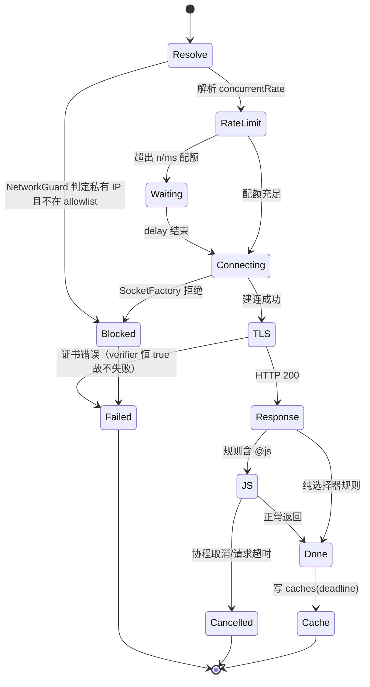
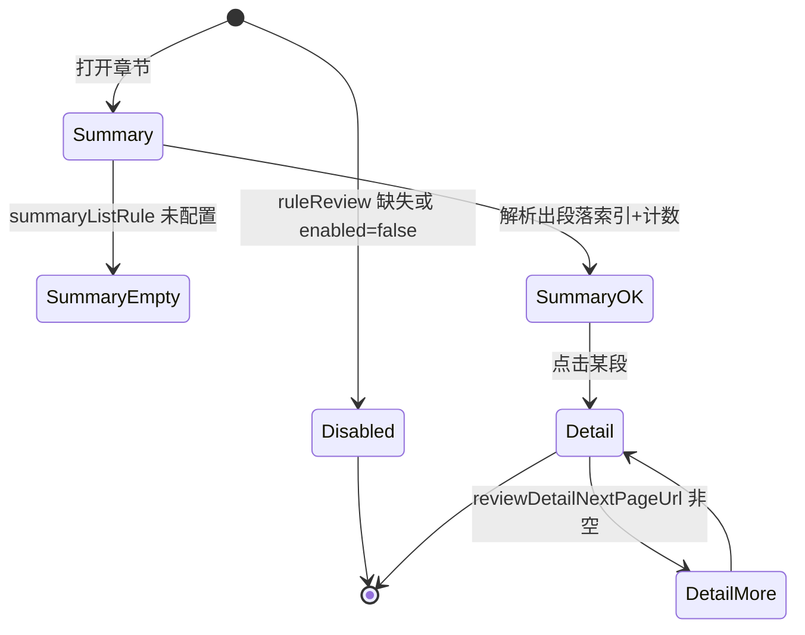

# kukume_legado-web 研究报告

> 仓库：`D:\YReader\references\kukume_legado-web` | 线上：https://github.com/kukume/legado-web
> 技术栈：Kotlin 2.4.21 / JVM 21 / Ktor 3.6.0（Netty，含 JWT、SSE、WebSockets、CORS、压缩）/ Exposed 1.5.1 + HikariCP 7.1 + SQLite（默认）/ PostgreSQL / bcrypt / Gson / OkHttp 5.5.0 / Jsoup 1.23.2 + JsoupXpath 2.5.5 + json-path 3.0.0 / Rhino（`org.htmlunit:htmlunit-core-js:5.3.0-legado.4`，自研封装 `com.script.rhino`）/ 前端 Vue 3.5 + TypeScript + Vite 8 + naive-ui 2.45 + Pinia 4 + PWA
> 代码规模：445 个文件；最大文件 `ShelfService.kt` 985 行、`AnalyzeRule.kt` 1,053 行、`AnalyzeUrl.kt` 1,050 行、`JsExtensions.kt` 1,353 行、`ReviewRuleParser.kt` 451 行、`Tables.kt` 289 行；`com/script/rhino/` 共 18 个文件（`RhinoScriptEngine.kt` 360、`RhinoContext.kt` 354、`RhinoClassShutter.kt` 222）
> 分析范围与方法：读 `server/build.gradle.kts`、`Application.kt`、`db/{Tables,DatabaseFactory,DbEngineStore}.kt`、`security/NetworkGuard.kt`、`com/script/rhino/*` 关键段、`app/model/analyzeRule/{AnalyzeRule,RuleAnalyzer,AnalyzeByJSoup,ReviewRuleParser}.kt`、`app/help/{ConcurrentRateLimiter,HttpHelper,HttpLogSanitizer,SSLHelper}.kt`、`data/entities/{BookSource,rule/ReviewRule}.kt`、`web/routes/*` 清单、`web/service/*` 清单、`web/package.json`。未覆盖：`ShelfService`/`SourceConfigService` 全量业务、`BrowserBridge`(637)/`RemoteBrowser`(693) 的 CDP 协议细节、`local/EpubParser`、i18n 资源。

## 0. 一句话结论

这是 6 个仓库里**工程完成度最高、最接近「我们想做的东西」的 JVM 版**：Ktor + Exposed + SQLite/PG 的正经 Web 后端、真正的 Rhino 沙箱（ClassShutter + 指令计数 + 解释模式）、**连接时校验真实 IP 的 SSRF 防护**、**真正实现 Legado `concurrentRate` 的限流器**、结构化 Cookie、Vue3 前端；它甚至把「书源 JSON 存一列、检索字段拆列」这件事做成了 `Tables.kt`。最大的坑是：**沙箱是黑名单而非白名单（作者自己承认不可能完美）**、**TLS 仍然全关**、**JS 没有逐规则超时（只有协程取消）**、`ShelfService` 985 行仍是上帝类。

## 1. 书源解析：规则类型与执行模型

### 1.1 支持的规则类型（逐项判定）

| 规则类型 | 判定 | 说明 | 证据 |
|---|---|---|---|
| CSS（默认） | 支持 | 与 Legado 同构，`SourceRule` 前缀识别 + Jsoup `select` | `AnalyzeByJSoup.kt:82`、`:206`、`:509` |
| `@css:` 显式 | 支持 | 大小写不敏感，剥前缀后仍走 Jsoup | `AnalyzeRule.kt:660` |
| `@@` 转义 | 支持 | 保留原始串 | `AnalyzeRule.kt:664` 附近 |
| `@XPath:` / `//` | 支持 | `AnalyzeByXPath` 与基线同构 | `AnalyzeRule.kt:670`；`AnalyzeByXPath.kt:55` |
| `@json:` / JSONPath / `$.` | 支持 | 三条入口（显式 `@Json:`、`$.`、内容本身是 JSON） | `AnalyzeRule.kt:675`；`AnalyzeByJSonPath.kt:36` |
| `##` 正则替换 | 支持 | 含 `replaceFirst` 第 4 段 | `AnalyzeRule.kt:594-604`（继承结构） |
| 纯正则（首字符 `:`） | 支持（仅 `getElement`） | 与基线一致 | `AnalyzeRule.kt:395-399`（继承） |
| `:regex` 后缀 | 不支持 | 全仓无 `:regex` 语法命中 | 未发现（已验证：`grep ":regex"`） |
| `||` / `&&` / `%%` | 支持 | `RuleAnalyzer` 逐字节沿用基线算法 | `RuleAnalyzer.kt:165`；`AnalyzeByJSoup.kt:82` |
| `@put:` / `@get:` / `{{ }}` | 支持 | 变量域仍是 chapter→book→ruleData 三级 | `AnalyzeRule.kt:851-886` |
| `@js:` / `<js>` | 支持 | 走自研 Rhino 封装，**编译结果有缓存（上限 16）** | `AnalyzeRule.kt:891-936` |
| `$n` 分组 / `!` 排除 / `[-1]` / `@href`/`@text`/`@html` | 支持 | 与基线同构 | `AnalyzeByJSoup.kt:509` 段 |
| Jsoup `:eq/:gt/:lt` | 部分支持 | 依赖 Jsoup 原生 | `AnalyzeByJSoup.kt` `temp.select(...)` |
| base64/AES/DES/3DES | 部分支持（仅 `java.*`） | 另新增 `java.md5Encode` 等编码工具 | `JsExtensions.kt:1353` 行函数清单 |
| **`ruleReview`（段评/本章说）** | **新增/部分支持** | 新增 `ReviewRule`（22 个字段）与 `ReviewRuleParser`；投票/发评/删评字段已声明但注释写明「以后实现」 | `ReviewRule.kt:7-38`（`:13` 注释）；`BookSource.kt:76` |
| **批量章节 JS 上下文** | **新增** | JS 里多出 `chapters`、`paraIndex`、`paraData`、`page`、`fromBookInfo` 等绑定 | `AnalyzeRule.kt:901-908` |

### 1.2 执行模型（关键）

1. **规则拆分仍沿用 Legado 手写扫描器**：`RuleAnalyzer.splitRule("&&","||","%%")`（`RuleAnalyzer.kt:165`），XPath/JSONPath/JSoup 三条路径统一调用，语义与基线完全一致——这意味着**用它的行为做兼容基准是安全的**。
2. **求值上下文新增「共享 JS 作用域」**：`evalJS` 先取 `source.getShareScope(coroutineContext)`，取不到再用 `topScopeRef`（弱引用），再取 `SharedJsScope.getCryptoScope(...)`，最后才新建标准顶层作用域（`AnalyzeRule.kt:910-926`）。**后果：同一书源内前一条规则用 `var` 声明的变量会泄漏到后一条规则**（Legado 语义），但跨书源通过 `sharedGlobalStateKey` 做了隔离。
3. **脚本编译缓存**：`scriptCache.getOrPutLimit(jsStr, 16)`（`AnalyzeRule.kt:933`）——最多缓存 16 个编译结果，超出即淘汰；这是「JS 规则热路径」的正确优化，但也意味着高基数规则串会反复编译。
4. **JS 沙箱（本仓库最有价值的部分）**：
   - 引擎：Rhino ES6 + **解释模式**（`cx.setInterpretedMode(true)`）+ 栈深 1000 + 指令观察阈值 10000（`RhinoScriptEngine.kt:290-295`）；
   - `cx.setClassShutter(RhinoClassShutter)`（`:292`），黑名单覆盖 `java.lang.Class/ClassLoader/Runtime/ProcessBuilder`、`java.io.*`、`java.nio.file.*`、`java.lang.reflect/invoke`、`java.sql`、`javax.script/naming`、`sun.*`、`com.sun.*`、hutool 反射工具、OkHttp/Okio 文件系统类，以及**服务端内部包** `io.legado.web`、`org.jetbrains.exposed`、`com.zaxxer`、`io.ktor`、`io.netty`（`RhinoClassShutter.kt:50-145`）；
   - **作者明确写了这是黑名单**：「这是黑名单，不可能做到完美……长期更稳妥的做法是改为白名单」（`RhinoClassShutter.kt:44-46`）；
   - 入口守卫：`doTopCall` 先 `ensureScriptRunAllowed(cx)`，未授权路径直接 `error("Not allow run script in unauthorized way.")`（`RhinoScriptEngine.kt:349-356`）；
   - 中断：`observeInstructionCount` 每 10000 条指令调 `cx.ensureActive()`（`:314-317`），配合协程取消实现「可中断」。
5. **JS 没有「逐规则墙钟超时」**：`evalJS` 本身没有 `withTimeout`（`AnalyzeRule.kt:891-929`），只有 `reGetBook`/`refreshBookUrl` 这类外层动作有 `withTimeout(1800000)`（`:988`、`:1014`）。真正兜底的是 HTTP 层的 `callTimeout(60s)`（`HttpHelper.kt:64`）与 Ktor 请求取消。
6. **网络层**：
   - OkHttp：`connect 15s / write 15s / read 60s / callTimeout 60s`、`retryOnConnectionFailure(true)`、`followRedirects(true)`（`HttpHelper.kt:61-69`）；
   - **仍使用 `unsafeSSLSocketFactory` + `unsafeHostnameVerifier`**（`:65`、`:67`），与两个 Legado 分支同样的问题；
   - **SSRF 防护是本仓库最强项**：`NetworkGuard` 在 `SocketFactory` 建立 TCP 连接时校验**真实 IP**（`NetworkGuard.kt:12-19` 注释，`:131-134` 的 `check`），因此域名解析到内网、IP 直连、302 跳内网、urlOption 的 `dns`、HTTP 代理都能拦住；支持管理员配置 allowlist（`nas.lan`、`*.lan`、`192.168.1.0/24`，`:60-78`）；私网判定覆盖 loopback/link-local/site-local/multicast + `100.64/10`、`198.18/15`、`192.0.0/24`、`240/4`、IPv6 `fc00::/7` 与 IPv4-mapped（`:100-119`）；
   - **日志脱敏**：`HttpLogSanitizer` 对 `authorization/cookie/set-cookie/password/token/api-key/sign` 做 header/query/JSON/Bearer 四类脱敏（`HttpLogSanitizer.kt:15-40`）。
7. **限流（真正实现了 Legado 语义）**：`ConcurrentRateLimiter` 解析 `"n/ms"` 与纯数字两种写法（`ConcurrentRateLimiter.kt:56-70`），`AnalyzeUrl` 在两次请求路径上 `withLimit { ... }`（`AnalyzeUrl.kt:458`、`:586`），记录写入 `concurrentRecordMap` 并按时长 `delay`（`ConcurrentRateLimiter.kt:108`）。

### 1.3 规则边界与失败语义

| 场景 | 行为 | 证据 |
|---|---|---|
| 书源请求超时 | Ktor 层把 `TimeoutCancellationException` 映射为 **504 + "书源响应超时"** | `Application.kt:225` |
| 搜索某源超时 | `SearchService` 捕获后把该源结果标记为「超时」，不影响其他源 | `SearchService.kt:88-89` |
| 书源检测超时 | `SourceCheckService` 单独捕获超时并记失败 | `SourceCheckService.kt:113` |
| 浏览器渲染 | CDP 驱动，页面级 `withTimeout(60_000)`，网络空闲等待 30s，打开 10s | `CdpWebViewProvider.kt:122,242,246,338,358` |
| 内网地址 | 抛 `BlockedException("已阻止访问内网地址 ...，可以请管理员在系统设置中允许")` | `NetworkGuard.kt:24-25,131-134` |
| JS 无限循环 | 只能靠协程取消（指令观察）中断，**无独立墙钟超时** | `RhinoScriptEngine.kt:314`；`AnalyzeRule.kt:891-929` |
| 规则未命中 | 返回空串/空列表，不抛错 | `AnalyzeByJSoup.kt:82-120`（同基线） |
| 规则调试台 | 有：`RuleRoutes.kt`(69 行) 字典/目录规则 CRUD + `ReviewService`，但**没有基线那种逐级 trace 端点** | `routes/RuleRoutes.kt` |
| 段评未配置 | `configuredSummaryUrl()` 在 `enabled=false` 或缺少必要规则时返回 `null`，直接跳过 | `ReviewRule.kt:41-48` |

## 2. 数据模型

### 2.1 表结构（Exposed `Tables.kt`）

| 表 | 关键列 | 说明 |
|---|---|---|
| `users` | `username varchar(64) unique`、`password_hash varchar(128)`、`role`、`enabled`、`invited_by`、`token_version`、`can_add_source`、`created_at/last_login_at` | 有 `token_version` 支持「改密即失效 JWT」 |
| `invites` / `invite_uses` | `code unique`、`max_uses`、`used_count`、`expires_at`、`invite_id/user_id` | 邀请制注册 |
| `settings` | `key`、`value text` | 系统设置 |
| `book_sources` | `owner_id`、`url varchar(1024)`、`name`、`group_name`、`type`、`enabled`、`enabled_explore`、`has_explore`、`has_login`、`custom_order`、`weight`、`respond_time`、`is_public`、`comment`、**`json text`**、`last_update_time` | **「检索列 + 整段 JSON」混合模型**，注释明确「完整的书源 JSON 保存在 json 字段，其余字段用于列表查询」 |
| `user_book_sources` | `user_id`、`source_id`、`enabled` | 用户与书源多对多 |
| `subscriptions` | `owner_id`、`name`、`url varchar(2048)`、`auto_update`、`last_update_at`、`last_result` | 订阅源 |
| `caches` | `user_id`、`cache_key varchar(512)`、`value text`、`deadline` | **带 TTL 的持久缓存**（不是纯内存） |
| `cookies` | `user_id`、`domain`、`cookie text` | 按用户+域 |
| `bookmarks` / `reading_stats` / `replace_rules` / `dict_rules` / `toc_rules` / `api_keys` | `user_id` + 业务列 | 见 `Tables.kt` 后续段 |

### 2.2 书源持久化形态

- **`json text` 存整段书源 + 冗余检索列**（`Tables.kt:44-61`）。这是 6 个仓库里唯一把「JSONB 思路」落到关系库的实现，也是我们 Stage 2 的直接对照：我们要把 `json text` 换成 `JSONB` 并建 GIN 索引，把 `url/name/group_name/enabled/weight/respond_time` 保留为普通列。
- 迁移：`DatabaseFactory` + `DbEngineStore` 支持 SQLite/PG 切换（`DatabaseFactory.kt` 68 行、`DbEngineStore.kt` 133 行）；未见 schema 版本表/迁移脚本框架（Exposed `SchemaUtils` 建表为主），**升级兼容靠 `createMissingTablesAndColumns` 类逻辑，不可逆**。
- 约束：`username`/`invite.code` 有唯一索引，`owner_id`/`source_id`/`user_id` 有普通索引；外键级联删除未见显式声明（Exposed 默认不建 FK）。

### 2.3 与 Legado 书源 JSON 的字段映射

与基线一致的 26 个 `rule*` 键（见 `changshengyu_reader-dev.md` §2.3）全部被 `BookSource` 承载（`BookSource.kt` 内 `ruleSearch/ruleExplore/ruleBookInfo/ruleToc/ruleContent`），并**新增 `ruleReview`**（`BookSource.kt:76`）：

| 新增字段 | 语义 | 证据 |
|---|---|---|
| `ruleReview.reviewUrl` | 段评列表页 URL | `ReviewRule.kt:7` |
| `ruleReview.avatarRule/contentRule/postTimeRule` | 段评条目解析 | `ReviewRule.kt:8-10` |
| `ruleReview.reviewQuoteUrl` | 段评回复页 | `ReviewRule.kt:11` |
| `ruleReview.reviewSummaryUrl/summaryListRule/summaryParagraphIndexRule/summaryCountRule` | 章末段评摘要 | `ReviewRule.kt:20-24` |
| `ruleReview.reviewDetailUrl/reviewDetailNextPageUrl/detailListRule/...` | 段评详情分页 | `ReviewRule.kt:25-32` |

> 结论：**`ruleReview` 是 Legado 生态的扩展键**，我们的 `book_sources.rules JSONB` 应允许未知键透传（forward-compatible），而不是白名单校验——否则会丢掉这类扩展。

## 3. 状态机

### 3.1 书源请求与限流状态

证据：`NetworkGuard.kt:131`；`ConcurrentRateLimiter.kt:56-108`；`HttpHelper.kt:61-69`；`AnalyzeRule.kt:891`；`Tables.kt:91-94`。

### 3.2 段评状态（新增）

证据：`ReviewRule.kt:41-48`（未配置直接返回 `null`）；`ReviewRuleParser`（451 行）负责摘要/详情/回复三层解析；`web/service/ReviewService.kt`(186 行) 提供 API。

### 3.3 书籍生命周期 / 缓存 / 并发

- 书籍：`Book` 实体沿用 Legado（`durChapterIndex/durChapterPos`），书架由 `ShelfService`(985 行) 管理，含阅读统计 `reading_stats`。
- 缓存：`caches` 表带 `deadline`（毫秒时间戳，0 表示不过期），由 `CacheManager.kt`(132 行) 统一读写；**这是 6 个仓库里唯一「缓存有 TTL 且可持久化」的实现**。
- 并发：书源级 `ConcurrentRateLimiter`（进程内 `concurrentRecordMap`）；`SourceLock`(100 行) 做同类任务互斥；`MiscExtensions.kt:48` 提供 `Semaphore(concurrency)` 包装。
- 多端：JWT + `token_version` 支持强制下线（`Tables.kt:15`）；进度通过 `ProgressEvents`(71 行) + SSE 推送。

## 4. 已知架构缺陷

| 严重度 | 缺陷 | 影响 | 证据 | 根因 |
|---|---|---|---|---|
| P0 | JS 沙箱是**黑名单** | 任一漏网的 JDK/依赖类（文件、反射、线程、网络）都可绕过；作者自认不可能完美 | `RhinoClassShutter.kt:44-46`、`:50-145` | 为了兼容真实书源的 `importClass` 用法，选择了黑名单 |
| P0 | TLS 校验仍全关 | 所有书源请求可被中间人；`Secure` Cookie 语义被削弱 | `HttpHelper.kt:65,67`；`SSLHelper.kt:25-62` | 直接继承 Legado 的「不安全 SSL 工具类」 |
| P0 | JS 无独立墙钟超时 | 恶意/死循环脚本只能等协程取消；若调用方没设超时则永久占用线程 | `AnalyzeRule.kt:891-929`（无 `withTimeout`）；仅 `:988`/`:1014` 有 | 把「可中断」误当成「有超时」 |
| P1 | `ShelfService` 985 行 + `AnalyzeRule` 1,053 行 | 书架/进度/导入导出/统计全部耦合；规则类承担了批量章节、段评、变量域 | `ShelfService.kt`(985)、`AnalyzeRule.kt`(1,053) | 从 Android 单机代码直接移植，未按 Web 分层重构 |
| P1 | 共享 JS 作用域导致跨规则变量泄漏 | 前一条规则的 `var` 可能被后一条规则误读，行为难复现 | `AnalyzeRule.kt:910-926` | 为兼容 Legado 的脚本惯用法，主动共享 `TopLevel` |
| P1 | 脚本缓存上限 16，超出反复编译 | 规则串基数大的书源会反复编译 JS，CPU 抖动 | `AnalyzeRule.kt:933` | 常量硬编码，无按书源/全局大小限制 |
| P1 | `ruleReview` 只实现只读解析 | 点赞/发评/删除字段已声明但未实现，前端可能暴露入口 | `ReviewRule.kt:13-18`（注释「以后实现」） | 先做「能看」，交互后置 |
| P2 | 无迁移框架 | 升级只能靠 Exposed 自动补列，回滚不可逆；SQLite→PG 迁移靠手工 | `DatabaseFactory.kt`、`DbEngineStore.kt` | 以 `SchemaUtils` 建表代替版本化迁移 |
| P2 | 段评/评论走独立 Service + Parser | 与正文解析两套规则求值路径，行为可能漂移 | `ReviewRuleParser.kt`(451) vs `AnalyzeRule.kt` | 段评协议复杂，单独实现更快 |
| P2 | CDP 浏览器常驻连接 | 容器需带 Chromium/Chrome，内存与稳定性成本高 | `CdpWebViewProvider.kt:122,338`；`RemoteBrowser.kt`(693) | 用真浏览器解决反爬 |
| P2 | `HttpLogSanitizer` 只覆盖日志 | 错误信息、调试台返回体仍可能带 Cookie/Token | `HttpLogSanitizer.kt:15-40` | 脱敏只在 OkHttp 日志拦截器层做 |

## 5. 对我们的启示

### 可借鉴

1. **`NetworkGuard` 的「连接时校验真实 IP」**：`SocketFactory` 层 `check(host, addr)`（`NetworkGuard.kt:131`）比「请求前解析域名」强，天然覆盖 DNS rebinding/302/代理。落地：Go 侧 `DialContext` 里对 `net.Conn` 的 `RemoteAddr()` 做同样的私网判定 + allowlist（`*` 通配/`CIDR`）。
2. **allowlist 的语法设计**：`nas.lan`、`*.lan`、`192.168.1.0/24`（`NetworkGuard.kt:60`）——自托管用户必然要访问 NAS，直接封死不可行。落地：`settings.network.allowlist` 文本配置 + 启动时解析缓存。
3. **`concurrentRate` 真正落地**：`"n/ms"` 与纯数字两种语义（`ConcurrentRateLimiter.kt:56-70`）。落地：Redis 令牌桶，key=`source:{id}`，`n/ms` 映射为 `rate=n/ms`，纯数字映射为并发上限（用 `errgroup.SetLimit`）。
4. **`caches` 表带 `deadline`**：把缓存 TTL 持久化（`Tables.kt:91-94`），进程重启不丢。落地：Redis 为主 + PG `cache_entries(key, value, deadline)` 兜底冷启动。
5. **`HttpLogSanitizer` 的四类脱敏**（header/query/JSON/Bearer，`HttpLogSanitizer.kt:15-40`）。落地：Go 的 `httputil.DumpRequest` 包装 + 同一套敏感键表，调试台默认脱敏、显式「查看原文」需二次确认。
6. **`RhinoClassShutter` 的黑名单条目本身**（`:50-145`）可作为我们写「禁止清单」的威胁建模清单：文件、进程、反射、线程池、SQL、脚本引擎、日志框架、内部包——即便 goja 不用 ClassShutter，我们的 `java.*` 桥接也要按这份清单做「不实现」决策。

### 必须避免

1. **不要用黑名单做沙箱**：`RhinoClassShutter.kt:44-46` 已自证。替代：goja 只注入显式白名单函数（`ajax/get/post/getCookie/base64/md5/aes`），**不暴露任何 Java/Go 对象反射入口**。
2. **不要关闭 TLS 校验**：`HttpHelper.kt:65`。替代：标准 TLS + 可选「用户导入 CA」。
3. **不要把「可中断」当「有超时」**：`AnalyzeRule.kt:891`。替代：`context.WithTimeout(3s)` 包裹每次 `vm.Run`，并用 `goja.Interrupt` 兜底。
4. **不要共享 JS 全局作用域**：`AnalyzeRule.kt:910-926` 的泄漏是兼容性妥协。替代：每个 `EvalStep` 用隔离的 `goja.Runtime`（或至少每次 `RunString` 前 clone 全局），变量只通过显式 `put/get` 传递。
5. **不要把所有书架逻辑塞一个 Service**：`ShelfService.kt` 985 行。替代：`service/shelf`、`service/progress`、`service/import` 分包。
6. **不要用 `SchemaUtils` 自动补列当迁移**：不可逆。替代：`golang-migrate` 版本化 SQL，每个迁移可回滚。

### 对 Stage 2 契约的具体约束建议

- `schema.sql`：直接对标 `Tables.kt`——`book_sources(id, owner_id, url, name, group_name, type, enabled, weight, respond_time, rules JSONB, created_at, updated_at)`，`rules` 建 GIN；`caches(user_id, cache_key, value, deadline)`；`cookies(user_id, domain, cookie)`；`users` 增加 `token_version` 支持强制下线。
- `openapi.yaml`：错误码必须区分 `504 书源超时`（学 `Application.kt:225`）与 `403 内网地址被阻止`（学 `NetworkGuard.kt:24`），不要在 handler 里笼统 500。
- 沙箱契约：白名单 API + 3s 超时 + 指令/内存上限；`concurrentRate` 必须在 fetcher 内强制执行，不能只声明。

## 6. 证据索引

| 文件:行号 | 结论 | 原文短引用（≤2 行） |
|---|---|---|
| `server/build.gradle.kts:25` | Ktor 3.6 后端 | `val ktorVersion = "3.6.0"` |
| `server/build.gradle.kts:37` | Exposed ORM | `implementation("org.jetbrains.exposed:exposed-core:$exposedVersion")` |
| `server/build.gradle.kts:40` | 同时支持 SQLite 与 PostgreSQL | `implementation("org.postgresql:postgresql:42.7.14")` |
| `server/src/main/kotlin/io/legado/web/Application.kt:225` | 书源超时映射为 504 | `is TimeoutCancellationException -> HttpStatusCode.GatewayTimeout to "书源响应超时"` |
| `.../com/script/rhino/RhinoScriptEngine.kt:291` | Rhino 解释模式 | `cx.setInterpretedMode(true)` |
| `.../com/script/rhino/RhinoScriptEngine.kt:292` | 安装 ClassShutter | `cx.setClassShutter(RhinoClassShutter)` |
| `.../com/script/rhino/RhinoScriptEngine.kt:294` | 指令观察阈值 | `cx.instructionObserverThreshold = 10000` |
| `.../com/script/rhino/RhinoScriptEngine.kt:314` | 每 10000 指令检查协程活性 | `override fun observeInstructionCount(cx: Context, instructionCount: Int) {` |
| `.../com/script/rhino/RhinoScriptEngine.kt:351` | 拒绝非授权入口执行脚本 | `error("Not allow run script in unauthorized way.")` |
| `.../com/script/rhino/RhinoClassShutter.kt:48` | 黑名单式 ClassShutter | `object RhinoClassShutter : ClassShutter {` |
| `.../com/script/rhino/RhinoClassShutter.kt:44` | 作者承认黑名单不完美 | `注意：这是黑名单，不可能做到完美` |
| `.../com/script/rhino/RhinoClassShutter.kt:134` | 屏蔽服务端内部包 | `"io.legado.web",` |
| `.../security/NetworkGuard.kt:131` | 连接时校验真实 IP | `fun check(host: String?, addr: InetAddress) {` |
| `.../security/NetworkGuard.kt:102` | 私网地址判定 | `if (addr.isLoopbackAddress \|\| addr.isAnyLocalAddress \|\| addr.isLinkLocalAddress \|\|` |
| `.../security/NetworkGuard.kt:60` | allowlist 支持主机/通配/CIDR | `允许列表：主机名（nas.lan）、通配（*.lan）、IP（192.168.1.10）、网段（192.168.1.0/24、fd00::/8）` |
| `.../app/help/http/HttpHelper.kt:64` | 总超时 60s | `.callTimeout(60, TimeUnit.SECONDS)` |
| `.../app/help/http/HttpHelper.kt:65` | 仍使用不安全 TLS | `.sslSocketFactory(SSLHelper.unsafeSSLSocketFactory, SSLHelper.unsafeTrustManager)` |
| `.../app/help/http/HttpLogSanitizer.kt:15` | 日志敏感键清单 | `private val sensitiveNames = setOf(` |
| `.../app/help/ConcurrentRateLimiter.kt:56` | `concurrentRate` 为 0/空则不限制 | `if (concurrentRate.isNullOrEmpty() \|\| concurrentRate == "0") {` |
| `.../app/help/ConcurrentRateLimiter.kt:63` | 解析 `n/ms` 语法 | `val rateIndex = concurrentRate.indexOf("/")` |
| `.../app/model/analyzeRule/AnalyzeUrl.kt:458` | 请求走限流器 | `concurrentRateLimiter.withLimit {` |
| `.../app/model/analyzeRule/AnalyzeRule.kt:891` | `evalJS` 无墙钟超时 | `fun evalJS(jsStr: String, result: Any? = null): Any? {` |
| `.../app/model/analyzeRule/AnalyzeRule.kt:910` | JS 共享作用域（跨规则变量泄漏） | `val sharedGlobalStateKey = source?.getSharedGlobalStateKey()` |
| `.../app/model/analyzeRule/AnalyzeRule.kt:933` | 脚本编译缓存上限 16 | `return scriptCache.getOrPutLimit(jsStr, 16) {` |
| `.../app/model/analyzeRule/AnalyzeRule.kt:901` | 新增批量章节绑定 | `bindings["chapters"] = batchContext?.chapters` |
| `.../app/data/entities/rule/ReviewRule.kt:7` | 新增段评规则 | `var reviewUrl: String? = null,          // 段评URL` |
| `.../app/data/entities/rule/ReviewRule.kt:13` | 互动能力仅声明未实现 | `// 这些功能将在以上功能完成以后实现` |
| `.../app/data/entities/BookSource.kt:76` | 书源挂载 `ruleReview` | `var ruleReview: ReviewRule? = null,` |
| `.../web/db/Tables.kt:44` | 书源整段 JSON 存一列 | `书源。完整的书源 JSON 保存在 json 字段，其余字段用于列表查询` |
| `.../web/db/Tables.kt:61` | 书源 JSON 列名 | `val json = text("json")` |
| `.../web/db/Tables.kt:94` | 缓存表带 deadline | `val deadline = long("deadline").default(0)` |
| `.../web/db/Tables.kt:15` | 用户 token 版本（强制下线） | `val tokenVersion = integer("token_version").default(0)` |
| `.../web/webview/CdpWebViewProvider.kt:122` | 浏览器渲染页级超时 60s | `withTimeout(60_000) { runPage(conn, sessionId, request) }` |
| `.../web/service/ShelfService.kt` | 书架服务 985 行 | `ShelfService.kt 985` |

## 7. 关键路径文件地图（Stage 2 取证入口）

| 关注点 | 文件（相对仓库根） | 行数 | 用途 |
|---|---|---|---|
| 服务入口/错误映射 | `server/src/main/kotlin/io/legado/web/Application.kt` | 316 | 插件安装、`TimeoutCancellationException`→504 |
| 规则入口 | `.../io/legado/app/model/analyzeRule/AnalyzeRule.kt` | 1,053 | 模式判定、变量域、JS 求值 |
| 组合切分 | `.../analyzeRule/RuleAnalyzer.kt` | 381 | 与基线同构 |
| CSS/XPath/JSONPath | `.../analyzeRule/{AnalyzeByJSoup,AnalyzeByXPath,AnalyzeByJSonPath}.kt` | 517/?/? | 三条取值路径 |
| 段评 | `.../analyzeRule/ReviewRuleParser.kt` | 451 | 摘要/详情/回复三层 |
| URL/限流 | `.../analyzeRule/AnalyzeUrl.kt` | 1,050 | urlOption、`withLimit` |
| 限流器 | `.../help/ConcurrentRateLimiter.kt` | 133 | `concurrentRate` 解析与等待 |
| JS 引擎 | `.../com/script/rhino/RhinoScriptEngine.kt` | 360 | 解释模式、指令观察、入口守卫 |
| 类白/黑名单 | `.../com/script/rhino/RhinoClassShutter.kt` | 222 | 屏蔽文件/反射/线程/内部包 |
| SSRF | `.../io/legado/web/security/NetworkGuard.kt` | 186 | 连接时 IP 校验 + allowlist |
| 日志脱敏 | `.../help/http/HttpLogSanitizer.kt` | 144 | header/query/JSON/Bearer |
| 表结构 | `.../io/legado/web/db/Tables.kt` | 289 | 列 + `json` text |
| 浏览器 | `.../web/webview/{CdpWebViewProvider,RemoteBrowser}.kt` | 372/693 | CDP 渲染 |
| 书架业务 | `.../web/service/ShelfService.kt` | 985 | 书架/进度/统计 |
| 前端 | `web/package.json` | 40 | Vue 3.5 + naive-ui |

## 8. 缺陷验证方法（Stage 5 可直接复用）

| 缺陷 | 验证方式 | 期望的「反例」观察 |
|---|---|---|
| 黑名单绕过 | 书源 JS 里 `importClass(java.nio.file.Files)` 或 `java.lang.System.exit(0)` | 取决于是否漏网；用其黑名单未覆盖的类做系统性 fuzz |
| JS 无墙钟超时 | `@js:while(true){}`，且不设上层 HTTP 超时 | 协程不取消则永久运行 |
| TLS 关闭 | 自签证书站点 | 请求成功 |
| `concurrentRate` 正确性 | 设 `2/1000`，并发 10 请求 | 每 1s 最多 2 个进入（用其契约测试可验证） |
| 内网 allowlist | 设 allowlist 为空 + 请求 `http://127.0.0.1` | 抛 `BlockedException` |
| 缓存 TTL | 写 `caches` 表 `deadline=now-1`，再读 | 应视为过期（若未过期即为 bug） |
| `ShelfService` 回归 | 并发保存同一本书进度 | 观察是否 last-write-wins |

## 9. 对 Stage 2 的开放问题

1. 白名单式 goja 沙箱需要枚举真实书源常用 API，是否先做「Top 50 书源采样」再定白名单？
2. `NetworkGuard` 的 allowlist 是否允许普通用户配置？还是仅管理员（安全 vs 自托管可用性）？
3. `cache` 表 TTL 语义（0=永不过期）是否照搬？我们 Redis 的 `deadline` 与 PG 兜底如何一致？
4. `concurrentRate` 是「每书源」还是「每域名」？其 `sourceKey` 用的是 source URL，我们是否应按域名聚合？
5. `ReviewRule` 的 22 个字段哪些进 MVP？投票/发评/删评是否明确不做？
6. JWT + `token_version` 的「踢下线」是否纳入 MVP（多端登录治理）？
