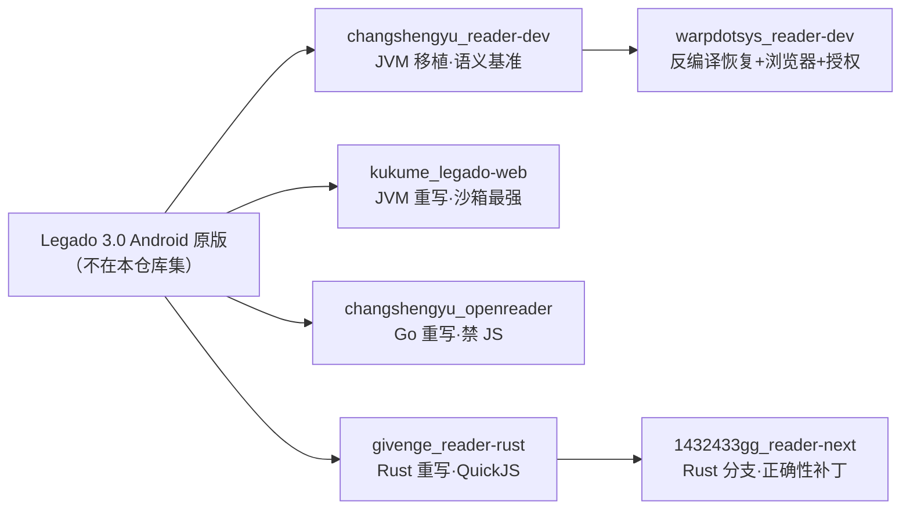

# Stage 1 汇总：6 个参考仓库的跨仓库对比与结论

> 产出：本文件 + 6 份单仓库报告（`docs/research/<repo-name>.md`），均为 Stage 1（研究）交付物。
> 方法：REA 逐仓库读取 + grep 证据定位；对 `warpdotsys_reader-dev` / `1432433gg_reader-next` 分别以 `changshengyu_reader-dev` / `givenge_reader-rust` 为基线做**文件哈希 + 行级差分**，确保「增量」而非重复叙述。所有结论可回溯到 `文件:行号`，单仓报告各含 ≥20 条证据索引。

## 0. 先纠正一个前提

任务书把 `changshengyu_reader-dev` 描述为「Java/Kotlin 的 Android Legado 分支」。**代码证据显示它不是 Android 工程**：`build.gradle.kts` 使用 `org.springframework.boot` 2.1.6 + `application` + `org.openjfx.javafxplugin`（无 Android Gradle Plugin），入口是 `ReaderApplication.kt:69`（Spring Boot + Vert.x）与 `ReaderUIApplication.kt:392`（JavaFX WebView）；`@Entity`/`@PrimaryKey`/Room 注解**全部被注释**（`BookSource.kt:23-26`、`Bookmark.kt:7`、`Cache.kt:3`），`appDb` 只存在于注释（`CacheManager.kt:25,31`），`src/main/java/io/legado/app/` 下没有 `ui` 包与 `App.kt`。它是**把 Legado 内核抽出来接到 JVM 外壳（Spring Boot + Vert.x + JavaFX + Vue2）上的移植工程**，存储退化为 `storage/data/<ns>/*.json`。

这一纠正直接影响结论：6 个仓库里**没有一个是真正的 Android 原生 App**，全部是「Web/桌面服务端 + 浏览器前端」形态；因此「Legado 书源语义」在 6 个仓库里都是**被移植/重写**的对象，而不是「原版参照」。

### 0.1 结论速览（给决策者）

- **要语义基准**：看 `changshengyu_reader-dev`（最纯的 Legado 规则语义，无商业扩展、反编译风险最低的一组）。
- **要安全基准**：看 `changshengyu_openreader`（SSRF/错误语义/契约测试最强）+ `kukume_legado-web`（唯一可用的 JS 沙箱）。
- **要数据模型基准**：看 `kukume_legado-web` 的 `Tables.kt`（列 + `json` text）与 `changshengyu_openreader` 的 `models.go`（列 + `rules` text + 迁移表）。
- **要「多端正确性」补丁**：看 `1432433gg_reader-next`（进度合并、目录去重、封面保护）。
- **要反例/威胁清单**：看 `warpdotsys_reader-dev` 的浏览器策略（可学思路）与其反编译来源（必须回避）。
- **总原则**：我们做「三者合一」——`changshengyu_reader-dev` 的语义 + `openreader` 的安全/错误语义 + `kukume` 的存储/沙箱工程化，全部用 Go/Vue3/PG 重写。

## 1. 六仓库定位矩阵| 仓库 | 语言/运行时 | 形态 | 前端 | 存储 | 能跑真 Legado 书源？ | 规则覆盖率（0–5） | 评分依据 |
|---|---|---|---|---|---|---|---|
| `changshengyu_reader-dev` | Kotlin 1.5.21 + Java 11 / Spring Boot 2.1.6 + Vert.x 3.8.1 + JavaFX 11 | JVM 桌面/服务端（同一内核两种外壳） | Vue 2.6 + Element UI 2.15 | `storage/data/<ns>/*.json` 单文件（`VertExt.kt:128-156`） | **能**：CSS/XPath/JSONPath/正则/`||`/`&&`/`%%`/`##`/`@put`/`@get`/`{{}}`/`@js` 全支持；Rhino 真跑 | **5** | 语义最完整、5 组 `rule*` 全实现、26 个字段一一对应；扣分项：打包 jar 内的 Rhino fork 只有黑名单 `ClassShutter`、无指令计数与超时（`javap` 已审计） |
| `warpdotsys_reader-dev` | 同上 + Camoufox(Python) + Guava + SQLite(license) | 同上 + 内置浏览器 + 独立授权服务 | Vue 3.5 + Element Plus（同时保留 Vue2） | 同上，但写入改为「锁 + 临时文件 + ATOMIC_MOVE + backup」（`VertExt.kt:157-196`） | **能，且更适合反爬**：浏览器渲染路径可跑 `webJs` | **5** | 继承全部语义 + `loginUi`/`enabledCookieJar`/`ruleReview`/`jsLib` 扩展；扣分项是**来源为反编译商业 JAR** |
| `kukume_legado-web` | Kotlin 2.4.21 / JVM 21 / Ktor 3.6 + Exposed 1.5 | JVM Web 服务（Netty） | Vue 3.5 + naive-ui + PWA | SQLite/PostgreSQL（Exposed）+ Hikari；书源=列+`json` text | **能**：语义最完整 + 真沙箱 + 限流 + SSRF | **5** | 唯一同时具备「完整规则语义 + 带指令计数的 JS 沙箱 + 连接级 SSRF + `concurrentRate` 落地 + 迁移表」的实现 |
| `changshengyu_openreader` | Go 1.26 | Go Web（Gin） | Vue 3.5 + Element Plus | SQLite（cgo，GORM）+ 迁移表 | **不能全覆盖**：`@js`/`<js>`/`webJs`/`{{}}` 一律 `ErrUnsupportedSourceRule` | **3** | 选择器/JSONPath/正则/组合/`@put`/`$n` 都正确，但**所有依赖脚本的书源直接失效**；SSRF 与错误语义最强 |
| `givenge_reader-rust` | Rust / Axum 0.7 + sqlx | Rust Web 服务 | Vue 3.5（`frontend/`）+ 旧 Vue2（`web/`） | SQLite（3 个迁移）+ 文件缓存 | **部分能**：有 QuickJS 可跑 `@js`，但缺 `!`/索引语法、`java.*` 子集小、无 SSRF/超时 | **3.5** | 规则主路径齐全（含 `%%`/`@put`/`@get`/`jsLib`），缺 JS 资源配额与部分 Legado 索引语法 |
| `1432433gg_reader-next` | Rust（reader-next 1.1.6） | Rust Web 服务 | Vue 3.5 + VitePress 文档站 | 同 reader-rust（**无新增迁移**） | **部分能**：同 reader-rust + 目录去重/最新章节清洗/进度合并/PDF/MOBI | **3.5** | 解析语义与 reader-rust 同源；增量集中在「数据正确性」而非「规则覆盖」 |

### 1.1 一张图看清「谁是什么」

### 1.2 逐仓库取舍（一句话）

- `changshengyu_reader-dev`：**当语义字典用**，不当代码模板用；它的存储层与安全层是反面教材。
- `warpdotsys_reader-dev`：**当浏览器兜底与 Cookie 建模的案例用**；代码不可借鉴（反编译来源），只读行为。
- `kukume_legado-web`：**当「Go 版要长成什么样」的 JVM 预演**；沙箱/SSRF/限流/表结构都可平移，但黑名单要换白名单。
- `changshengyu_openreader`：**当安全与错误语义的验收标准**；不要学它「禁 JS」的取舍。
- `givenge_reader-rust`：**当 API 兼容层与线性正则的参考**；不要学它的上帝文件与无配额 JS。
- `1432433gg_reader-next`：**当数据正确性补丁清单**；不要学它把补丁继续堆进 `book_service.rs`。

### 1.3 评分口径与置信度

| 维度 | 权重 | 说明 |
|---|---|---|
| 规则语义完整度 | 50% | CSS/XPath/JSONPath/正则/组合/`@put`/`@get`/`{{}}`/`@js`/索引语法 是否齐全 |
| 真实书源可运行性 | 30% | 是否真跑 JS、是否有浏览器兜底、是否支持 `jsLib`/登录 |
| 工程可移植性 | 20% | 是否有清晰的数据模型/错误语义/测试，便于我们「按规格重写」 |

> 置信度：高（代码级证据）；限制：**未做真实书源回归**（Stage 1 禁止运行参考仓库），评分是「能力矩阵」而非「实测通过率」。

## 2. 规则类型覆盖对比（行=规则类型，列=6 仓库）

> 单元格取值：**支持 / 部分 / 不支持**。判定均来自各仓库代码（详见单仓报告 §1.1）。

| 规则类型 | changshengyu_reader-dev | warpdotsys_reader-dev | kukume_legado-web | changshengyu_openreader | givenge_reader-rust | 1432433gg_reader-next |
|---|---|---|---|---|---|---|
| CSS（默认） | 支持 | 支持 | 支持 | 支持 | 支持 | 支持 |
| `@css:` 显式 | 支持 | 支持 | 支持 | 支持 | 支持 | 支持 |
| `@@` 转义 | 支持 | 支持 | 支持 | 部分 | 支持 | 支持 |
| `@XPath:` / `//` | 支持 | 支持 | 支持 | 支持 | 支持 | 支持 |
| `@json:` / JSONPath | 支持 | 支持 | 支持 | 支持 | 支持 | 支持 |
| `##` 正则替换（含 `##first`） | 支持 | 支持 | 支持 | 支持 | 支持 | 支持 |
| 纯正则（`:` 前缀） | 支持 | 支持 | 支持 | 支持 | 支持 | 支持 |
| `@regex:` 显式 | 不支持 | 不支持 | 不支持 | 不支持 | **支持** | **支持** |
| `:regex` 后缀 | 不支持 | 不支持 | 不支持 | 不支持 | 不支持 | 不支持 |
| `||` 或 | 支持 | 支持 | 支持 | 支持 | 支持 | 支持 |
| `&&` 与 | 支持 | 支持 | 支持 | 支持 | 支持 | 支持 |
| `%%` 交错 | 支持 | 支持 | 支持 | 支持 | 支持 | 支持 |
| `@put:` | 支持 | 支持 | 支持 | 支持 | 支持 | 支持 |
| `@get:` | 支持 | 支持 | 支持 | 支持 | 支持 | 支持 |
| `{{ }}` 插值 | 支持 | 支持 | 支持 | **不支持** | 支持 | 支持 |
| `@js:` / `<js>` | 支持 | 支持 | 支持 | **不支持** | 支持 | 支持 |
| `jsLib` | 不支持 | 支持 | 不支持 | 不支持 | 支持 | 支持 |
| `$n` 捕获 | 支持 | 支持 | 支持 | 支持 | 支持 | 支持 |
| `!` 排除 / `[-1]` / 区间 | 支持 | 支持 | 支持 | 不支持 | 不支持 | 不支持 |
| `@href/@text/@html/@textNodes/@ownText` | 支持 | 支持 | 支持 | 支持 | 支持 | 支持 |
| Jsoup `:eq/:gt/:lt` | 部分 | 部分 | 部分 | 部分 | 部分 | 部分 |
| `ruleReview`（段评） | 不支持 | 部分（模型） | 支持（只读） | 不支持 | 部分（模型） | 部分（模型） |
| base64/AES/DES（经 `java.*`） | 支持 | 支持 | 支持 | 不支持 | 部分 | 部分 |
| 浏览器渲染 `webJs` | 部分 | **支持** | 支持 | 不支持 | 不支持 | 不支持 |

**结论**：`changshengyu_reader-dev`/`warpdotsys_reader-dev`/`kukume_legado-web` 是「语义完整组」；`givenge_reader-rust`/`1432433gg_reader-next` 是「语义够用但缺索引语法组」；`changshengyu_openreader` 是「安全优先、牺牲 JS 组」。

## 3. 可借鉴 Top 10（含来源与落地方式）

| # | 借鉴点 | 来源仓库 + 证据 | 在我们的 Go/Vue3/PG 架构中如何落地 |
|---|---|---|---|
| 1 | **规则管道的求值顺序**：模式前缀识别 → `@put` 分离 → `$n`/`@get`/`{{}}` 回填 → `##` 三段拆分 | `changshengyu_reader-dev` `AnalyzeRule.kt:444-605`；`kukume_legado-web` `AnalyzeRule.kt:660-675` | 定义 `RuleStep{Mode, Expr, Put, Replace, Replacement, ReplaceFirst}`；`pipeline` 逐段求值；用 Legado 官方书源做 golden 测试 |
| 2 | **带平衡感知的顶层切分器**（跳过 `{}` 与引号内的 `||/&&/%%`） | `givenge_reader-rust` `rule_analyzer.rs:31-86`（含 `@@` 特判）；`changshengyu_reader-dev` `RuleAnalyzer.kt:166-238` | Go 重写为 `SplitTopLevel(rule, delims)`；测试用例直接用 `div[a="x&&y"]&&span`、`tag.div[-1, 3:-2:-10, 2]` |
| 3 | **SSRF：先解析、过滤私网、只拨放行 IP** | `changshengyu_openreader` `source_network_policy.go:307-344`（+ 禁用段 `:347-384`） | `fetcher` 自定义 `DialContext`：`LookupIP` → 过滤 → 对每个合法 IP `Dial`；`RoundTripper` 再校验代理端点；测试用其禁用段清单 |
| 4 | **连接时二次校验 + 可配置内网 allowlist** | `kukume_legado-web` `NetworkGuard.kt:131-134`、allowlist 语法 `:60-78` | `net.Dialer.Control` 里对 `RemoteAddr` 复检；`settings.network.allowlist` 支持 `nas.lan`/`*.lan`/CIDR |
| 5 | **JS 沙箱的威胁清单 + 指令计数**：ClassShutter 黑名单 + 每 10000 指令 `ensureActive()` | `kukume_legado-web` `RhinoClassShutter.kt:50-145`、`RhinoScriptEngine.kt:294-317` | goja 无法用 ClassShutter，但把该清单转成「**不实现**清单」：文件/进程/反射/线程池/SQL/脚本引擎/内部包一律不进 `java.*` 白名单；`goja.Interrupt` + `context.WithTimeout(3s)` |
| 6 | **`concurrentRate` 真正生效**：`"n/ms"` 窗口 + 纯数字串行 | `kukume_legado-web` `ConcurrentRateLimiter.kt:56-70`；`changshengyu_openreader` `fetcher.go:515-570` | Redis 令牌桶 `rate:{source_id}`；`n/ms` → `limit=n/window`；纯数字 → 并发上限（`errgroup.SetLimit`） |
| 7 | **结构化 Cookie Jar**：`domain/path/hostOnly/secure/httpOnly/sameSite/expires` + 公共后缀校验 | `warpdotsys_reader-dev` `BrowserCookieJar.kt:22-45`、`:4` | PG/Redis 存结构化 Cookie；用 `publicsuffix` 库校验 Domain；**禁止**扁平 `name=value` |
| 8 | **原子落盘 + 备份**（无 DB 时的最低要求） | `warpdotsys_reader-dev` `VertExt.kt:157-179` | `StorageProvider` 的 LocalFS 驱动：temp + `os.Rename`（同分区原子）+ `.bak`；业务数据一律 PG |
| 9 | **「列 + 规则 JSON」混合 schema** | `kukume_legado-web` `Tables.kt:44-61`；`changshengyu_openreader` `models.go:50-73` | `book_sources` 拆 `url/name/group/enabled/weight/respond_time` + `rules JSONB` + GIN；未知键透传（对齐 `openreader` 的 `customExtension` 保留） |
| 10 | **书源失效 TTL + 规则级 trace** | `changshengyu_openreader` `models.go:109-116`（`expires_at`）；`warpdotsys_reader-dev` `AnalyzeRule.kt:36`（`debugLog` 下沉） | PG `source_failures(..., expires_at)`；引擎每步产出 `StepTrace`，调试台按 `trace_id` 回放 |

**候补（未进 Top 10 但值得单独记）**：`reader-next` 的目录去重与 `latestChapter` 清洗（`rule_engine.rs` 差分）、进度冲突合并（`book_service.rs` 差分）、`/reader3/*` API 兼容层（`givenge_reader-rust` `router.rs`）、`HttpLogSanitizer` 四类脱敏（`kukume_legado-web` `HttpLogSanitizer.kt:15-40`）。

## 4. 必须避免 Top 10（含来源与替代方案）

| # | 反模式 | 来源仓库 + 证据 | 为什么 | 我们用什么替代 |
|---|---|---|---|---|
| 1 | **JSON 单文件存业务数据** | `changshengyu_reader-dev` `VertExt.kt:155`（`file.writeText`） | 无事务、无并发、崩溃即损坏；fork 加锁也只是单机 | PG + `rule_* JSONB`；缓存走 Redis |
| 2 | **JS 无执行超时（沙箱至多黑名单）** | `changshengyu_reader-dev` `AnalyzeRule.kt:644-657` + `src/lib/rhino-1.7.13-1.jar` 内 `RhinoScriptEngine$1`（有 `ClassShutter`、无指令计数）；`givenge_reader-rust` `js.rs:129` | 死循环无法中断；黑名单挡不住 `java.getFile`/`java.ajax` 这类显式桥接 | goja 白名单 + 3s `context` + `Interrupt` + 输出/内存上限 |
| 3 | **黑名单式沙箱** | `kukume_legado-web` `RhinoClassShutter.kt:44-46`（作者自认不完美） | JDK/依赖升级即可能引入新绕过 | 白名单：只注入显式函数，不暴露反射入口 |
| 4 | **一刀切禁 JS 就收工** | `changshengyu_openreader` `source_rule_evaluator.go:1037` | 覆盖率断崖，大量真实书源不可用 | 「执行但隔离」+「保留但不执行」双轨（保留原文 + `unsupported_features` 报告） |
| 5 | **关闭 TLS 校验** | 三个 Kotlin 仓库：`HttpHelper.kt:38`（changshengyu）/ `:65`（kukume） | 所有书源请求可被中间人；`Secure` Cookie 失效 | 标准 `crypto/tls`；自签场景显式导入 CA |
| 6 | **上帝类** | `changshengyu_reader-dev` `BookController.kt`(3,261)；`givenge_reader-rust` `book.rs`(3,185)/`rule_engine.rs`(2,508)；`reader-next` `book.rs`(3,875) | 任何规则语义变更都要改 5 条路径 | `api`（薄）→`service`（用例）→`engine`（解析）→`repository` |
| 7 | **书架/进度塞进 JSON 文档** | `givenge_reader-rust` `0003_...sql:25-31`（`json_documents`） | 无法分页/索引；并发写互相覆盖 | `books`/`chapters`/`reading_progress` 关系表 |
| 8 | **把浏览器/Python 塞进主进程** | `warpdotsys_reader-dev` `CamoufoxWebviewRenderer.kt:30`（Python child process） | 镜像膨胀、启动慢、崩溃面扩大 | 可选独立 sidecar（单独容器 + 单独限流），主进程只依赖 HTTP |
| 9 | **反编译代码当参考实现** | `warpdotsys_reader-dev` `reports/DECOMPILATION-RISK.md:5-6`、`reports/GIT-PROVENANCE.md:9-11` | 版权/许可证风险，且骨架是 `v4.0.7` 近似版本 | 只把行为当黑盒样例；实现从零写（见 §6 净室声明） |
| 10 | **双前端并行维护** | `warpdotsys_reader-dev` `web/`(Vue2)、`web-vue3/`(Vue3.5) 与 `simple-web-src/` 三套前端并存 | 行为漂移、维护翻倍、书源调试台两套实现 | 直接 Vue3 + Element Plus 单前端；旧前端只作行为参照 |

## 5. 给 Stage 2 的 10 条硬约束（可直接转成 schema/OpenAPI 条款）

1. **书源表结构**：`book_sources(id, user_id, book_source_url UNIQUE, book_source_name, book_source_group, enabled, enabled_explore, weight, respond_time, charset, concurrent_rate, header JSONB, rules JSONB, created_at, updated_at)`；`rules` 建 **GIN**；`rules` 内**未知键必须透传**（依据：`openreader` 的 `customExtension` 保留、`kukume` 的 `ruleReview` 扩展）。
2. **规则字段命名**：`rules` 至少覆盖 26 个 Legado 键（`bookList/name/author/intro/kind/lastChapter/updateTime/bookUrl/coverUrl/wordCount/init/tocUrl/canReName/preUpdateJs/chapterList/chapterName/chapterUrl/isVolume/isVip/nextTocUrl/content/nextContentUrl/webJs/sourceRegex/replaceRegex/imageStyle`），字段名与 Legado **逐字一致**，不做扁平化改名（依据：`changshengyu_reader-dev` §2.3 映射表）。
3. **书籍/章节/进度关系化**：`books` 唯一 `(user_id, book_url)`；`chapters` 唯一 `(book_id, url_hash)` 防重复（依据：`reader-next` 目录去重）；`reading_progress(book_id, chapter_index, char_offset, client_updated_at, version)`。
4. **进度冲突必须显式**：`PUT /books/{id}/progress` 支持 `version`（或 `If-Unmodified-Since`），冲突返回 **409** 并附双方进度；**禁止**「静默新者胜」的启发式（依据：`reader-next` `preserve_newer_reading_progress` 的回翻误判风险）。
5. **书源失效 TTL**：`source_failures(user_id, source_id, message, failed_at, expires_at)`，`expires_at` 可配置，**禁止**硬编码 600s（依据：`openreader` `models.go:109-116`；反例 `changshengyu_reader-dev` `BookController.kt:115`）。
6. **错误分类（OpenAPI 错误码）**：`source_timeout`→504、`unsafe_url`/`blocked_private_address`→403、`unsupported_rule`→422（含 `feature`）、`response_too_large`→502、`redirect_limit`→502、`source_request_failed`→502；只有「网络类失败」允许熔断书源，规则错不得熔断（依据：`openreader` `fetcher.go:42-53`、`kukume` `Application.kt:225`）。
7. **沙箱契约**：goja 每个执行上下文必须带 `context.WithTimeout`（默认 3s，可配）、最大步数/内存、输出长度上限；`java.*` 仅白名单（`ajax/get/post/getCookie/base64/aes/md5/timeFormat` 等），**禁止**文件/进程/反射/线程/SQL；`java.ajax` 必须复用 §8 的 fetcher（依据：三个 Kotlin 仓库的反例 + `kukume` 的黑名单教训）。
8. **Fetcher 契约**：解析域名 → 过滤私网/保留段（RFC1918、`100.64/10`、`169.254/16`、`::/128`、`fc00::/7`、IPv4-mapped 等）→ **只拨放行 IP**；allowlist 支持域名/`*.suffix`/CIDR；超时 15s、响应上限 16MiB、重定向 ≤5、重试 ≤3 且**带退避**；按 `concurrentRate` 做域名级限流（依据：`openreader` `source_network_policy.go`、`kukume` `NetworkGuard.kt`、`fetcher.go:26-31`）。
9. **编码与文本**：显式 `charset` → HTML `meta`/BOM → ICU 探测器；正文统一 UTF-8 入库；HTML 实体还原与 `@html` 的 `script/style` 剥离语义要与 Legado 一致（依据：`changshengyu_reader-dev` `OkHttpUtils.kt:113`、`AnalyzeByJSoup.kt:241-249`）。
10. **调试与可观测**：`POST /sources/{id}/debug` 必须返回「每级规则：输入摘要、命中/未命中、耗时、错误码」；日志默认脱敏（header/query/JSON/Bearer），调试台「查看原文」需二次确认（依据：`warpdotsys` `AnalyzeRule.kt:36`、`kukume` `HttpLogSanitizer.kt:15-40`）。

## 6. 净室合规声明

- 本次 Stage 1 **未复制、未粘贴、未软链、未引入**任何参考仓库的源码到 `D:\YReader\backend\`、`frontend\`、`crates\` 或其他源码目录；所有写入仅发生在 `D:\YReader\docs\research\` 下的 7 个 `.md`。
- 未运行 `references/` 下任何构建、测试或安装命令；未联网抓取；未修改 `references/` 下任何文件（仅只读访问）。
- 报告中出现的代码片段均为**单条 ≤2 行的引用**（用于证据标注），全文代码引用占比 < 10%，不构成可编译/可运行的代码复制。
- `warpdotsys_reader-dev` 已被识别为**反编译恢复工程**（`reports/DECOMPILATION-RISK.md:5-6`、`reports/GIT-PROVENANCE.md:9-11`）。我们**不借鉴其实现代码**，只把它的行为与文档当作黑盒观察对象；任何与它相似的功能都将由我们独立设计实现。
- 所有「可借鉴」条目均以**行为规格/算法思路**形式描述（如「解析后只拨放行 IP」「模式前缀识别顺序」），落地时将用 Go/Vue3/PG 从零实现，并由我们自己的契约测试验收。

## 7. 未覆盖与存疑

- `warpdotsys_reader-dev` 的 `license-server` 业务逻辑、`browser-poc` 的 Python worker 协议未逐行审计；其「反编译来源」结论依赖仓库自带的 `reports/*`，未独立复核 JAR 字节码。
- `kukume_legado-web` 的 `RhinoScriptEngine` 超时依赖协程取消，**未验证**「HTTP 请求未设超时时 JS 是否可能无限运行」的边界（代码上 `evalJS` 无 `withTimeout`）。
- `changshengyu_openreader` 的 XPath「有界 worker」只出现在契约测试（子进程 + 32MiB 限制），**生产路径未隔离**，这一点已在报告中如实标注。
- `givenge_reader-rust` / `1432433gg_reader-next` 的 `ruleReview` 只在模型层存在，**执行链未验证**。
- **已修正的误报**：初稿称 `1432433gg_reader-next` 的 `docs/` 中文为乱码。复核 30 份文档与 19 份 `warpdotsys` reports 均为**合法 UTF-8**，乱码系调用方以 ANSI/GBK 解码 UTF-8 所致的工具链假象；相关引用已按原文更正（`spec.md:25-27`、`:33`、`:1266`、`javascript.md:3`）。
- 6 个仓库均未提供「书源黄金测试集」的完整清单；覆盖率评分基于代码能力矩阵与单测/契约测试的存在性，**未做真实书源回归**（Stage 1 禁止运行参考仓库）。

## 8. Stage 2 选型建议（明确「选什么」与「不选什么」）

| 关注点 | 选择 | 明确不选 | 理由（来源） |
|---|---|---|---|
| 语言/框架 | Go 1.22+ / net/http 或 chi + pgx | Spring Boot、Axum（仅作 Rust 扩展模块） | AGENTS.md 铁律 2；Go 更适合高并发 I/O |
| 解析 | goquery + htmlquery + gjson + `regexp`(RE2) | Jsoup/JsonPath/Rhino 直接移植 | 3 个 Kotlin 仓库的经验：语义照抄、实现重写 |
| JS | goja + 白名单 + 3s 超时 + `Interrupt` | QuickJS 裸跑、Rhino 黑名单、完全禁 JS | `kukume` 沙箱 + `openreader` 反例 |
| 存储 | PostgreSQL（JSONB + GIN） | JSON 文件、SQLite 作为主库 | 三个 Kotlin 仓库 + 两个 Rust 仓库的存储教训 |
| 缓存 | Redis（TTL + 令牌桶）+ PG `cache_entries` 兜底 | 单文件缓存、内存 `HashMap` | `kukume` `caches.deadline`、`warpdotsys` 原子写 |
| 抓取 | 自研 fetcher（SSRF + 限流 + 编码 + 重试退避） | 直接用 OkHttp/reqwest 默认 client | `openreader` `source_network_policy.go` |
| 前端 | Vue3 + Element Plus（管理）+ 原生 CSS（阅读器） | Vue2+Element UI、双前端并存 | AGENTS.md 3.1；`warpdotsys` 双前端反例 |
| 书源导入 | 兼容 Legado JSON（对象/字符串双形态、未知键透传） | 只支持自家格式 | `reader-rust` `deserialize_rule_option`、`openreader` `customExtension` |

### 8.1 三个「必须现在决定」的契约问题

1. **JS 到底跑不跑？** 跑（覆盖率↑，安全成本↑）还是不跑（安全↑，覆盖率↓）——本报告建议「跑，但严格沙箱 + 白名单 + 3s」。
2. **模板 `{{ }}` 与 JS 是否等价？** 若等价，goja 一并解决；若不等价，需要单独的受限模板求值器（`openreader` 选择禁用，`kukume` 选择等同 JS）。
3. **书架是否允许「同一本书多源并存」？** `reader-next` 的选择是「同 URL 合并、同名不同源保留」，这决定 `books` 的唯一键设计。

## 9. 交付清单与自查

| 文件 | 章节完整性（0–6） | §6 证据条数 | 备注 |
|---|---|---|---|
| `changshengyu_reader-dev.md` | 完整 | 40 | 语义基准 |
| `warpdotsys_reader-dev.md` | 完整 | 41 | 增量视角 + 来源取证 |
| `kukume_legado-web.md` | 完整 | 34 | 沙箱/SSRF/表结构 |
| `changshengyu_openreader.md` | 完整 | 37 | 安全/错误语义 |
| `givenge_reader-rust.md` | 完整 | 39 | Rust + QuickJS |
| `1432433gg_reader-next.md` | 完整 | 44 | 与 reader-rust 差异 |
| `summary.md` | — | — | 本文件 |

自查结论：7 个文件全部位于 `D:\YReader\docs\research\`；`D:\YReader` 根目录仅新增 `docs/`（`references/` 未改动）；未创建 `backend/`、`frontend/`、`crates/` 等目录。
