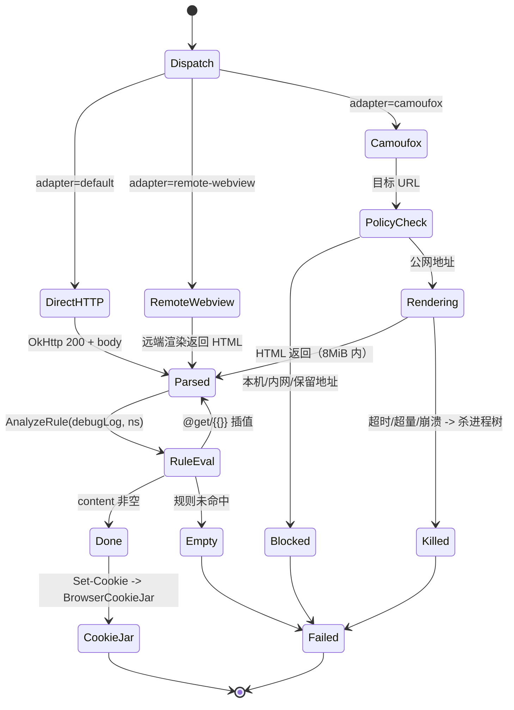

# warpdotsys_reader-dev 研究报告

> 仓库：`D:\YReader\references\warpdotsys_reader-dev` | 线上：https://github.com/warpdotsys/reader-dev
> 技术栈：Kotlin 1.5.21 + Java 8 字节码（class major 52）/ Spring Boot 2.1.6.RELEASE + Vert.x 3.8.x / OkHttp 4.9.1 / Rhino 1.7.13 / Jsoup 1.14.1 + JsoupXpath 2.5.0 + json-path 2.6.0 / Guava（`InternetDomainName`）/ Vue 3.5.42 + Element Plus 2.10 + Pinia 3 + Vite 7（`web-vue3/`，同时保留 Vue 2 旧前端）/ 内置 Camoufox（Python 子进程浏览器）/ 独立 `license-server`（Java 11 + SQLite）
> 代码规模：1,857 个文件；`src/test` 下 103 个测试文件；`docs/` 100+ 篇日期化交付文档、`reports/` 20+ 篇取证/差分报告；规则内核相对基线有增减（`AnalyzeRule.kt` 734→756、`AnalyzeUrl.kt` 629→703、`WebBook.kt` 246→294、`BookContent.kt` 149→159、`JsExtensions.kt` 910→945），存储层 `VertExt.kt` 268→594，`BookController.kt` 3,261→3,642
> 分析范围与方法：以 `changshengyu_reader-dev` 为基线做**逐文件哈希比对 + `Compare-Object` 行级差分**，只深读有差异的文件（`analyzeRule/*`、`webBook/*`、`adapters/*`、`utils/{VertExt,BrowserCookieJar,BrowserNetworkPolicy,CamoufoxWebviewRenderer}.kt`、`entities/{Book,BookSource}.kt`、`api/YueduApi.kt`）；另读 `reports/{JAR-STRUCTURE-AND-VERSION,GIT-PROVENANCE,DECOMPILATION-RISK}.md` 作为来源证据。未覆盖：`license-server` 业务实现、`browser-poc` 的 Python worker 全量、`semantic-review/`、`web-vue3` 组件细节、Camoufox 协议逐字段。

## 0. 一句话结论

这不是「另一个 Legado fork」，而是 **对商业闭源 `reader-pro-3.2.14.jar` 的反编译恢复工程**（`Start-Class=com.htmake.reader.ReaderApplicationKt`，骨架取自 `v4.0.7`），在 `com.htmake.reader` + `io.legado.app` 同一套内核上追加了**内置 Camoufox 浏览器渲染、结构化 Cookie Jar、浏览器出网代理与 SSRF 策略、按用户命名空间隔离、原子化 JSON 落盘、Vue3 前端、独立授权服务**；书源语义 99% 与基线相同，**唯一值得学的是它的「浏览器兜底渲染 + 出网管控」工程化思路**，而它的**来源合法性、Python 子进程重依赖、依然无超时的 Rhino JS、依然关闭的 TLS 校验、依然文件型的存储**都必须整体回避。

## 1. 书源解析：规则类型与执行模型（增量视角）

### 1.1 规则类型：继承基线的判定 + fork 的实际变化

> 说明：本节不重复基线的实现细节（见 `changshengyu_reader-dev.md` §1.1），只标注**是否继承、是否有语义改动**；凡「支持」均已在 fork 代码中复核，不是照抄基线结论。

| 规则类型 | 判定 | fork 相对基线的变化 | 关键证据 |
|---|---|---|---|
| CSS（默认）、`@css:`、`@@` | 支持 | 无变化，逐字节相同（`AnalyzeByJSoup.kt` 哈希一致） | `AnalyzeByJSoup.kt:486`；`AnalyzeRule.kt:447` |
| `@XPath:`、`//` | 支持 | 无变化（`AnalyzeByXPath.kt` 哈希一致） | `AnalyzeByXPath.kt:51` |
| `@json:` / JSONPath / `$.` 自动判定 | 支持 | 无变化（`AnalyzeByJSonPath.kt` 哈希一致） | `AnalyzeRule.kt:459-466` |
| `##` 正则替换（含第 4 段 `replaceFirst`） | 支持 | 无变化 | `AnalyzeRule.kt:594-604` |
| 纯正则（首字符 `:`） | 支持（仅 `getElement`） | 无变化 | `AnalyzeRule.kt:395-399` |
| `:regex` 后缀式 | 不支持 | 仍未实现（`grep ":regex"` 无命中） | — |
| `||` / `&&` / `%%` | 支持 | 切分器逐字节相同（`RuleAnalyzer.kt` 哈希一致） | `RuleAnalyzer.kt:166` |
| `@put:` / `@get:` / `{{ }}` | 支持 | 无变化；但 `{{}}`/`@get` 求值时的 `cookie`/`cache` **改为按用户命名空间实例化** | `AnalyzeRule.kt:653-654` |
| `@js:` / `<js>` | 支持 | **仍无超时**：`evalJS` 直接 `SCRIPT_ENGINE.eval`（`:663`），只有新 API `reGetBook()` 内部套了 30 分钟 `withTimeout`（`:737`） | `AnalyzeRule.kt:650-664`、`:737` |
| `$n` / `!` / `[-1]` / 区间索引 / `@href`/`@text`/`@html` | 支持 | 无变化（`AnalyzeByJSoup.kt` 哈希一致） | `AnalyzeByJSoup.kt:214-256` |
| Jsoup `:eq/:gt/:lt` | 部分支持 | 无变化（依赖 Jsoup 原生选择器） | `AnalyzeByJSoup.kt:298` |
| base64/AES/DES/3DES | 部分支持（仅经 `java.*`） | 无变化（`JsExtensions.kt` 仅 +35 行，集中在新增 API） | `JsExtensions.kt:221-243` |
| **浏览器渲染 JS（`webJs`）** | **新增/支持** | `AnalyzeUrl` 在 `useWebView` 且适配器管理 Cookie 时，改走 `getStrResponseByRemoteWebview(...)`，可把 {@code webJs} 交给真实浏览器执行 | `AnalyzeUrl.kt:360-390`、`adapters/ReaderAdapterInterface.kt:20` |
| **登录 UI（`loginUi`）/ 登录头（`loginHeader`）** | **新增** | `BookSource` 新增 `loginUi`、`loginHeader/loginInfo` 字段与 `SourceLoginController` | `BookSource.kt` 字段区；`controllers/SourceLoginController.kt:171` |

### 1.2 执行模型（关键增量）

1. **多用户命名空间贯穿解析链**：`RuleDataInterface` 增加 `fun getUserNameSpace(): String`（`model/analyzeRule/RuleDataInterface.kt` 新增 2 行），`AnalyzeRule` 用它构造 `CookieStore(ns)`/`CacheManager(ns)`（`AnalyzeRule.kt:653-654`），`AnalyzeUrl` 实现 `getUserNameSpace()`（`AnalyzeUrl.kt:44` 附近）。**这是 fork 对「一个进程服务多个用户」问题的唯一系统性回答**。
2. **调试上下文注入**：`AnalyzeRule` 新增 `var debugLog`（`:36`）与 `getLogger()`（`:41`），`AnalyzeUrl` 同样携带 `debugLog`（`AnalyzeUrl.kt:40` 附近）。基线里调试日志只能从 `WebBook` 层看，fork 下沉到规则求值层，能记录「哪一条规则产生了什么」。
3. **新增 JS API `reGetBook()`**：在 JS 里触发「按书名+作者精确重搜 → 覆盖 `bookUrl` → 合并 `variableMap` → 重新拉详情」，整体 30 分钟超时（`AnalyzeRule.kt:732-747`）。这是对「书源换域名/换 bookUrl」的自动化修复，思路可借鉴（但要换成可取消的 `context`）。
4. **浏览器渲染路径的状态机**：`ReaderAdapterInterface` 抽象出 `managesWebviewCookies()` 与 `getStrResponseByRemoteWebview(url, tag, headerMap, sourceRegex, javaScript, proxy, post, body, userNameSpace, debugLog)`（`adapters/ReaderAdapterInterface.kt:18-34`）；实现有 `DefaultAdpater`（本地直连，`:37`）与 `init/ReaderAdapter.kt`（浏览器，`:20`/`:38`）。`YueduApi.kt:132` 通过 `"camoufox" -> CamoufoxWebviewRenderer(...)` 选择渲染器。
5. **浏览器侧的执行安全（fork 唯一做得比基线好的地方）**：
   - `BrowserNetworkPolicy` 对目标 IP 做完整判定：`isAnyLocalAddress/isLoopbackAddress/isLinkLocalAddress/isSiteLocalAddress/isMulticastAddress` 全部拒绝（`BrowserNetworkPolicy.kt:112-121`），并枚举 RFC1918、CGNAT `100.64/10`、`169.254/16`、`192.0.0/24`、`198.18/15`、`203.0.113/24` 等保留段（`:123-139`）。
   - `BrowserEgressProxy` 用 `Semaphore(MAX_CONNECTIONS)` 限制浏览器出网并发（`BrowserEgressProxy.kt:18,34`）。
   - `CamoufoxWebviewRenderer` 有请求队列上限（`:74`「请求队列已满」）、worker 超时并杀进程树（`:222`）、stdout 上限 8 MiB（`:229`、`:380`）、协议白名单（`:240`）。
6. **网络层（直连路径）没有变好**：`HttpHelper.kt` 仍注册 `unsafeSSLSocketFactory/unsafeTrustManager/unsafeHostnameVerifier`（`:38-40`），超时仍是 15s/15s/15s（`:35-37`）。fork 只把默认 UA 注入逻辑改成「未设置则补 `AppConst.userAgent`，显式 `"null"` 则移除」（`:47-51`）。
7. **SSRF 防护只覆盖浏览器路径**：`BrowserNetworkPolicy` 被 `CamoufoxWebviewRenderer` 使用（`:136`、`:148`），但 `AnalyzeUrl.ajax`/`java.ajax`/普通 OkHttp 请求路径**没有**调用它（`grep "BrowserNetworkPolicy\."` 仅命中浏览器渲染器）。也就是说：**书源写 `@js:java.ajax("http://127.0.0.1:8080/...")` 依然可直达内网**。

### 1.3 规则边界与失败语义（增量）

| 场景 | fork 行为 | 证据 |
|---|---|---|
| 浏览器渲染队列满 | 抛 `IllegalStateException("Camoufox WebView 请求队列已满")`，不排队等待 | `CamoufoxWebviewRenderer.kt:74` |
| 浏览器渲染超时 | 杀整棵浏览器进程树后抛错 | `CamoufoxWebviewRenderer.kt:222` |
| worker 输出过大 | 超过 8 MiB 直接终止并把错误文本回给规则层 | `CamoufoxWebviewRenderer.kt:229,380` |
| 渲染碰到内网/本机地址 | `BrowserNetworkPolicyViolation`，错误文本「渲染触及了本机或非公网网络资源，已中止」 | `CamoufoxWebviewRenderer.kt:136,148`；`BrowserNetworkPolicy.kt:96` |
| 浏览器不支持的资源协议 | `BrowserNetworkPolicyViolation("已阻止不支持的资源协议")` | `CamoufoxWebviewRenderer.kt:240` |
| 证书错误 | 把 `SSL_ERROR_BAD_CERT_DOMAIN`/`SEC_ERROR_UNKNOWN_ISSUER` 翻译成可读提示 | `CamoufoxWebviewRenderer.kt:247-249` |
| 正文 body 为空 | 与基线一致：`throw Exception("error_get_web_content")` | `BookContent.kt:31-33` |
| 失效书源 | 与基线一致的 600s 失效缓存 | `BookController.kt`（同基线逻辑，未改） |
| 规则调试台 | 增强：`debugLog` 下沉到 `AnalyzeRule`/`AnalyzeUrl`，可记录规则级输入输出 | `AnalyzeRule.kt:36`、`AnalyzeUrl.kt:40` |

## 2. 数据模型

### 2.1 实体与增量字段

| 实体 | fork 新增/变化 | 证据 |
|---|---|---|
| `BookSource` | `enabledCookieJar: Boolean?`、`loginUi: String?`、`loginHeader/loginInfo`、`variableComment`、`@Transient _userNameSpace`、`@Transient debugLog` | `BookSource.kt:38`、字段区 diff |
| `Book` | `group: Long`（基线 `Int`）、`isInShelf`、`lastCheckError`、PDF 支持（`isPdf()`/`getPdfImageWidth()`/`pdfImageWidth` 配置） | `Book.kt` diff |
| `RuleDataInterface` | `getUserNameSpace()` / `getLogger()` | `RuleDataInterface.kt` diff；`BaseSource.kt` |
| 存储介质 | **仍是 JSON 文件**，但换成「读锁/写锁 + 临时文件 + `ATOMIC_MOVE` + `.backup.json` + 可选 Mongo 镜像」 | `VertExt.kt:131-197` |

### 2.2 持久化与一致性（fork 的核心改造）

`saveStorage` 的新流程（`VertExt.kt:157-196`）：

1. `storageLock(file).writeLock().tryLock(10, TimeUnit.SECONDS)`，超时抛「保存文件超时」；
2. 写临时文件 `Files.createTempFile(...)`（`:166`）；
3. 旧文件 `ATOMIC_MOVE` 成 `<name>.backup.json`（`:170-172`），新文件 `ATOMIC_MOVE` 就位（`:174`）；
4. 文件名长度 ≥32（即 md5 命名的章节目录 JSON）时删掉备份（`:177-179`）；
5. `users` 文件额外写 `.users.key`，内容是 `md5("userCount=N")` 取末 16 位（`:180-187`），读取时校验，不一致直接抛「用户数据被篡改，请联系开发者修复」（`:235-241`）；
6. `saveMongoFile(path, toJson)` 旁路镜像到 Mongo（`:188`），`getStorage` 在文件缺失/为空时从 Mongo 回填（`:215-233`）。

`getStorage` 同样加读锁（`:205-211`），注释明确「saveStorage 持锁期间会把旧文件移走，存在性检查必须在锁内」（`:212-214`）。

**评价**：这是「文件存储能做到的极限」，但仍是**单机、单文件、全量重写**：没有事务边界（一次业务操作可能触碰 bookshelf + chapterList + bookSource 三个文件）、没有跨进程互斥（多实例部署即失效）、没有 schema 版本迁移，`users` 的校验和只能发现「数量变化」而不能发现内容篡改。

### 2.3 与 Legado 书源 JSON 的字段映射

字段与基线一致（`ruleSearch/ruleExplore/ruleBookInfo/ruleToc/ruleContent` 共 26 个键，见基线报告 §2.3），fork 仅追加：

| 新增字段 | 语义 | 证据 |
|---|---|---|
| `enabledCookieJar` | 是否启用结构化 Cookie Jar（浏览器级作用域） | `BookSource.kt:38` |
| `loginUi` | 登录页 UI 描述（供浏览器渲染登录） | `BookSource.kt` 字段区 |
| `loginHeader`/`loginInfo` | 登录后注入的请求头/信息 | `BookSource.kt` `@JsonIgnoreProperties` 列表 |
| `variableComment` | 变量说明（书源作者注释） | `BookSource.kt` 字段区 |

> 对我们的意义：**Legado 原生字段足够覆盖 Stage 2**；`enabledCookieJar`/`loginUi` 属于「浏览器能力扩展」，不应进入核心 schema，可作为 `book_sources.options JSONB` 的可选键。

## 3. 状态机

### 3.1 抓取主流程（含 fork 新增的浏览器分支）

证据：分派 `AnalyzeUrl.kt:360-390`；策略 `BrowserNetworkPolicy.kt:112-139`；渲染 `CamoufoxWebviewRenderer.kt:74,222,229`；Cookie 落盘 `AnalyzeUrl.kt` 的 `saveCookieJar(...)` 与 `BrowserCookieJar.mergeResponseHeaders`。

### 3.2 Cookie 状态（fork 真正新增的状态机）

`BrowserCookieJar` 定义了完整 Cookie 记录：`name/value/domain/path/hostOnly/secure/httpOnly/sameSite/expires/deleted`（`BrowserCookieJar.kt:22-35`），`StoredJar(version=2, managedHosts, managedLegacyScopes, ...)`（`:38-45`）。关键设计：

- **旧 `CookieStore` 是「按域名的扁平 `name=value` 字符串」，不能承载浏览器 profile**（`:14-19` 注释）；
- 合并 `Set-Cookie` 时用 Guava `InternetDomainName` 校验公共后缀，拒绝公共后缀 Domain（`:4`、`mergeResponseHeaders`）；
- **不再把新 Cookie 写回无语义的 legacy key**（`AnalyzeUrl.kt` 注释「Do not write new Set-Cookie values back to the attribute-less legacy key」），避免 `Secure`/被拒 Domain 的 Cookie 被「复活」。

### 3.3 书籍生命周期 / 缓存

- 书籍状态：基线字段 + `isInShelf`、`lastCheckError`（`Book.kt` diff）；书架巡检失败原因首次可持久化。
- 缓存：仍是章节正文 `<index>.txt` + 目录 JSON；fork 未引入 TTL/ETag（`BookController.kt` 仍 3,642 行的同构实现）。
- 定时任务：`ReaderApplication` 仍 `@EnableScheduling`（`ReaderApplication.kt:25`），书架巡检间隔由配置项控制（`application.properties` 的 `reader.app.shelfUpdateInteval=10`，单位分钟，基线同名字段）。

### 3.4 并发与一致性

- **文件级**：读写锁按文件粒度（`VertExt.kt:157,205`），跨文件无事务。
- **请求级**：浏览器渲染有队列上限（`CamoufoxWebviewRenderer.kt:74`）与出网 `Semaphore`（`BrowserEgressProxy.kt:34`）；直连 HTTP 仍由 OkHttp 连接池自治，**无域名限流**。
- **多端**：仍只有 WebDAV 全量同步（`BookController.kt`，同基线）+ Mongo 旁路镜像（fork 新增），两者都不是冲突解决机制。
- **多实例**：`storageLocks` 是 JVM 内 `ReentrantReadWriteLock`（`VertExt.kt:451` `synchronized(storageLocks)`），**多实例部署时完全失效**，这是 fork 从「单容器」假设出发的直接后果。

## 4. 已知架构缺陷

| 严重度 | 缺陷 | 影响 | 证据 | 根因 |
|---|---|---|---|---|
| P0 | **来源合法性**：由商业 JAR 反编译恢复 | 代码版权/许可证风险，不能作为「参考实现」直接借鉴实现细节；我们若照抄将污染净室 | `reports/DECOMPILATION-RISK.md:5-6`；`reports/GIT-PROVENANCE.md:9-11`；`reports/JAR-STRUCTURE-AND-VERSION.md:28` | 项目定位即「从 `reader-pro-3.2.14.jar` 恢复」，源码骨架取 `v4.0.7` 近似版本 |
| P0 | Rhino JS 仍无超时（沙箱仅黑名单） | 恶意书源死循环或读文件可拖垮/接管进程 | `AnalyzeRule.kt:650-664`（`SCRIPT_ENGINE.eval` 无包裹）；`JsExtensions.kt` 仍暴露 `readFile/deleteFile` | 只给新增的 `reGetBook` 加了 `withTimeout`（`:737`），没解决通用求值 |
| P0 | 直连路径无 SSRF 过滤，TLS 校验仍全关 | `java.ajax` 可打内网；所有请求可被中间人 | `AnalyzeUrl.kt:366-390`（仅浏览器分支走策略）；`HttpHelper.kt:38-40`；`BrowserNetworkPolicy` 只被渲染器引用 | 安全能力被做成了「浏览器专属」，没有下沉到统一 fetcher |
| P0 | 存储仍是单文件 JSON + JVM 内锁 | 多实例/多进程并发必丢数据；业务跨文件无事务 | `VertExt.kt:157-196`、`:451` | 从单容器文件存储演进，未替换为 DB |
| P1 | 引入 Python/Camoufox 子进程作为运行时依赖 | 镜像膨胀、启动慢、崩溃面扩大；`browser-poc` 与 `CamoufoxWebviewRenderer` 需协议同步演进 | `CamoufoxWebviewRenderer.kt:30-35,203`；`browser-poc/` | 用「真浏览器」绕过反爬，代价是把爬虫复杂度搬进主进程 |
| P1 | `users` 完整性校验是「数量哈希」 | 只能发现用户名数量变化，改密码/权限不会触发；误报时直接拒绝启动式报错 | `VertExt.kt:185-187,235-241` | 没有 DB 约束，只能用旁路校验和兜底 |
| P1 | `BookController` 继续膨胀到 3,642 行 | 抓取/存储/同步/导出/登录/浏览器全在一个类 | `BookController.kt`（3,642 行；对比基线 3,261） | 与基线同构，fork 只加功能不拆层 |
| P1 | 双前端并存（Vue2 + Vue3） | 同一 API 两套页面，行为漂移；`web/` 与 `web-vue3/` 都要维护 | `web/package.json`（vue 2.6）；`web-vue3/package.json`（vue 3.5.42） | 渐进迁移未收尾，`-PreaderWebUi=vue3` 只是打包开关 |
| P2 | Mongo 旁路镜像与文件主存储双写 | 两边不一致时读路径随机回填，可能把旧数据写回文件 | `VertExt.kt:188,215-233` | 「备份」被做成了第二写源 |
| P2 | 浏览器 worker stdout 8 MiB 硬上限 | 大页面/大 JS 结果被截断抛错 | `CamoufoxWebviewRenderer.kt:229,380` | 常量硬编码，无按书源配置 |
| P2 | 文档/报告 100+ 篇日期化 Markdown | 同一事实多处描述、互相引用，维护成本极高（本仓库 1,857 文件中大量为文档） | `docs/`、`reports/` 目录清单 | 以「交付记录」替代架构文档 |
| P2 | 授权服务独立部署 + 客户端内置公钥 | 自托管场景下形成「离线也要连授权」的隐性依赖 | `license-server/build.gradle`（sqlite-jdbc/Jackson）；`reports/LICENSE-CENTER-RECOVERY.md:120` | 商业化授权模型与自托管开源目标冲突 |

## 5. 对我们的启示

### 可借鉴

1. **「浏览器兜底渲染」作为可插拔适配器**：把「直接 HTTP → 远端渲染 → 本地浏览器」抽象成 `ReaderAdapterInterface`（`adapters/ReaderAdapterInterface.kt:18-34`）。落地：Go 侧定义 `Renderer` 接口（`HTTPRenderer` 默认 / `BrowserRenderer` 可选 sidecar），只在书源显式声明 `render: browser` 时启用，**默认不引入浏览器依赖**。
2. **浏览器出网 SSRF 策略的 IP 判定清单**：`BrowserNetworkPolicy.kt:123-139` 的 RFC1918/CGNAT/保留段枚举可直接作为我们 `fetcher` 的 `IsPublicIP` 测试用例集（注意：要应用到**所有**出网路径，而不是只给浏览器）。
3. **结构化 Cookie Jar**：`BrowserCookieJar` 的 `hostOnly/path/secure/httpOnly/sameSite/expires` + 公共后缀校验（`BrowserCookieJar.kt:22-45`）是正确的方向。落地：Redis 存 `cookie:{source_id}:{domain}` hash，字段同上；**绝不**用 `name=value` 扁平串。
4. **原子落盘 + 备份**：`VertExt.kt:157-179` 的 temp+`ATOMIC_MOVE`+backup 是「没有 DB 时」的最低要求。落地：我们只在 `StorageProvider` 的 LocalFS 驱动里用同样手法写封面/正文缓存（`os.Rename` 同分区原子），业务数据一律进 PG。
5. **规则级 debugLog 下沉**：`AnalyzeRule.kt:36` 让每条规则的输入/输出可追踪。落地：引擎 `EvalStep` 结构体带 `Trace []StepTrace`，调试台按 `trace_id` 回放。
6. **`reGetBook` 式自动修链**：书源换域名时按「书名+作者」精确重搜并回写 `bookUrl`（`AnalyzeRule.kt:732-747`）。落地：后台任务 `RelinkBook`，带指数退避与最大 3 次尝试，绝不 30 分钟阻塞。

### 必须避免

1. **不要参考反编译恢复的代码**：`GIT-PROVENANCE.md:9-11` 已说明骨架是 `v4.0.7` 近似版本，不是 3.2.14 源码。我们只把它当「行为黑盒样例」，实现一律从零写。
2. **不要把安全做成「某条路径专属」**：`BrowserNetworkPolicy` 只保护浏览器（`CamoufoxWebviewRenderer.kt:136`），直连裸奔。我们的 fetcher 必须在**唯一出口**做 IP 校验，任何 renderer 都不能绕过。
3. **不要为了反爬把浏览器塞进主进程**：`CamoufoxWebviewRenderer.kt:30` 的 Python 子进程 + 8 MiB stdout 限制会带来长期运维负担。替代：独立可选 sidecar（单独容器/单独限流），主进程只依赖 HTTP。
4. **不要双前端并行维护**：`web/`(Vue2) 与 `web-vue3/`(Vue3.5) 并存。我们直接 Vue3 + Element Plus，不留历史包袱。
5. **不要用「文件 + JVM 锁」当多用户存储**：`VertExt.kt:451` 的 `synchronized(storageLocks)` 在多实例下无效。替代：PG 行级锁/乐观版本号。
6. **不要引入授权/遥控服务**：`license-server` 与内置公钥（`LICENSE-CENTER-RECOVERY.md:120`）违背自托管定位。替代：完全离线、无 phone-home。

### 对 Stage 2 契约的具体约束建议

- `schema.sql`：`book_sources` 增加 `options JSONB`（存放 `enabledCookieJar`、`renderMode` 等非 Legado 原生键），避免为 fork 特性污染核心列；`book_sources` 唯一键 `book_source_url`，`(enabled, weight)` 建部分索引供搜索排序。
- `openapi.yaml`：`POST /sources/{id}/render-preview` 返回 `{renderer, status, blockedReason, bytes, elapsedMs}`，把「浏览器被策略拦截」变成显式错误码而不是 500。
- 沙箱契约：JS 一律 `context.WithTimeout`（默认 3s）+ 输出上限；`java.ajax` 复用统一 fetcher；**禁止**任何 renderer 拥有独立网络栈。

## 6. 证据索引

| 文件:行号 | 结论 | 原文短引用（≤2 行） |
|---|---|---|
| `reports/DECOMPILATION-RISK.md:5` | 原始样本是商业 `reader-pro-3.2.14.jar` | `样本：D:\Download\reader-pro-3.2.14.jar；SHA-256 为 B26FB476...` |
| `reports/DECOMPILATION-RISK.md:6` | 入口类为 `com.htmake.reader.ReaderApplicationKt` | `Start-Class=com.htmake.reader.ReaderApplicationKt` |
| `reports/JAR-STRUCTURE-AND-VERSION.md:28` | 同上，独立取证确认 | `Start-Class: com.htmake.reader.ReaderApplicationKt` |
| `reports/GIT-PROVENANCE.md:9` | 骨架是 `v4.0.7` 而非 3.2.14 | `JAR 的 159 个非 class 应用资源中有 153 个与该目录逐字节一致` |
| `reports/GIT-PROVENANCE.md:11` | 不能声称等同于 3.2.14 | `不能声称它等同于 JAR 3.2.14` |
| `reports/GIT-PROVENANCE.md:84` | JAR 与 Gradle mainClass 不一致 | `JAR 的 Start-Class 是 ReaderApplicationKt，而 Gradle application 任务的 main class 配置是 ReaderUIApplicationKt` |
| `src/main/java/io/legado/app/model/analyzeRule/AnalyzeRule.kt:650` | `evalJS` 仍无超时包裹 | `fun evalJS(jsStr: String, result: Any? = null): Any? {` |
| `src/main/java/io/legado/app/model/analyzeRule/AnalyzeRule.kt:663` | 直接调用脚本引擎 | `return SCRIPT_ENGINE.eval(jsStr, bindings)` |
| `src/main/java/io/legado/app/model/analyzeRule/AnalyzeRule.kt:653` | Cookie 按命名空间隔离 | `bindings["cookie"] = CookieStore(getUserNameSpace())` |
| `src/main/java/io/legado/app/model/analyzeRule/AnalyzeRule.kt:737` | 新增 `reGetBook` 有 30 分钟超时 | `withTimeout(30 * 60 * 1000L) {` |
| `src/main/java/io/legado/app/model/analyzeRule/RuleDataInterface.kt` | 新增命名空间接口 | `fun getUserNameSpace(): String` |
| `src/main/java/io/legado/app/model/analyzeRule/AnalyzeUrl.kt:360` | 浏览器分支条件（是否由适配器管理 Cookie） | `if (!(this.useWebView && useWebView &&` |
| `src/main/java/io/legado/app/model/analyzeRule/AnalyzeUrl.kt:366` | POST 走远端渲染 | `getStrResponseByRemoteWebview(` |
| `src/main/java/io/legado/app/adapters/ReaderAdapterInterface.kt:20` | 渲染适配器接口 | `suspend fun getStrResponseByRemoteWebview(` |
| `src/main/java/io/legado/app/adapters/DefaultAdpater.kt:37` | 默认适配器实现（直连） | `override suspend fun getStrResponseByRemoteWebview(` |
| `src/main/java/com/htmake/reader/api/YueduApi.kt:132` | 可选 Camoufox 渲染器 | `"camoufox" -> CamoufoxWebviewRenderer(` |
| `src/main/java/com/htmake/reader/utils/CamoufoxWebviewRenderer.kt:30` | 浏览器是 Python 子进程 | `Camoufox is managed as a short-lived Python child process inside the Reader container.` |
| `src/main/java/com/htmake/reader/utils/CamoufoxWebviewRenderer.kt:74` | 渲染队列有上限 | `throw IllegalStateException("Camoufox WebView 请求队列已满")` |
| `src/main/java/com/htmake/reader/utils/CamoufoxWebviewRenderer.kt:222` | 超时杀进程树 | `throw IllegalStateException("Camoufox WebView 超时，浏览器进程树已终止")` |
| `src/main/java/com/htmake/reader/utils/CamoufoxWebviewRenderer.kt:380` | stdout 上限 8 MiB | `private const val MAX_WORKER_STDOUT_BYTES = 8 * MEBIBYTE` |
| `src/main/java/com/htmake/reader/utils/BrowserNetworkPolicy.kt:113` | 拒绝本机/内网/链路本地/组播 | `address.isSiteLocalAddress \|\| address.isMulticastAddress) return false` |
| `src/main/java/com/htmake/reader/utils/BrowserNetworkPolicy.kt:130` | 拒绝 CGNAT 100.64/10 | `first == 100 && second in 64..127 -> false // Shared address space` |
| `src/main/java/com/htmake/reader/utils/BrowserEgressProxy.kt:34` | 浏览器出网并发受限 | `private val connectionLimit = Semaphore(MAX_CONNECTIONS)` |
| `src/main/java/com/htmake/reader/utils/BrowserCookieJar.kt:22` | Cookie 记录带完整属性 | `data class Cookie(` / `val hostOnly: Boolean = true,` |
| `src/main/java/com/htmake/reader/utils/BrowserCookieJar.kt:4` | 用 Guava 公共后缀校验 | `import com.google.common.net.InternetDomainName` |
| `src/main/java/com/htmake/reader/utils/VertExt.kt:157` | 写文件前取写锁（10s 超时） | `acquired = lock.writeLock().tryLock(10, TimeUnit.SECONDS)` |
| `src/main/java/com/htmake/reader/utils/VertExt.kt:174` | 新文件原子就位 | `Files.move(temp, filePath, StandardCopyOption.ATOMIC_MOVE)` |
| `src/main/java/com/htmake/reader/utils/VertExt.kt:185` | `users` 校验和只统计用户名数量 | `MD5Utils.md5Encode("userCount=${countOccurrences(toJson, "username")}")` |
| `src/main/java/com/htmake/reader/utils/VertExt.kt:451` | 锁是 JVM 内对象 | `synchronized(storageLocks) {` |
| `src/main/java/io/legado/app/help/http/HttpHelper.kt:38` | TLS 校验仍关闭 | `.sslSocketFactory(SSLHelper.unsafeSSLSocketFactory, SSLHelper.unsafeTrustManager)` |
| `src/main/java/io/legado/app/help/http/HttpHelper.kt:35` | 超时仍 15s | `.connectTimeout(15, TimeUnit.SECONDS)` |
| `src/main/java/io/legado/app/help/http/HttpHelper.kt:47` | 新增 UA 缺省/显式 null 处理 | `if (request.header("User-Agent") == null) {` |
| `src/main/java/io/legado/app/data/entities/BookSource.kt:38` | 新增 `enabledCookieJar` | `override var enabledCookieJar: Boolean? = false,` |
| `src/main/java/io/legado/app/data/entities/Book.kt` | 新增 PDF/`isInShelf`/`lastCheckError` | `var isInShelf: Boolean = false,` |
| `web-vue3/package.json:10` | 新前端是 Vue 3.5 + Element Plus | `"vue": "3.5.42",` |
| `license-server/build.gradle:15` | 授权服务用 SQLite | `implementation 'org.xerial:sqlite-jdbc:3.46.1.0'` |
| `reports/LICENSE-CENTER-RECOVERY.md:120` | 原始 JAR 内置公钥，换密钥不可行 | `原始 JAR 不能使用新中心的新密钥。` |
| `src/main/java/com/htmake/reader/utils/BrowserNetworkPolicy.kt:96` | 内网拦截的错误语义 | `throw BrowserNetworkPolicyViolation.forHost("本地 WebView 已阻止本机、内网或保留地址", reason, host)` |
| `src/main/java/com/htmake/reader/utils/VertExt.kt:172` | 旧文件原子备份 | `Files.move(filePath, backupPath, StandardCopyOption.ATOMIC_MOVE)` |
| `src/main/java/com/htmake/reader/utils/VertExt.kt:240` | 用户文件被篡改即报错 | `throw Exception("用户数据被篡改，请联系开发者修复")` |
| `src/main/java/com/htmake/reader/utils/BrowserCookieJar.kt:24` | Cookie 记录含 hostOnly/secure/httpOnly | `val hostOnly: Boolean = true,` |

## 7. 关键路径文件地图（Stage 2 取证入口）

| 关注点 | 文件（相对仓库根） | 行数 | 与基线的关系 |
|---|---|---|---|
| 规则入口 | `src/main/java/io/legado/app/model/analyzeRule/AnalyzeRule.kt` | 756 | +22 行：`debugLog`、命名空间、`reGetBook` |
| 组合切分 | `.../analyzeRule/RuleAnalyzer.kt` | 381 | 哈希一致（未改） |
| URL 编译 | `.../analyzeRule/AnalyzeUrl.kt` | 703 | +74 行：浏览器分支、Cookie Jar |
| JS 桥 | `src/main/java/io/legado/app/help/JsExtensions.kt` | 945 | +35 行 |
| 渲染适配器 | `src/main/java/io/legado/app/adapters/{ReaderAdapterInterface,DefaultAdpater,ReaderAdapterHelper}.kt` | 34/53/17 | 新增 |
| 浏览器渲染器 | `src/main/java/com/htmake/reader/utils/CamoufoxWebviewRenderer.kt` | ~380 | 新增（Python 子进程） |
| 出网策略 | `src/main/java/com/htmake/reader/utils/BrowserNetworkPolicy.kt` | 182 | 新增（IP 白/黑名单） |
| 出网代理 | `src/main/java/com/htmake/reader/utils/BrowserEgressProxy.kt` | ~60 | 新增（Semaphore 限连） |
| Cookie Jar | `src/main/java/com/htmake/reader/utils/BrowserCookieJar.kt` | 441 | 新增（结构化 Cookie） |
| 存储读写 | `src/main/java/com/htmake/reader/utils/VertExt.kt` | 594 | +326 行：锁/原子写/备份/Mongo |
| 业务 | `src/main/java/com/htmake/reader/api/controller/BookController.kt` | 3,642 | +381 行 |
| 领域实体 | `src/main/java/io/legado/app/data/entities/{Book,BookSource}.kt` | 328/244 | +33/+24 行 |
| 新前端 | `web-vue3/package.json` | 40 | Vue 3.5 + Element Plus |
| 授权服务 | `license-server/build.gradle` | 40 | Java 11 + SQLite |

## 8. 缺陷验证方法（Stage 5 可直接复用）

| 缺陷 | 验证方式 | 期望的「反例」观察 |
|---|---|---|
| 直连 SSRF | `@js:java.ajax("http://127.0.0.1:<port>/")`（不经浏览器） | 能访问本机，证明策略只作用于浏览器 |
| 浏览器 SSRF | 书源 `webJs` 内 `location.href="http://192.168.1.1/"` | 被 `BrowserNetworkPolicyViolation` 拦截 |
| JS 死循环 | `@js:while(true){}` | 无超时，占用线程直到进程重启 |
| TLS 劫持 | 用自签证书的测试站点 + 书源请求 | 请求成功（证明 `unsafeTrustManager` 生效） |
| 存储并发 | 50 并发同时 `saveStorage("bookshelf")` | 无损坏但有锁等待；跨进程（两个 JVM）时损坏 |
| 多实例 | 起两个实例指向同一 `storage/` 目录 | `synchronized(storageLocks)` 失效，后写覆盖 |
| 浏览器资源 | 并发 20 个渲染请求 | 命中队列上限，抛「请求队列已满」 |

## 9. 对 Stage 2 的开放问题

1. 「浏览器兜底渲染」是否进入我们的 MVP？若进入，选 sidecar 还是进程内？其网络栈如何强制复用统一 fetcher？
2. `enabledCookieJar` 这类扩展字段放 `book_sources.options JSONB` 还是单独列？迁移时如何与 Legado 原生字段区分？
3. `loginUi`/`loginHeader` 属于「登录编排」，我们的 OpenAPI 是否需要 `/sources/{id}/login` 会话端点？
4. 反编译来源已确认，**任何与 warpdotsys 相似度高的实现都需要额外法务评估**；Stage 2 是否要求在 `architecture.md` 记录「独立实现」证据链？
5. 其 `users` 文件「数量校验和」只是防篡改的姿态，我们是否需要审计日志来替代？
6. Camoufox 的 8 MiB stdout 限制是否可配置？我们的渲染 sidecar 应把「输出上限」做成书源级还是全局级？
